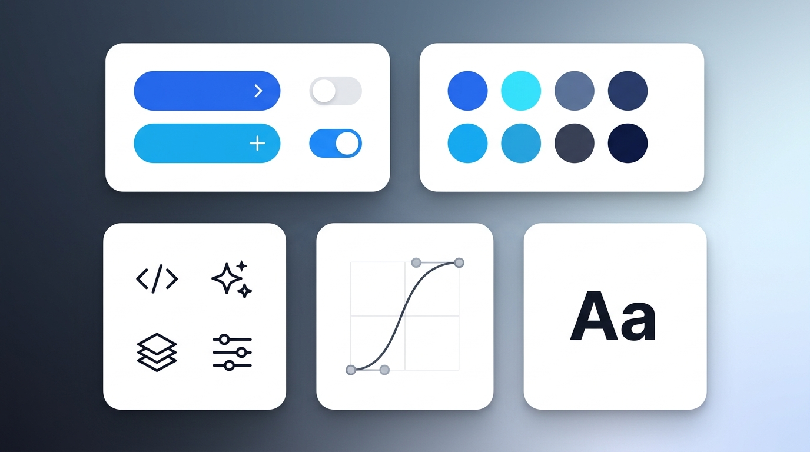
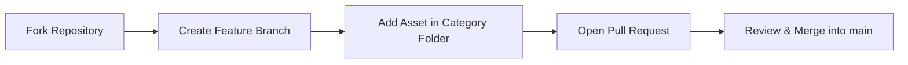

<a id="top"></a>

<div align="center">


<h1>Frontend Library</h1>

<p><b>An open-source collection of reusable frontend assets—UI components, stylesheets, icons, fonts, animations, and templates—built by the community, for the web.</b></p>

<p>
  <a href="https://github.com/satiricalguru/Frontend-Library/stargazers"></a>
  <a href="https://github.com/satiricalguru/Frontend-Library/network/members"></a>
  <a href="https://github.com/satiricalguru/Frontend-Library/pulls"></a>
  <a href="https://github.com/satiricalguru/Frontend-Library/issues"></a>
</p>

<p>
  <a href="#-asset-categories">Explore Assets</a> ·
  <a href="#-quick-start">Quick Start</a> ·
  <a href="CONTRIBUTING.md">Contribute</a> ·
  <a href="https://github.com/satiricalguru/Frontend-Library/issues/new/choose">Request an Asset</a>
</p>

<br>


</div>

## ✨ Why Frontend Library

- 🎨 **Curated frontend building blocks.** Components, styles, SVG icons, fonts, animations, and starter layouts organized in one clean repository.
- 🤝 **Open to every contributor.** Built around welcoming Pull Requests, clear issue templates, and lightweight guidelines so anyone can ship an asset in minutes.
- ⚡ **Drop-in and framework-agnostic.** Keep snippets self-contained so developers can adapt them cleanly to vanilla web, React, Vue, Tailwind, or static sites.
- 🗂️ **Consistent structure and attribution.** Every multi-file contribution uses kebab-case naming, clean previews, and clear license or source notes.

## 🖼️ Showcase

<table>
  <tr>
    <td width="50%">
      
      <p align="center"><sub><b>Modular Asset Collection</b> — Components, design tokens, icons, motion curves, and typography</sub></p>
    </td>
    <td width="50%">
      
      <p align="center"><sub><b>PRs Always Welcome</b> — Fork, add your favorite asset, and submit a Pull Request</sub></p>
    </td>
  </tr>
</table>

## 📦 Asset Categories

| Category | Directory | What Belongs Here |
|:--|:--|:--|
| Animations | [animations/](animations/) | CSS keyframes, Lottie JSONs, GSAP/Framer Motion presets |
| Components | [components/](components/) | Reusable UI components, cards, modals, navbars, and snippets |
| Fonts | [fonts/](fonts/) | Open-source webfonts and typography packages with license notes |
| Icons | [icons/](icons/) | Clean SVG icons and curated icon sets |
| Images | [images/](images/) | Textures, gradients, backgrounds, and illustrations |
| Styles | [styles/](styles/) | CSS/SCSS utilities, design tokens, themes, and resets |
| Templates | [templates/](templates/) | Starter layouts and boilerplate pages |

## 🚀 Quick Start

### Clone and explore assets

```bash
git clone https://github.com/satiricalguru/Frontend-Library.git
cd Frontend-Library
```

### Contribute your first asset

<details>
<summary><b>Step-by-step Pull Request guide</b></summary>

1. Fork `satiricalguru/Frontend-Library` on GitHub.
2. Clone your fork and create a descriptive branch:

```bash
git clone https://github.com/<your-username>/Frontend-Library.git
cd Frontend-Library
git checkout -b feat/add-my-asset
```

3. Add your asset inside the matching category folder using kebab-case naming (e.g., `components/glassmorphic-card/`).
4. Commit, push, and open a Pull Request against `main`:

```bash
git add .
git commit -m "feat(components): add glassmorphic card"
git push origin feat/add-my-asset
```

</details>

## 🔀 How Contributions Flow



## 🤝 Contributing & Community

> [!TIP]
> First time contributing to open source? Start by checking [open issues](https://github.com/satiricalguru/Frontend-Library/issues), submitting a [new asset request](https://github.com/satiricalguru/Frontend-Library/issues/new?template=new-asset-request.md), or sharing a clean UI snippet via [CONTRIBUTING.md](CONTRIBUTING.md).

- Read the full contribution guidelines in [CONTRIBUTING.md](CONTRIBUTING.md)
- Use the [Pull Request template](.github/PULL_REQUEST_TEMPLATE.md) when opening a PR
- Report broken assets or suggest new ideas via [Issue templates](.github/ISSUE_TEMPLATE/config.yml)

### Contributors

<a href="https://github.com/satiricalguru/Frontend-Library/graphs/contributors">
  
</a>

---

<div align="center">
  <sub>If <b>Frontend Library</b> helps your workflow, give it a ⭐ or open a Pull Request · <a href="#top">Back to top ↑</a></sub>
</div>
