<a id="top"></a>

<div align="center">

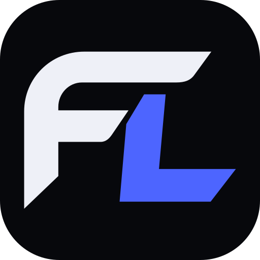

<br>

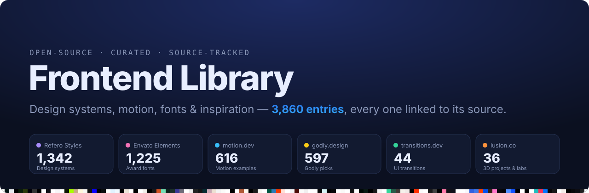

<p><b>Landing-page evidence, WebGL demos, design systems, media resources and reusable frontend code—for developers, contributors and AI agents.</b></p>

<p>
  <a href="https://github.com/satiricalguru/Frontend-Library/stargazers"></a>
  <a href="SOURCES.md"></a>
  <a href="SOURCES.md"></a>
  <a href="https://github.com/satiricalguru/Frontend-Library/pulls"></a>
</p>

<p>
  <a href="#landing-page-references-for-people-and-ai-agents">Landing pages & agents</a> ·
  <a href="#-whats-inside">What's inside</a> ·
  <a href="#-animation-snippets">Snippets</a> ·
  <a href="#-components">Components</a> ·
  <a href="#-design-systems">Design systems</a> ·
  <a href="#-motion--transitions">Motion</a> ·
  <a href="#-fonts">Fonts</a> ·
  <a href="#-inspiration">Inspiration</a> ·
  <a href="#-contributors">Contributors</a> ·
  <a href="SOURCES.md">Source tracker</a>
</p>

</div>

<br>

<table>
  <tr>
    <td width="33%"></td>
    <td width="33%"></td>
    <td width="33%"></td>
  </tr>
</table>

## Landing-page references for people and AI agents

**4,556 indexed references**, complemented by local capture packages, 12 original animations and a reusable component. This is a growing reference library for studying composition, WebGL scenes, scroll animation, design constraints and the assets needed to implement them.

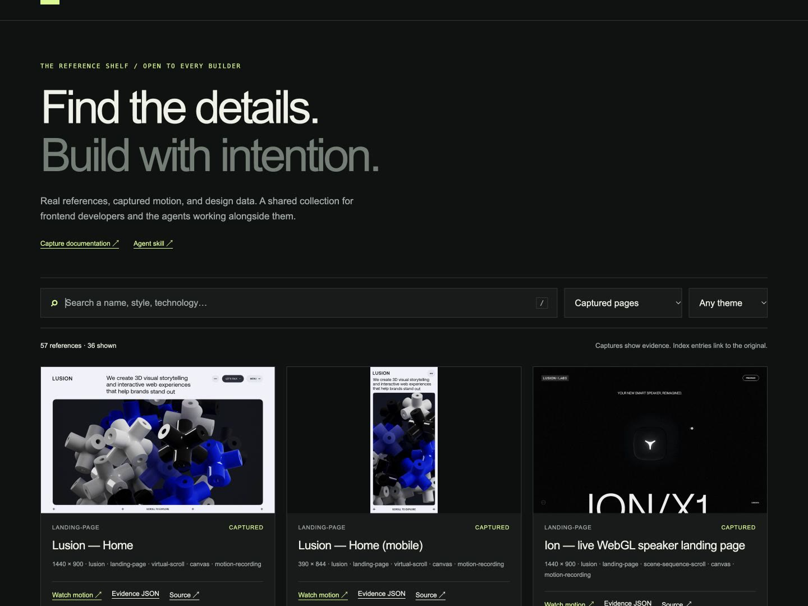

<!-- capture-stats:start -->
**57 evidence packages across 56 source routes · 57 browser recordings · 342 visual checkpoints · 1242 unique observed resource URLs.**

52 completed captures · 5 need review · 0 failed. Packages include desktop/mobile variants and diagnostic captures; [see coverage and limitations](docs/reference-library/README.md).
<!-- capture-stats:end -->

<table>
<tr>
<td width="50%"><a href="docs/reference-library/lusion-home.md"></a><br><sub><b>Lusion homepage</b> · desktop and mobile evidence, layout and scene guidance</sub></td>
<td width="50%"><a href="captures/lusion/lusion-home/traversal.mp4"></a><br><sub><b>Study the motion</b> · watch the recorded traversal and inspect intermediate states</sub></td>
</tr>
</table>

[Capture collection](docs/reference-library/README.md) · [Lusion deep dive](docs/reference-library/lusion-home.md) · [Agent setup](docs/agents.md) · [Source policies](data/source-policies.json)

| New collection | Entries | What an agent can inspect |
|:--|--:|:--|
| [Lusion page evidence](docs/reference-library/README.md) | See capture statistics | Viewport screenshots, browser recordings, layout/type facts and resource URLs; status and limits per package |
| [Codrops WebGL & creative demos](inspiration/codrops/) | 315 | 297 official demo repositories and 18 article links, with demo/code links where observed |
| [DESIGN.md analyses](styles/design-md/) | 84 | Complete attributed Markdown analyses, pinned to an upstream commit under MIT |
| [Media, motion & design resources](images/video-resources/) | 297 | 10 stock-video providers plus photos, audio, mockups, animation tools, inspiration and compression resources |

Capture packages may overlap the link catalog, and different collections may describe the same website. Counts are not unique sites or completely reproduced landing pages. Case studies, Labs write-ups and live experiences have explicit types. Loading failures and incomplete states are marked for review. Captures are browser recordings, not extracted source videos or an offline website copy.

### Open the visual library

No build step. With Python 3 installed, run from the checkout:

```bash
python3 -m http.server 8000 --bind 127.0.0.1
```

Open [the local viewer](http://127.0.0.1:8000/library/). Search names and techniques, switch collections, inspect palettes and play recordings. Press `/` to focus search.

### Give agents useful evidence

The [portable Frontend Library skill](.agents/skills/frontend-library/SKILL.md) guides retrieval, visual inspection, a motion brief, implementation and comparison. The offline CLI and read-only MCP connector use the same data:

```bash
python3 scripts/query-library.py Lusion --type captures --has-video --json
python3 scripts/query-library.py shader --type codrops --limit 6 --json
python3 scripts/query-library.py Linear --type design-md --json
python3 scripts/query-library.py --type media-resources --tag "Stock Videos" --limit 20 --json
```

From another project, pass `--library /absolute/path/to/Frontend-Library` or set `FRONTEND_LIBRARY_ROOT`. [Skill installation and MCP configuration →](docs/agents.md)

The local MCP server exposes `list_collections`, `search_references`, `get_reference` and `read_design`. It can return an actual checkpoint JPEG to a multimodal agent or a complete local DESIGN.md analysis. It reads local evidence and performs no network requests or writes.

> Use $frontend-library to study Lusion's homepage, inspect its desktop and mobile evidence, and implement that direction in this project's stack. Write the section and motion brief first, identify needed assets, and verify matching viewports and scroll states.

Agents distinguish **observed facts**, **inferred techniques** and **proposed implementation**. This improves fidelity; it cannot guarantee a mistake-free, pixel-identical clone without the original models, shaders, fonts and interaction evidence. Preserve the target project's existing design rules and merge verified constraints from a chosen DESIGN.md.

Refero's existing 1,342 records contain palette/typeface metadata and original links. Its complete DESIGN.md files and animations are not bundled. Refero and Codrops restrict named AI crawlers; blocked deep crawling was not bypassed. Codrops coverage expands through its official public demo repositories. Media-resource listings are not licences for individual footage.

### Help grow the reference collection

Contributors can upload permitted screenshots, recordings, original assets and code through pull requests. Add a clear type, discovery source, date, viewport, attribution and limitations. [Use the reference package template](docs/reference-library/contribution-template.md). A hosted upload/review service and automated visual comparison are future features.

The [viewer](library/LICENSE) and [agent skill](.agents/skills/frontend-library/LICENSE) are MIT licensed. The imported design analyses retain their [upstream licence](styles/design-md/UPSTREAM-LICENSE). Third-party branding and website assets retain their creators' rights.

## ✨ Why Frontend Library

- 🧭 **One place to look.** Design-and-motion sources, local page evidence and licensed design analyses, indexed into searchable Markdown tables and JSON.
- 🧾 **Every entry is traceable.** Each row links to the original, and [SOURCES.md](SOURCES.md) plus [data/sources.csv](data/sources.csv) record the exact page it was collected from.
- 🎨 **Real design data.** Brand palettes and typefaces for 1,342 websites, plus a ready-to-import [`palettes.css`](styles/refero-design-systems/palettes.css).
- 🎬 **Code you can paste today.** Twelve original, dependency-free animations with live demos. All of them respect `prefers-reduced-motion`.
- ♻️ **Rebuildable.** The catalogs and the charts on this page are generated from [`data/`](data/) by two small Python scripts.

## 📦 What's inside

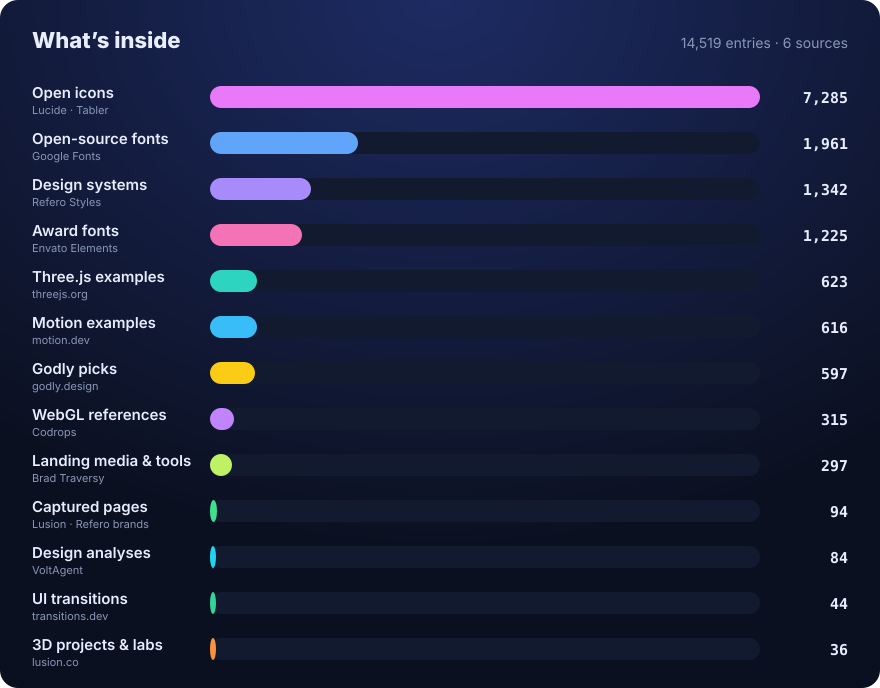

| Collection | Entries | Folder | Collected from |
|:--|--:|:--|:--|
| 🎨 Brand design systems | 1,342 | [styles/refero-design-systems](styles/refero-design-systems/) | [styles.refero.design](https://styles.refero.design/) |
| 🔤 Award & celebration fonts | 1,225 | [fonts/envato-award-fonts](fonts/envato-award-fonts/) | [elements.envato.com/fonts/awards](https://elements.envato.com/fonts/awards) |
| 🌀 Motion examples & UI | 616 | [animations/motion-dev](animations/motion-dev/) | [motion.dev/examples](https://motion.dev/examples) |
| ⚡ Websites, sections, tools, resources | 434 | [inspiration/godly](inspiration/godly/) | [godly.design](https://godly.design/) |
| 🧩 Website templates | 163 | [templates/godly-templates](templates/godly-templates/) | [godly.design/templates](https://godly.design/templates) |
| ✨ UI micro-transitions | 44 | [animations/transitions-dev](animations/transitions-dev/) | [transitions.dev](https://transitions.dev/) |
| 🪐 3D case studies & labs | 36 | [inspiration/lusion](inspiration/lusion/) | [lusion.co](https://lusion.co/projects) |
| 🎬 Original animation snippets | 12 | [animations/snippets](animations/snippets/) | Our own code |
| 🧩 Original UI components | 1 | [components](components/) | Our own code |

## 🎬 Animation snippets

Original, copy-paste animations. Each one is a single `index.html` you can open in a browser. [Browse all 12 →](animations/snippets/)

<table>
  <tr>
    <td align="center" width="33%"><a href="animations/snippets/sliding-tabs/"></a><br><sub><b>Sliding tabs</b></sub></td>
    <td align="center" width="33%"><a href="animations/snippets/success-check/"></a><br><sub><b>Success check</b></sub></td>
    <td align="center" width="33%"><a href="animations/snippets/like-burst/"></a><br><sub><b>Like burst</b></sub></td>
  </tr>
  <tr>
    <td align="center"><a href="animations/snippets/shimmer-text/"></a><br><sub><b>Shimmer text</b></sub></td>
    <td align="center"><a href="animations/snippets/skeleton-reveal/"></a><br><sub><b>Skeleton → content</b></sub></td>
    <td align="center"><a href="animations/snippets/spring-toggle/"></a><br><sub><b>Spring toggle</b></sub></td>
  </tr>
  <tr>
    <td align="center"><a href="animations/snippets/tooltip-open-close/">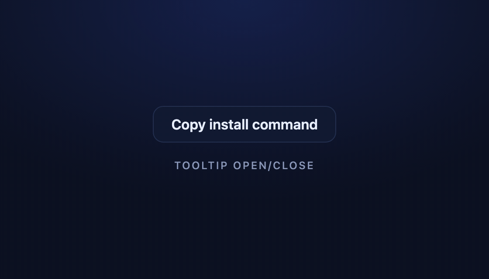</a><br><sub><b>Tooltip open/close</b></sub></td>
    <td align="center"><a href="animations/snippets/accordion/">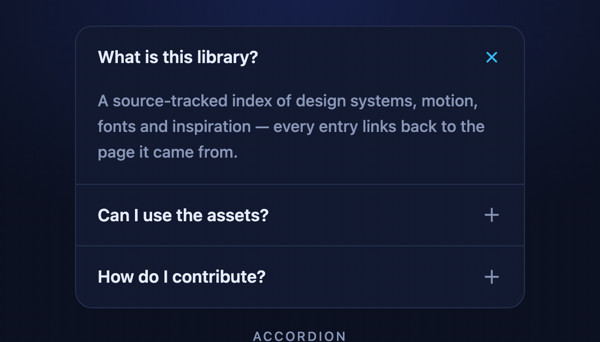</a><br><sub><b>Accordion</b></sub></td>
    <td align="center"></td>
  </tr>
</table>

<details>
<summary><b>Use a snippet in 30 seconds</b></summary>

```bash
git clone https://github.com/satiricalguru/Frontend-Library.git
open Frontend-Library/animations/snippets/sliding-tabs/index.html   # macOS; use xdg-open on Linux
```

Copy the blocks marked `── snippet ──` into your project and skip anything under `// demo loop`.

</details>

## 🧩 Components

Reusable UI pieces with live demos — same rules as the snippets: one HTML file, no dependencies, and `prefers-reduced-motion` respected.

<table>
  <tr>
    <td align="center" width="50%"><a href="components/command-palette/"></a><br><sub><b>Command palette</b> · CSS + JS, ⌘K</sub></td>
    <td align="center" width="50%"></td>
  </tr>
</table>

[Browse components →](components/)

## 🎨 Design systems

Colors and typefaces for 1,342 real product websites, grouped by industry, each linking to Refero's full style page and DESIGN.md.

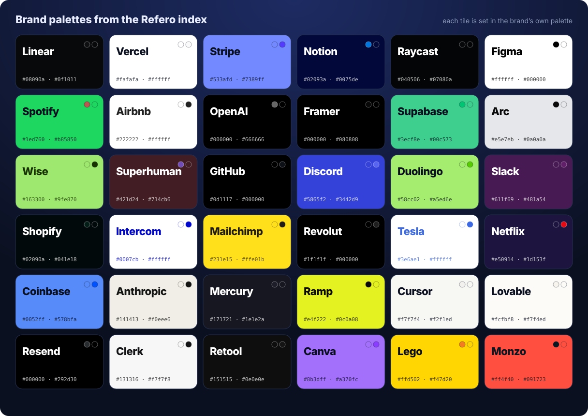

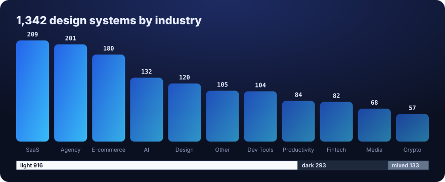

```css
/* every palette as CSS custom properties */
@import "styles/refero-design-systems/palettes.css";

.button { background: var(--stripe-1); color: var(--stripe-2); }
```

**Browse:** [SaaS](styles/refero-design-systems/saas.md) · [Agency](styles/refero-design-systems/agency.md) · [E-commerce](styles/refero-design-systems/e-commerce.md) · [AI](styles/refero-design-systems/ai.md) · [Design](styles/refero-design-systems/design.md) · [Dev Tools](styles/refero-design-systems/dev-tools.md) · [Fintech](styles/refero-design-systems/fintech.md) · [Productivity](styles/refero-design-systems/productivity.md) · [Media](styles/refero-design-systems/media.md) · [Crypto](styles/refero-design-systems/crypto.md) · [Other](styles/refero-design-systems/other.md)

## 🌀 Motion & transitions

<table>
  <tr>
    <td width="60%">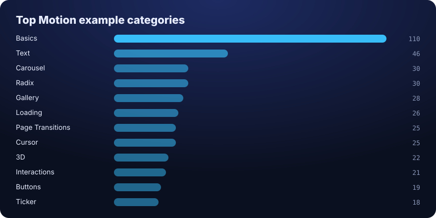</td>
    <td width="40%">
      <b><a href="animations/motion-dev/">616 Motion examples</a></b><br>
      <sub>React, JavaScript, Vue, Svelte and Three.js. Grouped into 27 categories: text, carousels, cursors, page transitions, scroll, layout animations and more, plus 90 Motion UI section components.</sub>
      <br><br>
      <b><a href="animations/transitions-dev/">44 transitions.dev patterns</a></b><br>
      <sub>Micro-interactions such as card resize, toast stacks, streaming text and dropdown morph, each with docs and a builder link.</sub>
    </td>
  </tr>
</table>

## 🔤 Fonts

<table>
  <tr>
    <td width="55%">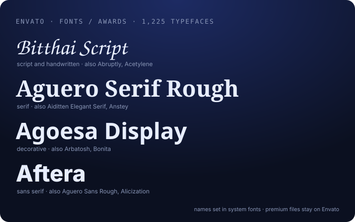</td>
    <td width="45%">
      <b><a href="fonts/envato-award-fonts/">1,225 award-ready typefaces</a></b> for certificates, trophies, invitations and celebration graphics. Script & handwritten · serif · sans-serif · decorative.
      <br><br>
      <sub>⚠️ Premium fonts: they need an Envato Elements licence. This repo stores names and links only, never font files.</sub>
    </td>
  </tr>
</table>

## 💡 Inspiration

<table>
  <tr>
    <td width="50%"><a href="inspiration/lusion/">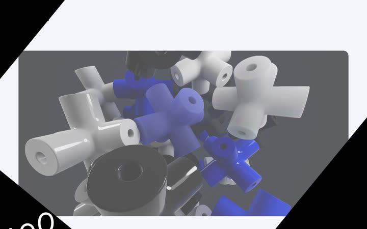</a><br><sub><b><a href="inspiration/lusion/">Lusion</a></b>: 19 award-winning 3D/WebGL case studies + 17 Labs experiments</sub></td>
    <td width="50%"><a href="inspiration/godly/">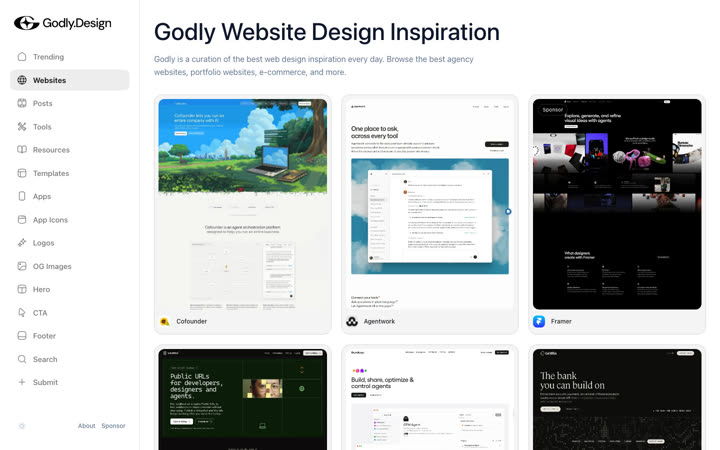</a><br><sub><b><a href="inspiration/godly/">Godly</a></b>: websites, hero / CTA / footer sections, 39 tools, 298 resources, 163 templates</sub></td>
  </tr>
  <tr>
    <td width="50%"><a href="styles/refero-design-systems/">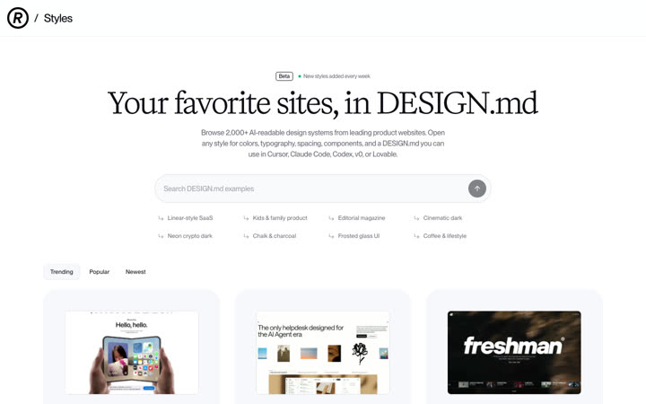</a><br><sub><b><a href="styles/refero-design-systems/">Refero Styles</a></b>: AI-readable design systems</sub></td>
    <td width="50%"><a href="animations/motion-dev/">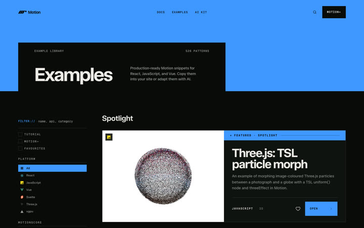</a><br><sub><b><a href="animations/motion-dev/">Motion</a></b>: animation examples for every framework</sub></td>
  </tr>
</table>

<sub>Screenshots of the source sites are shown for reference and belong to their owners.</sub>

## 🧾 Source tracking

Every entry records where it came from:

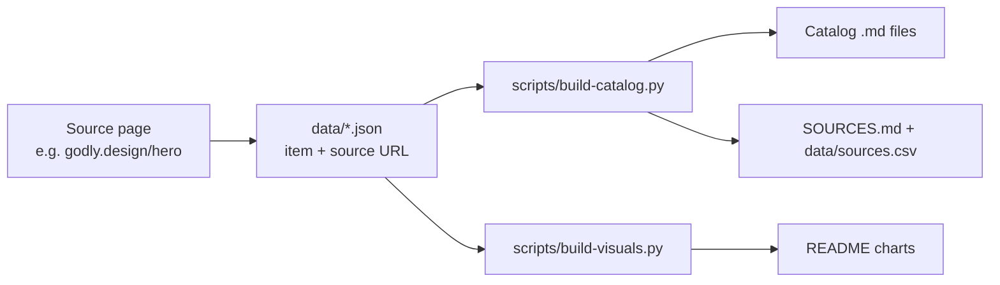

```bash
# find where any entry came from
grep -i "linear" data/sources.csv | head

# rebuild catalogs and charts after editing data/
python3 scripts/build-reference-library.py
python3 scripts/build-catalog.py
python3 scripts/build-visuals.py
python3 scripts/validate-data.py
python3 scripts/validate-references.py
python3 scripts/check-library-mcp.py
```

## 📁 Repository layout

| Folder | What belongs here |
|:--|:--|
| [animations/](animations/) | Original snippets, Motion and transitions.dev catalogs, CSS/JS motion presets |
| [components/](components/) | Reusable UI components, cards, modals, navbars |
| [fonts/](fonts/) | Open-source webfonts and font catalogs with licence notes |
| [icons/](icons/) | SVG icons and icon sets |
| [images/](images/) | Textures, gradients, backgrounds, illustrations |
| [inspiration/](inspiration/) | Curated sites and creative-tech references |
| [styles/](styles/) | Design tokens, palettes, themes, resets |
| [templates/](templates/) | Starter layouts and template picks |
| [data/](data/) | Machine-readable catalogs + the per-entry source log |

## 🤝 Contributing

Visit our [contributing guide](CONTRIBUTING.md) to learn how to contribute, and use the [PR template](.github/PULL_REQUEST_TEMPLATE.md). It only takes ~5 minutes to add your own!

> [!TIP]
> Adding a catalog entry? Put it in the matching `data/*.json` file with a `source` URL, then run `python3 scripts/build-catalog.py`. Adding original code? Give it its own kebab-case folder with a demo `index.html`.

## 💬 Community

Have questions, comments, or feedback? Start a [GitHub Discussion](https://github.com/satiricalguru/Frontend-Library/discussions) or open an [issue](https://github.com/satiricalguru/Frontend-Library/issues/new/choose).

## 👥 Contributors

<!-- CONTRIBUTORS:START -->
<a href="https://github.com/satiricalguru/Frontend-Library/graphs/contributors">
  
</a>
<!-- CONTRIBUTORS:END -->

## ⚖️ Credits & licensing

Link catalogs store **links and short factual metadata** (names, colors, typefaces, categories). The local DESIGN.md analyses retain their upstream MIT licence and attribution. Captures are reference evidence and grant no reuse licence for underlying models, shaders, fonts or source code. All linked designs, fonts, code and media belong to their creators: [Lusion](https://lusion.co/), [Refero](https://styles.refero.design/), [Motion](https://motion.dev/), [Transitions.dev](https://transitions.dev/), [Godly](https://godly.design/) and [Envato](https://elements.envato.com/), [Codrops](https://tympanus.net/codrops/tag/webgl/), [VoltAgent](https://github.com/VoltAgent/awesome-design-md) and [Brad Traversy](https://github.com/bradtraversy/design-resources-for-developers#stock-videos). Follow each source's terms before using anything you find through this library. The snippets in [animations/snippets](animations/snippets/) are original work under the [MIT licence](animations/snippets/LICENSE).

---

<div align="center">
  <sub>If <b>Frontend Library</b> saves you a search, give it a ⭐ · <a href="#top">Back to top ↑</a></sub>
</div>
