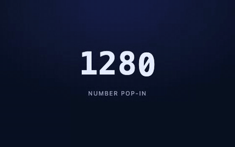
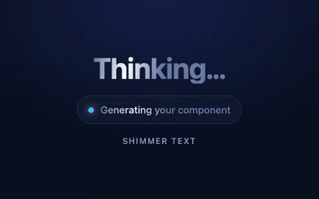
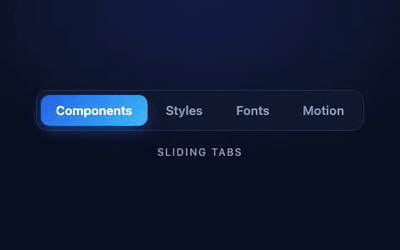
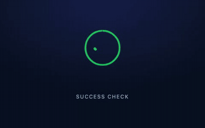
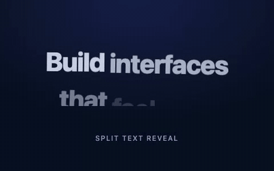
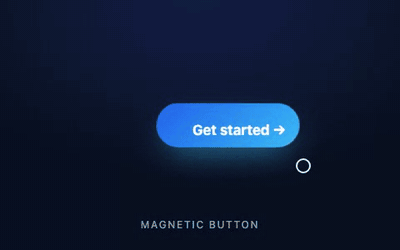
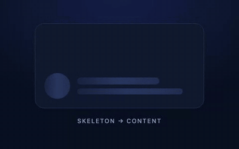
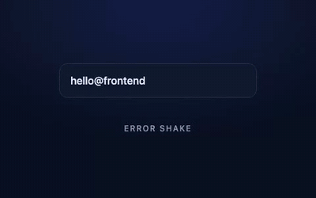
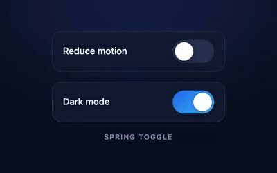

<div align="center">

# 🎬 Animation snippets

Ten small, dependency-free UI animations you can copy straight into a project.<br>
Original MIT-licensed code written for Frontend Library. Each one is our own take on a pattern from the catalogs.

<sub>Open any <code>index.html</code> in a browser to see the demo · all respect <code>prefers-reduced-motion</code> · <a href="../../README.md">← Back to library</a></sub>

</div>

<table>
  <tr>
    <td align="center" width="50%"><a href="number-pop-in/"></a><br><b>Number pop-in</b> · CSS + 30 lines JS</td>
    <td align="center" width="50%"><a href="shimmer-text/"></a><br><b>Shimmer text</b> · pure CSS</td>
  </tr>
  <tr>
    <td align="center"><a href="sliding-tabs/"></a><br><b>Sliding tabs</b> · CSS + 15 lines JS</td>
    <td align="center"><a href="success-check/"></a><br><b>Success check</b> · SVG + CSS</td>
  </tr>
  <tr>
    <td align="center"><a href="like-burst/"></a><br><b>Like burst</b> · SVG + CSS + JS</td>
    <td align="center"><a href="split-text-reveal/"></a><br><b>Split text reveal</b> · CSS + JS splitter</td>
  </tr>
  <tr>
    <td align="center"><a href="magnetic-button/"></a><br><b>Magnetic button</b> · CSS vars + pointer JS</td>
    <td align="center"><a href="skeleton-reveal/"></a><br><b>Skeleton → content</b> · pure CSS</td>
  </tr>
  <tr>
    <td align="center"><a href="error-shake/"></a><br><b>Error shake</b> · CSS keyframes</td>
    <td align="center"><a href="spring-toggle/"></a><br><b>Spring toggle</b> · CSS + ARIA switch</td>
  </tr>
</table>

## How to use one

Every `index.html` has the reusable code between `── snippet ──` comments. Everything under `// demo loop` only exists to animate the preview, so leave it out of your project.

```html
<!-- 1. copy the <style> block marked “snippet” -->
<!-- 2. copy the markup -->
<!-- 3. copy the <script> block marked “snippet” (if there is one) -->
```

The demos share [`_shared/demo.css`](_shared/demo.css) for the dark stage and color tokens (`--accent`, `--panel`, …). Each snippet falls back to its own values, so the stage file is optional.

## Credits & inspiration

| Snippet | Inspired by (catalog entry) |
|:--|:--|
| Number pop-in | <https://transitions.dev/transitions/number-pop-in/> |
| Shimmer text | <https://transitions.dev/transitions/shimmer-text/> |
| Sliding tabs | <https://transitions.dev/transitions/tabs-sliding/> |
| Success check | <https://transitions.dev/transitions/success-check/> |
| Like burst | <https://transitions.dev/transitions/like-button/> |
| Split text reveal | <https://motion.dev/examples/js-split-text> |
| Magnetic button | <https://motion.dev/examples/react-cursor-magnetic> |
| Skeleton → content | <https://transitions.dev/transitions/skeleton-loader-and-reveal/> |
| Error shake | <https://transitions.dev/transitions/error-state-shake/> |
| Spring toggle | <https://transitions.dev/transitions/toggle/> |

These are clean-room versions: no code was copied from the sites above. The same mapping is in [`SOURCES.json`](SOURCES.json) and the root [SOURCES.md](../../SOURCES.md).
