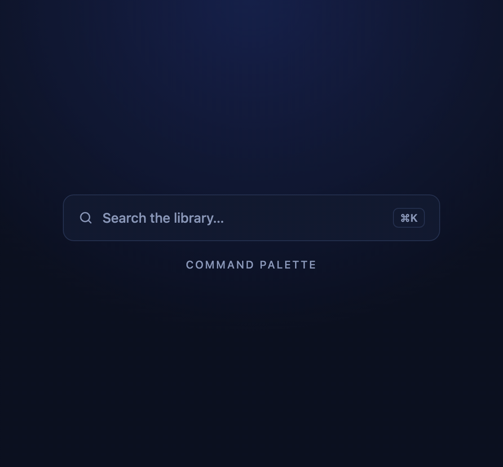
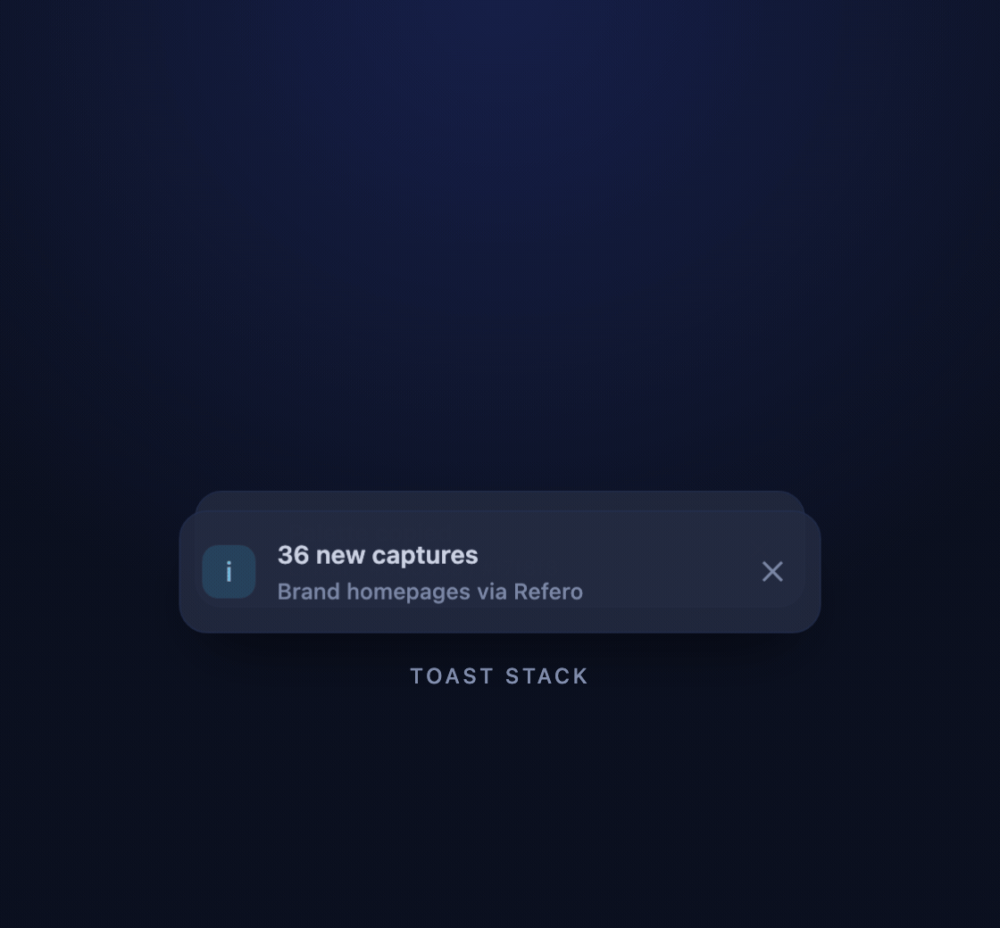

<div align="center">

# 🧩 Components

Copy-paste UI components with live demos. No dependencies, no build step — every one is a single `index.html` you can open in a browser.

<sub>Each component ships with a README covering usage, accessibility and licence · <a href="../README.md">← Back to library</a></sub>

</div>

<table>
  <tr>
    <td align="center" width="50%"><a href="command-palette/"></a><br><b>Command palette</b> · CSS + JS, ⌘K</td>
    <td align="center" width="50%"><a href="toast-stack/"></a><br><b>Toast stack</b> · CSS + JS, hover to expand</td>
  </tr>
</table>

## How to use one

Every component keeps the reusable code between `── snippet ──` comments. Everything under `// demo loop` only exists to animate the preview, so leave it out of your project.

```html
<!-- 1. copy the <style> block marked “snippet” -->
<!-- 2. copy the markup -->
<!-- 3. copy the <script> block marked “snippet” (if there is one) -->
```

The demos share [`_shared/demo.css`](_shared/demo.css) for the dark stage and color tokens (`--accent`, `--panel`, …). Each component falls back to its own values, so the stage file is optional.

## Contributing a component

Put it in its own kebab-case folder, add a `README.md` with usage notes, accessibility details and licence info, and attach a screenshot or short preview in your pull request. See [CONTRIBUTING.md](../CONTRIBUTING.md).
