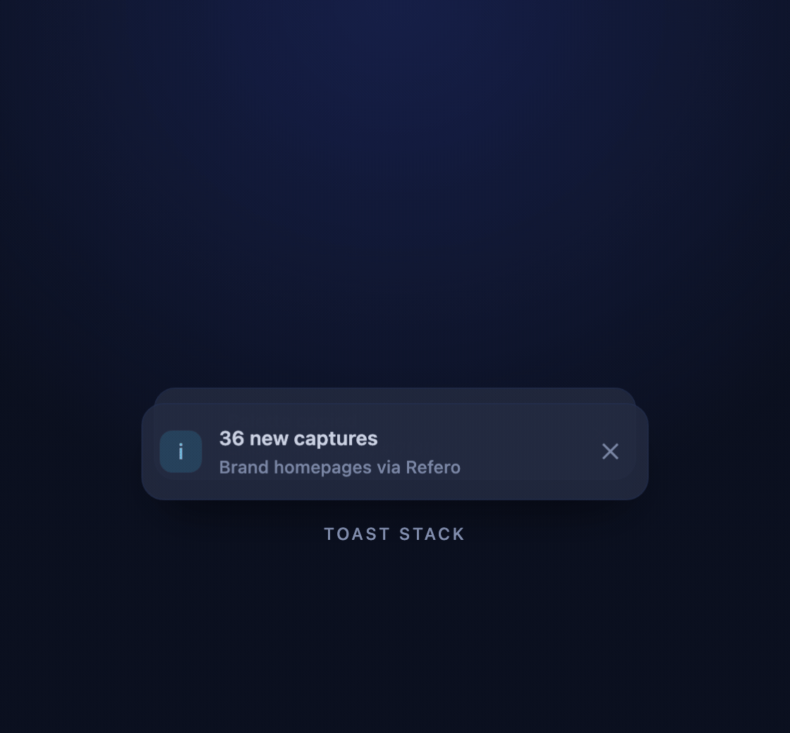

# Toast stack

Stacked notifications that tuck behind each other, fan out on hover or focus, and slide away when
dismissed. No dependencies, no build step: one HTML file with about 80 lines of CSS and 50 of JS.

Open [`index.html`](index.html) in a browser to see it working.



## What you get

| Part | What it does |
|:--|:--|
| `createToaster(root, { max, timeout })` | Wires up a container and returns `{ push, remove }` |
| `push({ title, body, kind })` | Adds a toast. `kind` is `ok`, `info` or `warn` |
| `remove(toast)` | Slides a toast out and removes it |
| Hover / focus | Fans the stack open so every toast is readable |
| `max` | How many toasts stay visible (older ones fade out) |
| `timeout` | Optional auto-dismiss in milliseconds (`0` keeps toasts until dismissed) |

## Usage

```html
<section class="toasts" id="toasts" aria-label="Notifications" aria-live="polite"></section>
```

```js
const toaster = createToaster(document.getElementById('toasts'), { max: 3, timeout: 6000 });
toaster.push({ title: 'Palette copied', body: '#08090a / #f7f8f8', kind: 'ok' });
```

Copy the `<style>` block marked `── snippet ──`, the markup above and the `createToaster`
function. Everything under `// demo loop` only animates the preview, so leave it out of your project.

## Accessibility

- The container is a polite live region, so screen readers announce new toasts without interrupting.
- Each toast has `role="status"` and a dismiss button labelled with the toast's title.
- The stack expands on `:focus-within`, so keyboard users can reach every dismiss button.
- Text is inserted with `textContent`, never as HTML.
- With `prefers-reduced-motion: reduce`, toasts fade instead of sliding and springing.

## Credits

Original code written for Frontend Library, inspired by the stacked-notification pattern in the
library's [Motion "Toast: Stacked notifications"](https://motion.dev/examples/react-toast-stack)
entry. No code was copied. [MIT licence](../../animations/snippets/LICENSE), same as the other components.
