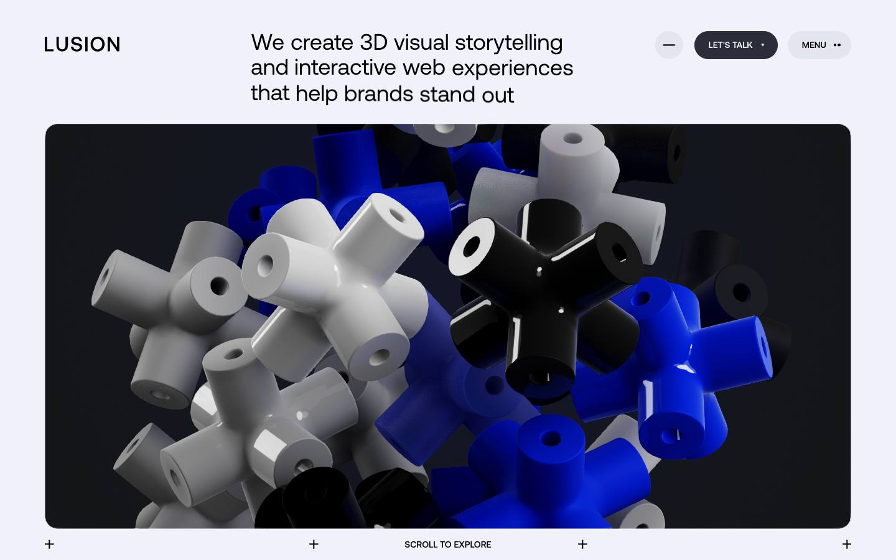
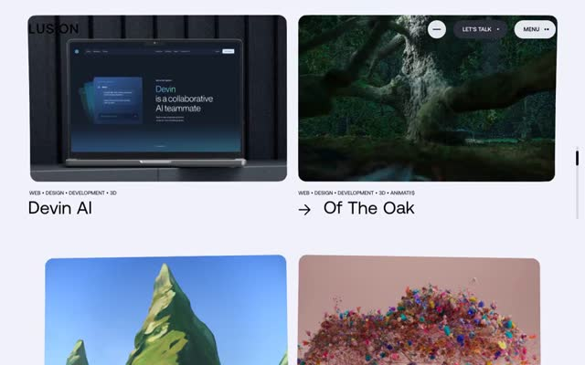
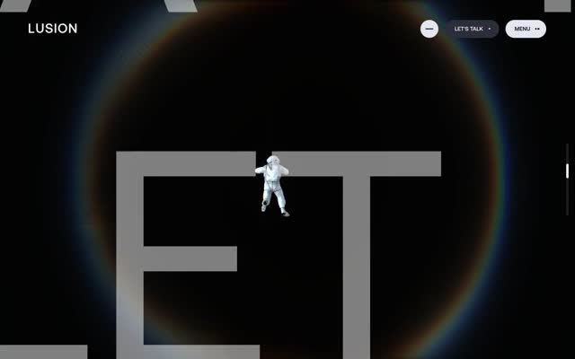
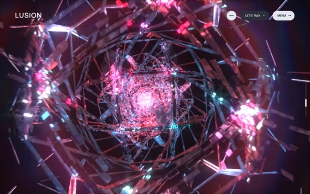
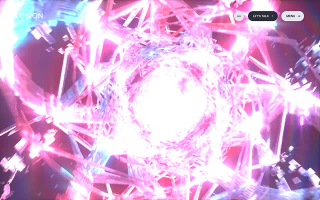
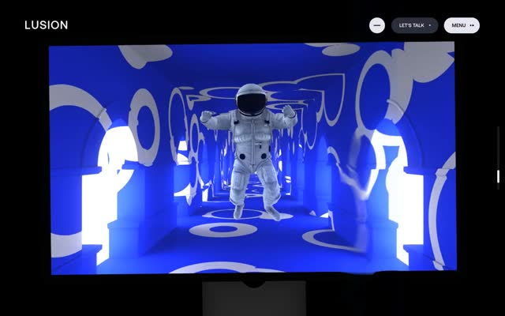
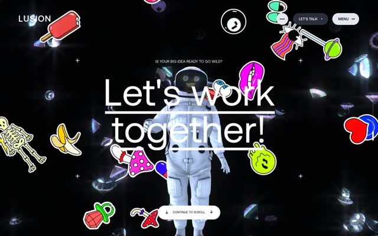

# Lusion homepage: layout, scenes and motion evidence

[Live reference](https://lusion.co/) · [Raw capture](../../captures/lusion/lusion-home/page.json) · [138-second desktop traversal](../../captures/lusion/lusion-home/traversal.mp4) · [All captures](README.md)

The desktop pass was captured on 2026-11-12 at **1440 × 900**. It reached the measured bottom of the page, covering the hero, project grid, long 3D journey, contact composition and footer/navigation. This is a reference specification with proposed implementation choices, not recovered source code.



## Observed page structure

| Stage | Evidence | Layout and behavior to reproduce |
|:--|:--|:--|
| Hero | `home-hero`, initial height 900 px | Light ground, compact logo/navigation, offset text and rounded viewport containing blue/white/black cross-shaped objects |
| Introduction and reel | `home-reel`, initial y 900 px; height 2,533 px | Very large type, smaller supporting column, a distinct reel stage and a visible play action |
| Project selection | `home-featured`, initial y 3,433 px; height 3,904 px | Two-column project grid, visual thumbnails, captions and a transition into the dark scene sequence |
| Extended scene journey | `home-goal`, initial y 7,337 px; height 39,855 px | Astronaut, dark circular halo, moving industrial tunnel, bright faceted pink scene and blue patterned environment visible across the recording |
| Closing action | Late video frames | Central action amid floating illustrated shapes and the astronaut, followed by a light information footer |
| Next-page navigation | Final checkpoint | A dark navigation region after the footer; the final captured route remains the homepage |

The native document height was only **900 px**, while the outer content measured approximately **51,555 px** in this run. The recorder measured **50,655 px** of movement and reached the closing navigation. These numbers depend on viewport, font loading and the current site revision; do not hard-code them as universal breakpoints.

## Computed typography facts

| Element | Family | Size | Line height | Weight |
|:--|:--|--:|--:|--:|
| Hero heading | Aeonik | 36 px | 39.6 px | 400 |
| Intro display heading | Aeonik | 144 px | 144 px | 400 |
| Intro supporting heading | Aeonik | 21.6 px | 30.24 px | 400 |

These are computed values at the recorded desktop size. Aeonik is not bundled. Use a licensed font or document the substitute. Inspect the record for additional geometry and computed styles.

## What the resource evidence establishes

The recording observed a persistent viewport canvas, first-party `.buf` model resources, `.exr` and image textures, audio URLs, and an MP4 reel resource. The inventory lists 105 first-party response URLs for this pass. The model filenames include cross-shaped hero geometry, astronaut parts/animations and tunnel geometry. Source resources are linked in JSON; their bodies were not copied into the repository.

This supports a 3D/media-heavy implementation. It does not independently establish the renderer version, physics solver, exact camera splines, shader source, postprocessing settings or animation timings. A case-study or video asset elsewhere in the collection also does not prove a live client's WebGL runtime.

## Proposed implementation brief

1. Build semantic navigation, heading, reel action, project grid, closing action and footer as ordinary DOM. Match the measured desktop framing before adding effects.
2. Use one renderer canvas with explicit scene states. A Three.js implementation could use original cross geometry/instances, an appropriately licensed character and scene environments. Keep the source design's visual composition as a reference, with asset availability called out.
3. Map one scroll progress source to scene transitions, camera position, camera look-at and character clip time. Define boundaries from reviewed video frames. Keep the DOM and canvas on the same timeline.
4. Use normalized pointer input with time-based damping for the hero. This is an implementation proposal; collision forces and original interaction code are not recovered from the capture.
5. Provide responsive scene framing, touch behavior, a stable reduced-motion composition, loading/error fallbacks and keyboard-accessible actions. Measure GPU cost with the target assets before setting a performance claim.

Use the [agent implementation guide](../../.agents/skills/frontend-library/references/implementation.md) and [Three.js documentation](https://threejs.org/docs/) for API decisions. The query tool also finds existing Motion scroll examples:

```bash
python3 scripts/query-library.py scroll --type motion --limit 6 --json
```

## Study frames from the recording

These stills are sampled every eight seconds from the actual traversal. They preserve evidence of intermediate scenes; the times are video sampling times, not original site animation durations.













## Remaining capture scope

The traversal includes continuous wheel input and a moving pointer. It does not exhaustively record menu states, every project hover, reel playback, drag gestures, audio behavior or mobile-specific alternatives. Refer to separate viewport/interaction packages when present. Recreate a specific requested state only after inspecting or obtaining evidence for it.

All depicted designs and media belong to Lusion and their respective creators. The local recording is study evidence and grants no licence to the underlying assets.
