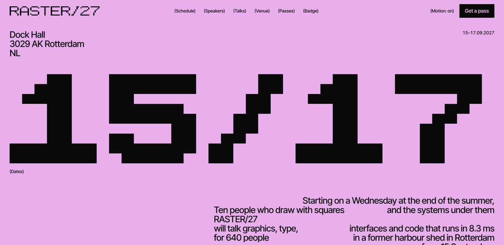
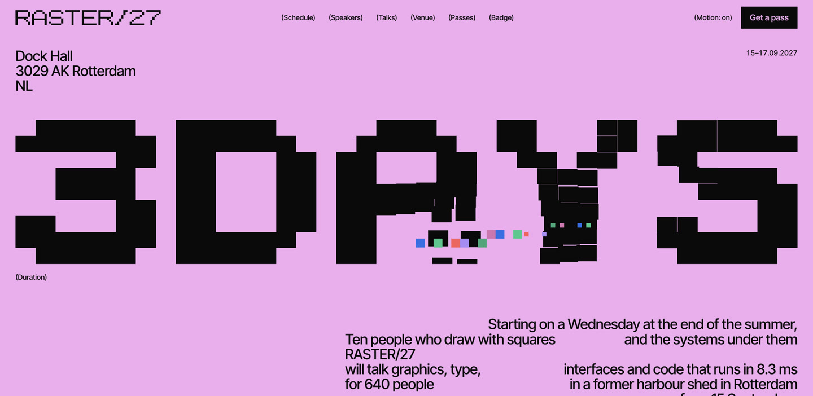
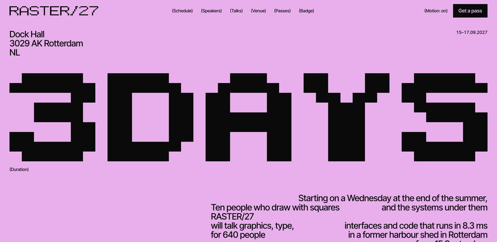
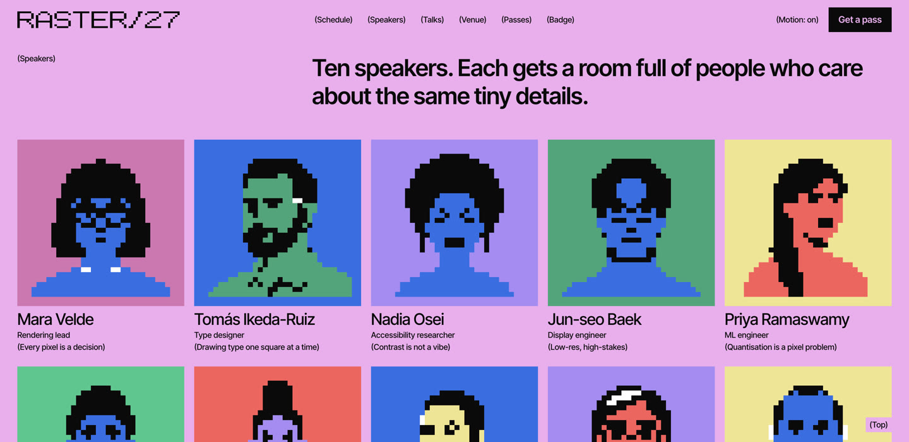
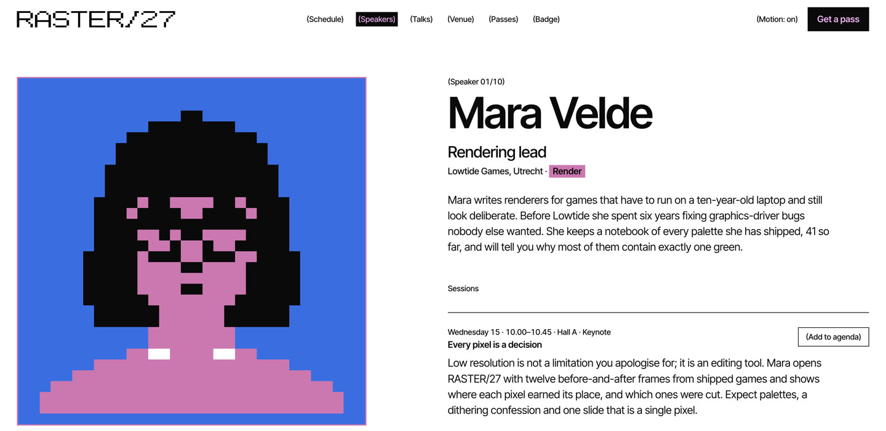
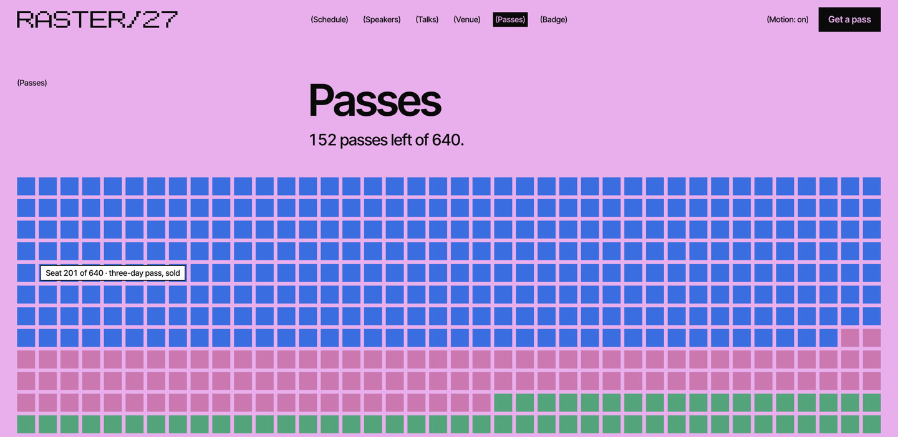

# RASTER/27 — Google AI Studio app (fcd45129)

[Source](https://ai.studio/apps/fcd45129-87d8-4e4d-aa45-e63b33e93ecb?fullscreenApplet=true) · [Discovery page](https://ai.studio/apps/fcd45129-87d8-4e4d-aa45-e63b33e93ecb?fullscreenApplet=true) · [Raw record](../../../captures/ai-studio/ai-studio-fcd45129/page.json)

Captured `2026-11-12T20:15:00.000Z` at **1470 × 717**. Type: **interactive-experience**. Status: **captured**.

[Play/download the recorded browser traversal](../../../captures/ai-studio/ai-studio-fcd45129/traversal.mp4) (12.0 seconds, muted). This is a browser recording, not an extracted source video.

## Visual checkpoints

Each percentage is requested capture progress, not a verified animation timeline. Check the recorded URL and visible section IDs.

Frame `0` · `0.0s` · requested progress `0` · [actual route](https://ai.studio/apps/fcd45129-87d8-4e4d-aa45-e63b33e93ecb?fullscreenApplet=true).

Frame `1` · `2.0s` · requested progress `0.2` · [actual route](https://ai.studio/apps/fcd45129-87d8-4e4d-aa45-e63b33e93ecb?fullscreenApplet=true).

Frame `2` · `4.0s` · requested progress `0.4` · [actual route](https://ai.studio/apps/fcd45129-87d8-4e4d-aa45-e63b33e93ecb?fullscreenApplet=true).

Frame `3` · `6.0s` · requested progress `0.6` · [actual route](https://ai.studio/apps/fcd45129-87d8-4e4d-aa45-e63b33e93ecb?fullscreenApplet=true#/speakers).

Frame `4` · `8.0s` · requested progress `0.8` · [actual route](https://ai.studio/apps/fcd45129-87d8-4e4d-aa45-e63b33e93ecb?fullscreenApplet=true#/speakers/detail).

Frame `5` · `10.0s` · requested progress `1.0` · [actual route](https://ai.studio/apps/fcd45129-87d8-4e4d-aa45-e63b33e93ecb?fullscreenApplet=true#/tickets).

## Observed structure

| Section ID | Initial y | Height |
|:--|--:|--:|
| `hero` | 0 | 261 |
| `speakers` | 261 | 300 |
| `tickets` | 561 | 156 |

## Implementation boundary

This package records the route above. A studio case study may show videos of a client website; it does not establish that client's runtime or interactions. Inspect the outbound links in the record before choosing a live project as a target.

- Captured interactively via browser subagent with real-time mouse movement dispatch.
- Hero canvas particle physics and pointer trail effects are driven by requestAnimationFrame loops.
- Embedded applet uses custom 2D Canvas bitmap glyph rendering and WebGL route transitions.
- Audio is muted; interactive controls (resolution scrubber, seat map tooltip, badge maker) were exercised during inspection.

Google AI Studio applet and community content retain their respective owners' rights; reference capture for study and inspection only.

[Agent workflow](../../../.agents/skills/frontend-library/SKILL.md) · [Implementation guidance](../../../.agents/skills/frontend-library/references/implementation.md)
