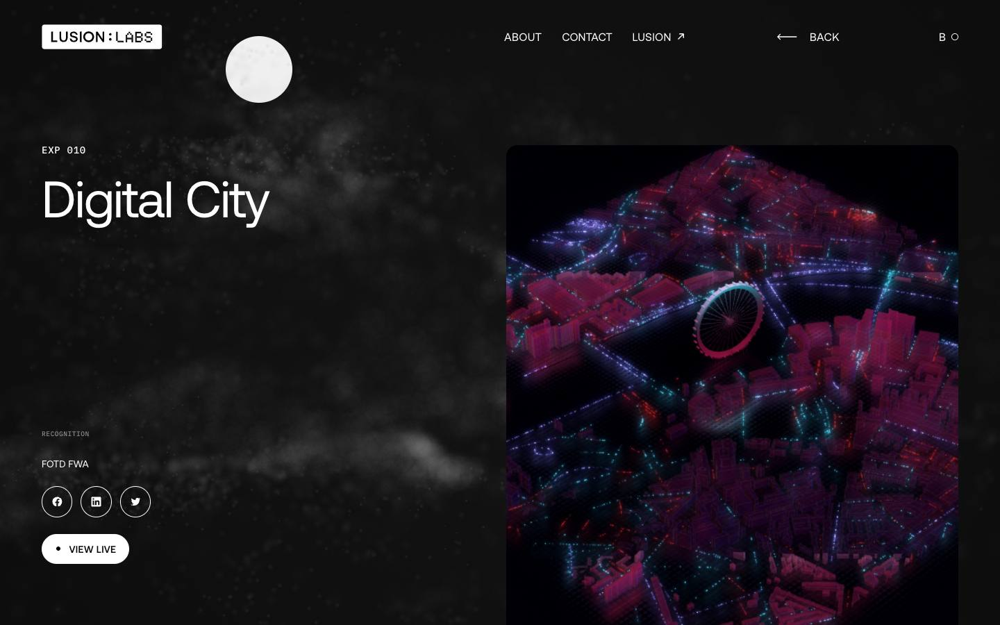
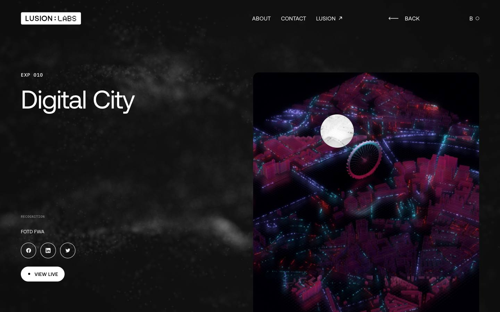
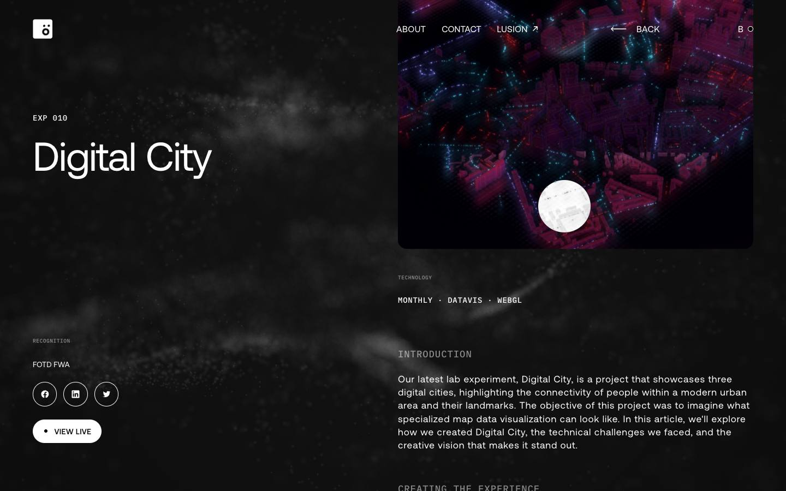
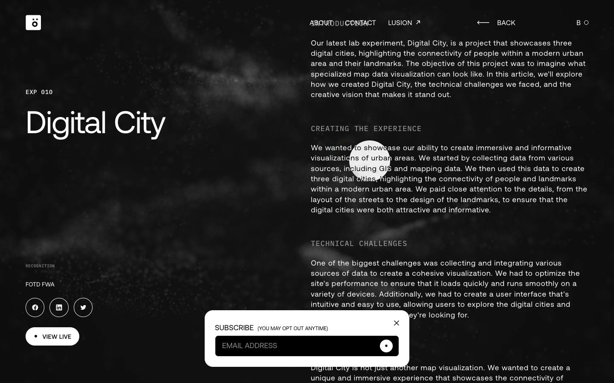
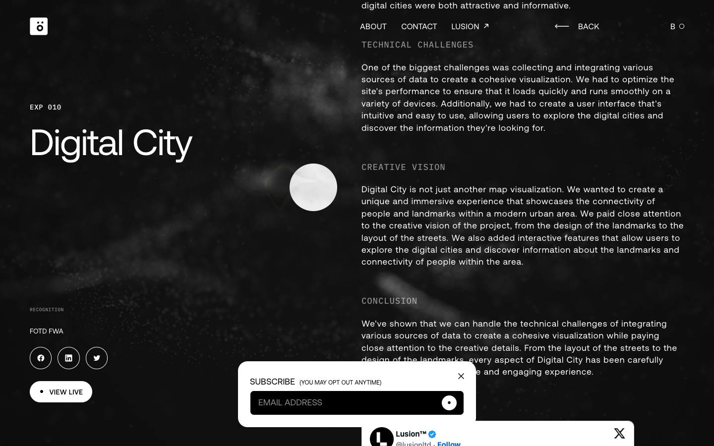
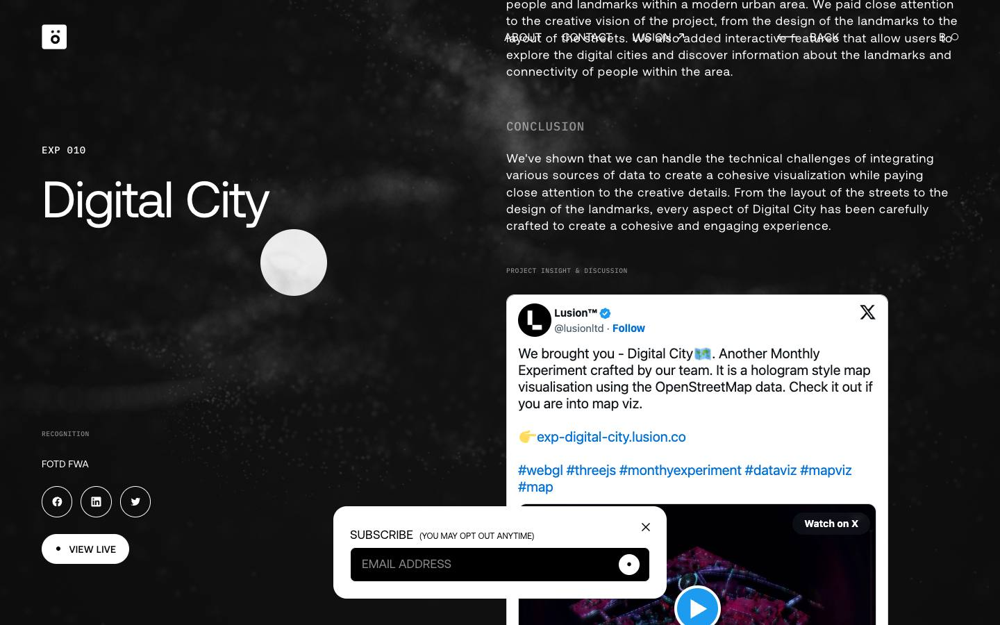

# Digital City

[Source](https://labs.lusion.co/exp/digital-city) · [Discovery page](https://labs.lusion.co/) · [Raw record](../../../captures/lusion/labs-digital-city/page.json)

Captured `2026-11-12T08:20:31.043Z` at **1440 × 900**. Type: **lab-case-study**. Status: **captured**.

[Play/download the recorded browser traversal](../../../captures/lusion/labs-digital-city/traversal.mp4) (10.4 seconds, muted). This is a browser recording, not an extracted source video.

## Visual checkpoints

Each percentage is requested capture progress, not a verified animation timeline. Check the recorded URL and visible section IDs.

Frame `0` · `0.0s` · requested progress `0` · [actual route](https://labs.lusion.co/exp/digital-city).

Frame `5` · `1.1s` · requested progress `0.22` · [actual route](https://labs.lusion.co/exp/digital-city).

Frame `9` · `3.0s` · requested progress `0.39` · [actual route](https://labs.lusion.co/exp/digital-city).

Frame `14` · `5.8s` · requested progress `0.61` · [actual route](https://labs.lusion.co/exp/digital-city).

Frame `18` · `8.0s` · requested progress `0.78` · [actual route](https://labs.lusion.co/exp/digital-city).

Frame `23` · `10.4s` · requested progress `1` · [actual route](https://labs.lusion.co/exp/digital-city).

## Observed structure

| Section ID | Initial y | Height |
|:--|--:|--:|

## Implementation boundary

This package records the route above. A studio case study may show videos of a client website; it does not establish that client's runtime or interactions. Inspect the outbound links in the record before choosing a live project as a target.

- A recorded browser traversal, not an offline copy of the site.
- Shader source, models, textures and original media are inventoried by URL only.
- Audio is muted. Scroll checkpoints do not enumerate every possible interaction.
- A canvas does not by itself prove Three.js or any particular rendering technique.

Reference screenshots and recordings of Lusion work; original rights retained. No reusable asset licence granted.

[Agent workflow](../../../.agents/skills/frontend-library/SKILL.md) · [Implementation guidance](../../../.agents/skills/frontend-library/references/implementation.md)
