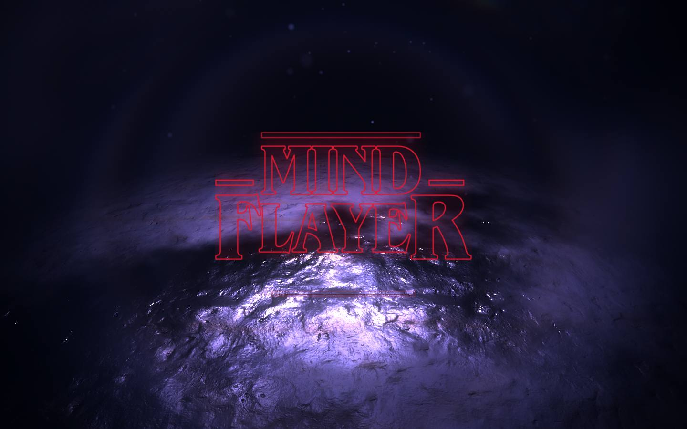
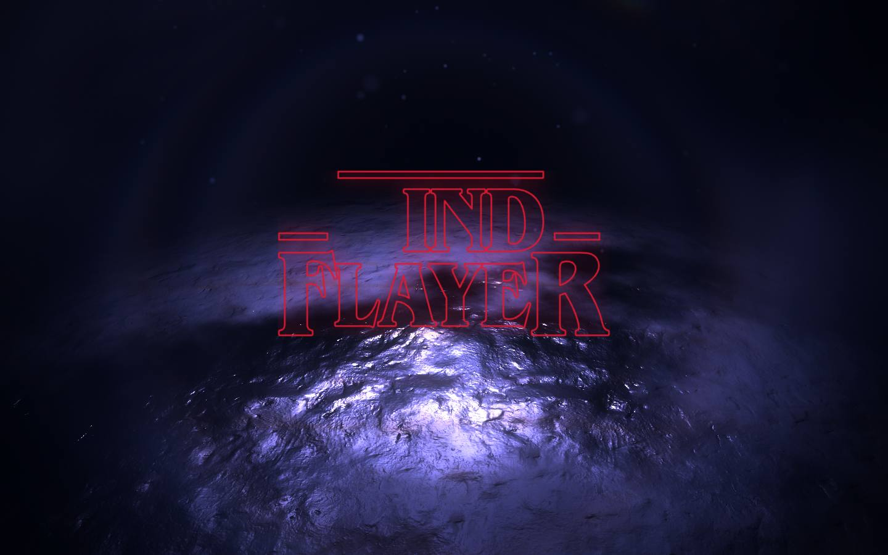
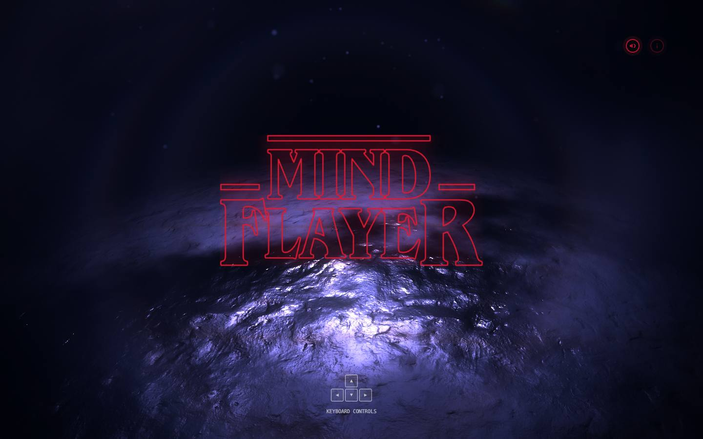

# Exp Mind Flayer — live experience

[Source](https://exp-mind-flayer.lusion.co/) · [Discovery page](https://labs.lusion.co/exp/hair-simulation) · [Raw record](../../../captures/lusion/live-exp-mind-flayer/page.json)

Captured `2026-11-12T08:19:31.731Z` at **1440 × 900**. Type: **interactive-experience**. Status: **captured**.

[Play/download the recorded browser traversal](../../../captures/lusion/live-exp-mind-flayer/traversal.mp4) (4.4 seconds, muted). This is a browser recording, not an extracted source video.

## Visual checkpoints

Each percentage is requested capture progress, not a verified animation timeline. Check the recorded URL and visible section IDs.

Frame `0` · `0.0s` · requested progress `0` · [actual route](https://exp-mind-flayer.lusion.co/).

Frame `5` · `0.9s` · requested progress `0.22` · [actual route](https://exp-mind-flayer.lusion.co/).

Frame `9` · `1.7s` · requested progress `0.39` · [actual route](https://exp-mind-flayer.lusion.co/).

Frame `14` · `2.6s` · requested progress `0.61` · [actual route](https://exp-mind-flayer.lusion.co/).

Frame `18` · `3.4s` · requested progress `0.78` · [actual route](https://exp-mind-flayer.lusion.co/).

Frame `23` · `4.4s` · requested progress `1` · [actual route](https://exp-mind-flayer.lusion.co/).

## Observed structure

| Section ID | Initial y | Height |
|:--|--:|--:|
| `canvas` | 0 | 0 |
| `ui` | 0 | 900 |
| `not-supported-container` | 0 | 0 |

## Implementation boundary

This package records the route above. A studio case study may show videos of a client website; it does not establish that client's runtime or interactions. Inspect the outbound links in the record before choosing a live project as a target.

- A recorded browser traversal, not an offline copy of the site.
- Shader source, models, textures and original media are inventoried by URL only.
- Audio is muted. Scroll checkpoints do not enumerate every possible interaction.
- A canvas does not by itself prove Three.js or any particular rendering technique.
- Opening fixed-viewport/pointer state only; zero native travel does not establish complete interaction or scroll coverage.

Reference screenshots and recordings of Lusion work; original rights retained. No reusable asset licence granted.

[Agent workflow](../../../.agents/skills/frontend-library/SKILL.md) · [Implementation guidance](../../../.agents/skills/frontend-library/references/implementation.md)
