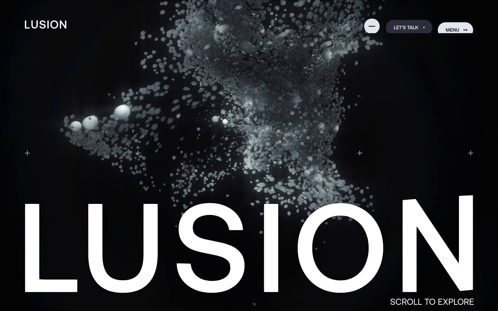
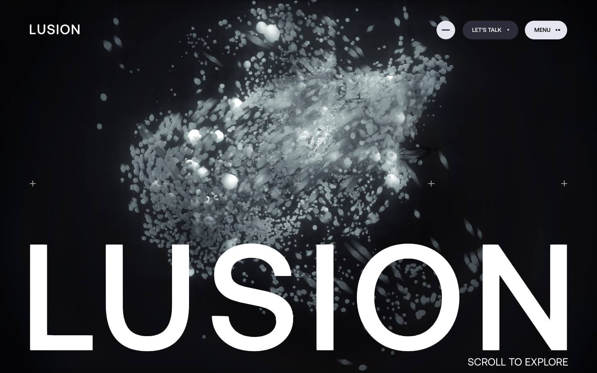
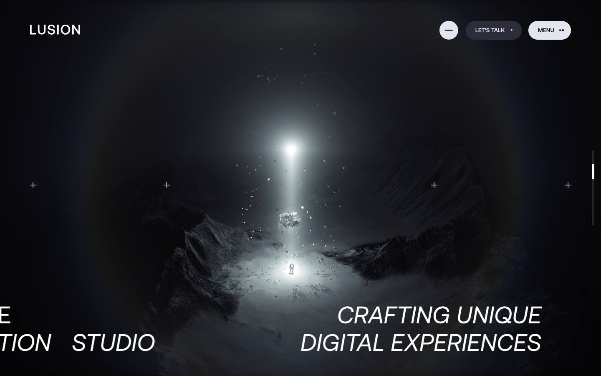
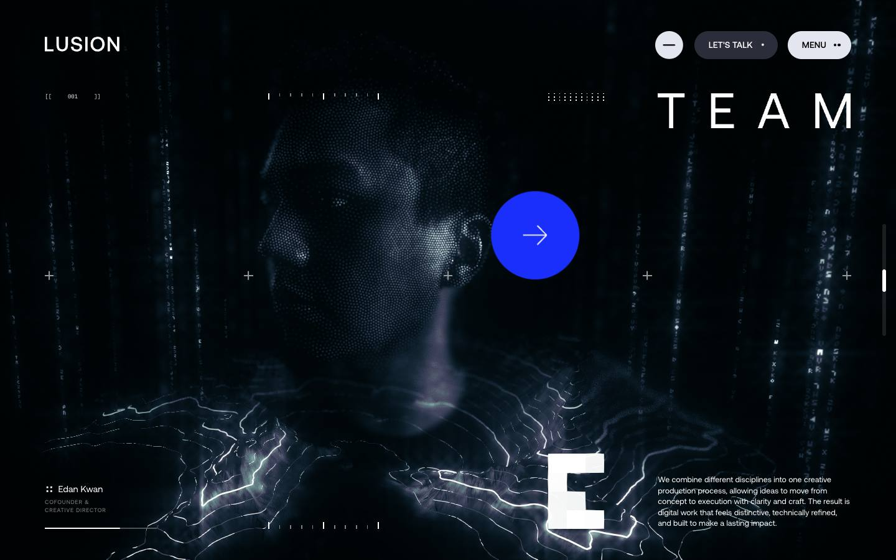
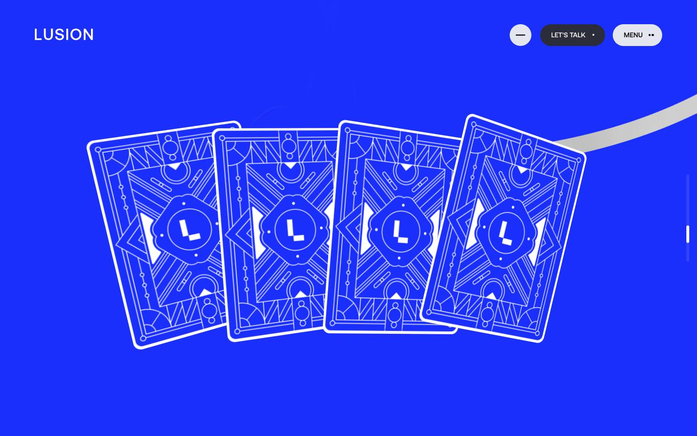
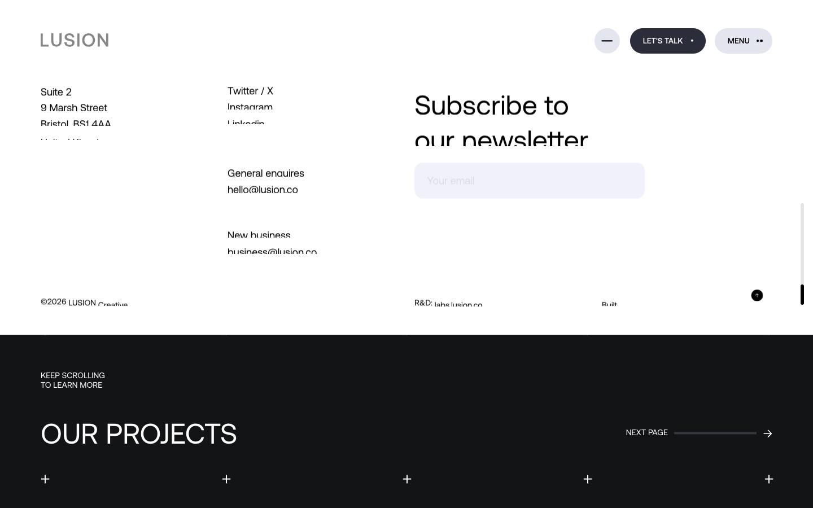

# Lusion — About

[Source](https://lusion.co/about) · [Discovery page](https://lusion.co/) · [Raw record](../../../captures/lusion/lusion-about/page.json)

Captured `2026-11-12T07:44:27.231Z` at **1440 × 900**. Type: **studio-page**. Status: **captured**.

[Play/download the recorded browser traversal](../../../captures/lusion/lusion-about/traversal.mp4) (19.4 seconds, muted). This is a browser recording, not an extracted source video.

## Visual checkpoints

Each percentage is requested capture progress, not a verified animation timeline. Check the recorded URL and visible section IDs.

Frame `0` · `0.0s` · requested progress `0` · [actual route](https://lusion.co/about).

Frame `5` · `2.4s` · requested progress `0.22` · [actual route](https://lusion.co/about).

Frame `9` · `6.4s` · requested progress `0.39` · [actual route](https://lusion.co/about).

Frame `14` · `11.3s` · requested progress `0.61` · [actual route](https://lusion.co/about).

Frame `18` · `14.8s` · requested progress `0.78` · [actual route](https://lusion.co/about).

Frame `23` · `19.4s` · requested progress `1` · [actual route](https://lusion.co/about).

## Observed structure

| Section ID | Initial y | Height |
|:--|--:|--:|
| `about-who` | 0 | 14580 |
| `about-clients` | 14580 | 1049 |
| `about-award` | 15629 | 1875 |
| `about-capability` | 17504 | 3871 |

## Implementation boundary

This package records the route above. A studio case study may show videos of a client website; it does not establish that client's runtime or interactions. Inspect the outbound links in the record before choosing a live project as a target.

- A recorded browser traversal, not an offline copy of the site.
- Shader source, models, textures and original media are inventoried by URL only.
- Audio is muted. Scroll checkpoints do not enumerate every possible interaction.
- A canvas does not by itself prove Three.js or any particular rendering technique.

Reference screenshots and recordings of Lusion work; original rights retained. No reusable asset licence granted.

[Agent workflow](../../../.agents/skills/frontend-library/SKILL.md) · [Implementation guidance](../../../.agents/skills/frontend-library/references/implementation.md)
