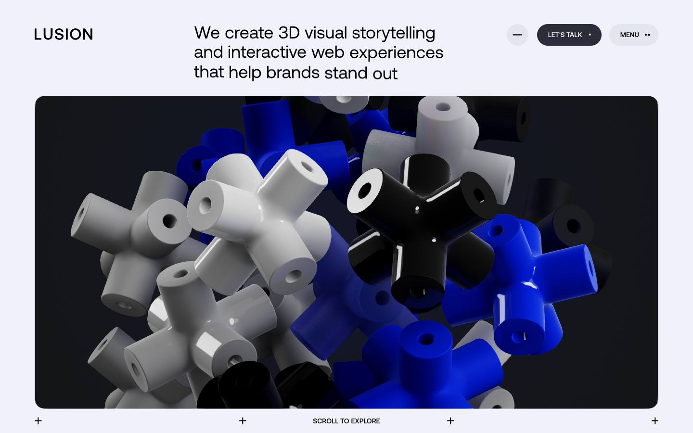
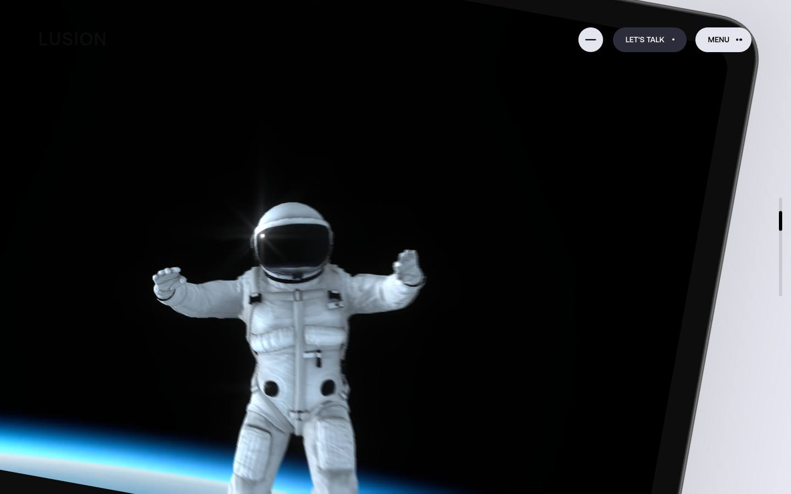
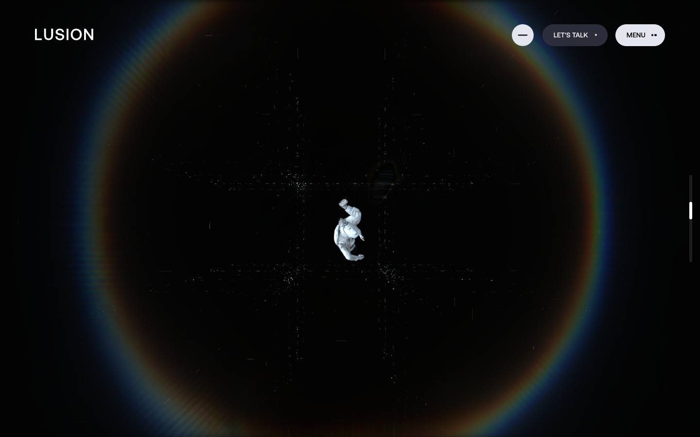
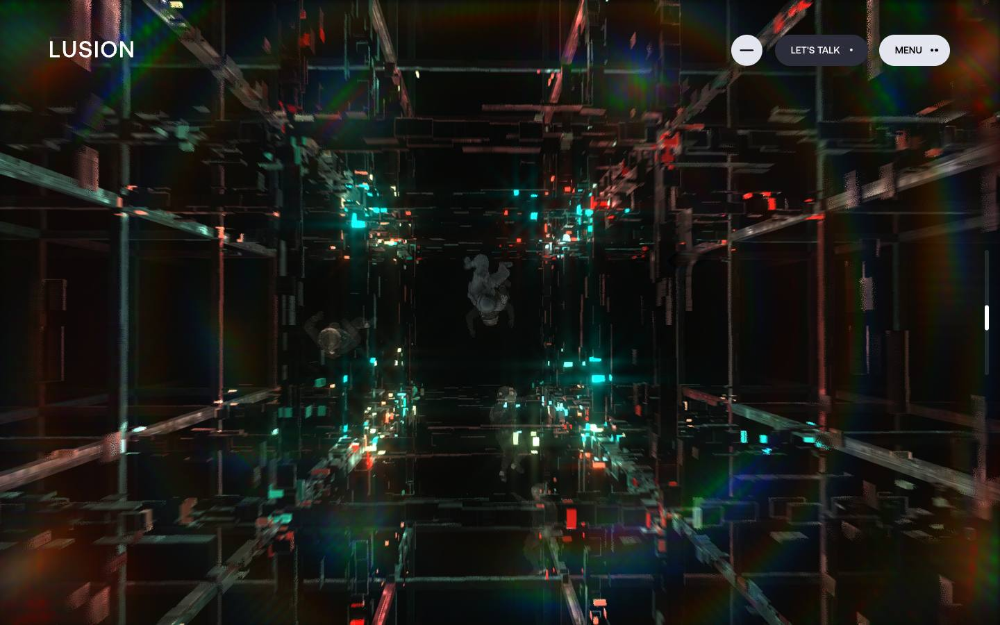
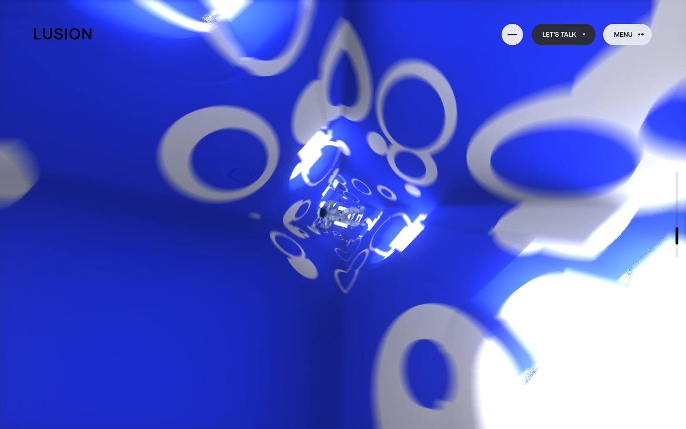

# Lusion — Home

[Source](https://lusion.co/) · [Discovery page](https://lusion.co/) · [Raw record](../../../captures/lusion/lusion-home/page.json)

Captured `2026-11-12T07:40:04.348Z` at **1440 × 900**. Type: **landing-page**. Status: **captured**.

[Play/download the recorded browser traversal](../../../captures/lusion/lusion-home/traversal.mp4) (137.6 seconds, muted). This is a browser recording, not an extracted source video.

## Visual checkpoints

Each percentage is requested capture progress, not a verified animation timeline. Check the recorded URL and visible section IDs.

Frame `0` · `0.0s` · requested progress `0` · [actual route](https://lusion.co/).

Frame `24` · `32.4s` · requested progress `0.2` · [actual route](https://lusion.co/).

Frame `48` · `46.2s` · requested progress `0.4` · [actual route](https://lusion.co/).

Frame `71` · `78.5s` · requested progress `0.6` · [actual route](https://lusion.co/).

Frame `95` · `104.7s` · requested progress `0.8` · [actual route](https://lusion.co/).

Frame `119` · `137.6s` · requested progress `1` · [actual route](https://lusion.co/).

## Observed structure

| Section ID | Initial y | Height |
|:--|--:|--:|
| `home-hero` | 0 | 900 |
| `home-reel` | 900 | 2533 |
| `home-featured` | 3433 | 3904 |
| `home-goal` | 7337 | 39855 |

## Implementation boundary

This package records the route above. A studio case study may show videos of a client website; it does not establish that client's runtime or interactions. Inspect the outbound links in the record before choosing a live project as a target.

- A recorded browser traversal, not an offline copy of the site.
- Shader source, models, textures and original media are inventoried by URL only.
- Audio is muted. Scroll checkpoints do not enumerate every possible interaction.
- A canvas does not by itself prove Three.js or any particular rendering technique.

Reference screenshots and recordings of Lusion work; original rights retained. No reusable asset licence granted.

[Agent workflow](../../../.agents/skills/frontend-library/SKILL.md) · [Implementation guidance](../../../.agents/skills/frontend-library/references/implementation.md)
