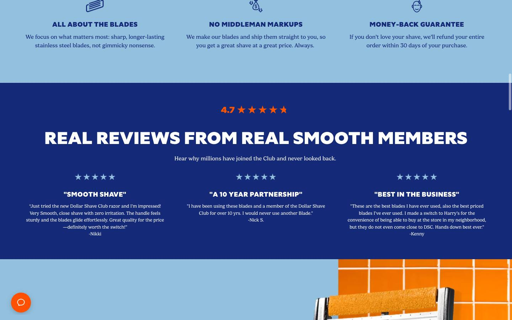
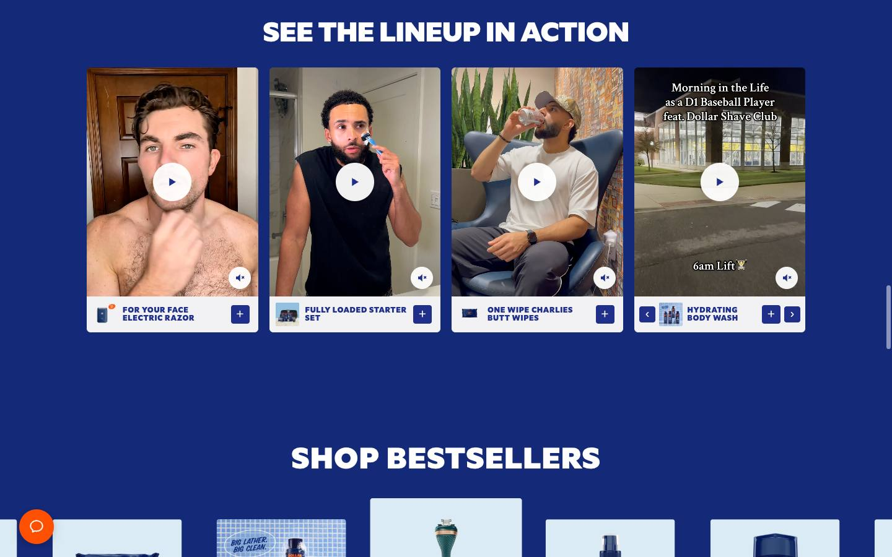
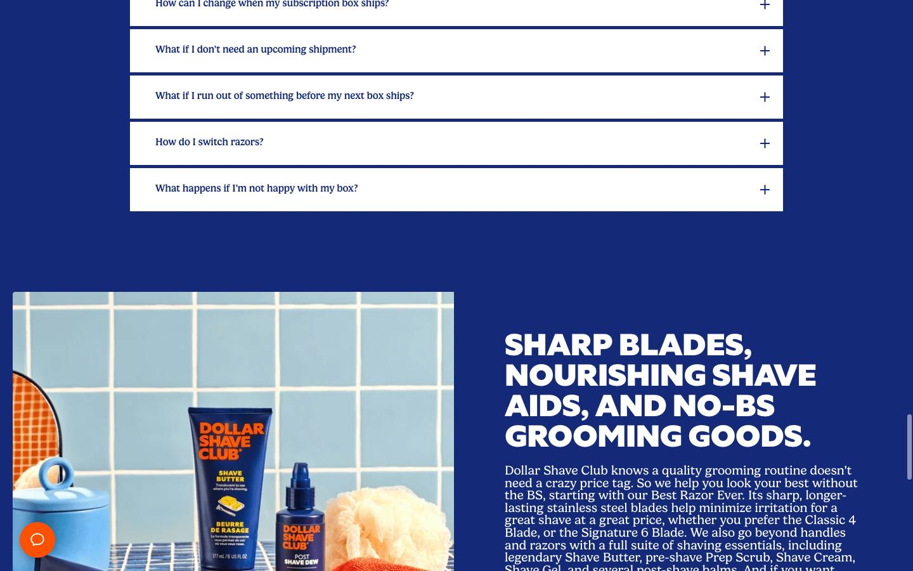
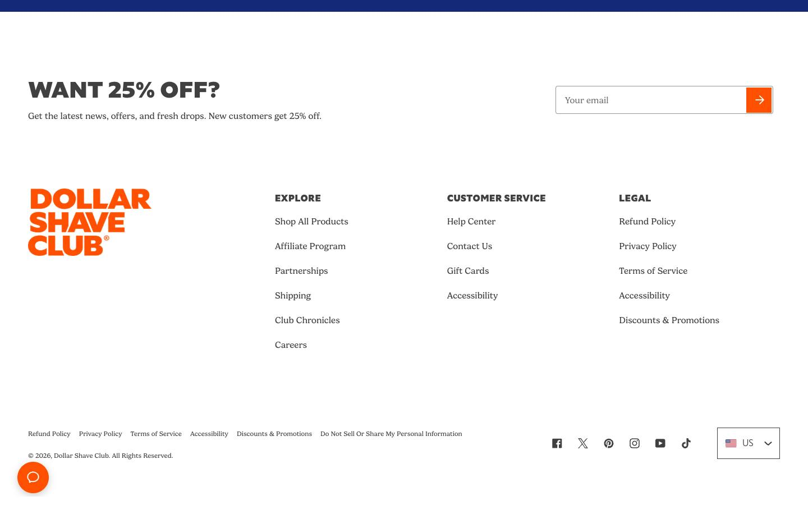

# Dollar Shave Club — homepage

[Source](https://www.dollarshaveclub.com/) · [Discovery page](https://styles.refero.design/style/6d72f05e-dce6-43ad-9532-f61bf211ed46) · [Raw record](../../../captures/refero/refero-dollar-shave-club/page.json)

Captured `2026-11-12T10:55:38.134Z` at **1440 × 900**. Type: **landing-page**. Status: **captured**.

[Play/download the recorded browser traversal](../../../captures/refero/refero-dollar-shave-club/traversal.mp4) (12.6 seconds, muted). This is a browser recording, not an extracted source video.

## Visual checkpoints

Each percentage is requested capture progress, not a verified animation timeline. Check the recorded URL and visible section IDs.

Frame `0` · `0.0s` · requested progress `0` · [actual route](https://us.dollarshaveclub.com/).

Frame `5` · `3.3s` · requested progress `0.22` · [actual route](https://us.dollarshaveclub.com/).

Frame `9` · `6.7s` · requested progress `0.39` · [actual route](https://us.dollarshaveclub.com/).

Frame `14` · `8.8s` · requested progress `0.61` · [actual route](https://us.dollarshaveclub.com/).

Frame `18` · `10.5s` · requested progress `0.78` · [actual route](https://us.dollarshaveclub.com/).

Frame `23` · `12.6s` · requested progress `1` · [actual route](https://us.dollarshaveclub.com/).

## Observed structure

| Section ID | Initial y | Height |
|:--|--:|--:|
| `shopify-section-template--18751524438064__custom_liquid_jVPUhg` | 121 | 550 |
| `shopify-section-template--18751524438064__custom_liquid_9cxNEW` | 671 | 647 |
| `shopify-section-template--18751524438064__custom_liquid_afknyx` | 1318 | 300 |
| `shopify-section-template--18751524438064__multicolumn_DGjez3` | 1618 | 349 |
| `shopify-section-template--18751524438064__custom_liquid_w3UpiL` | 1968 | 93 |
| `shopify-section-template--18751524438064__multicolumn_iNkHw7` | 2060 | 403 |
| `shopify-section-template--18751524438064__image_hero_with_text_k7DBKH` | 2464 | 818 |
| `shopify-section-template--18751524438064__multicolumn_7KXd9P` | 3282 | 519 |
| `shopify-section-template--18751524438064__custom_liquid_C7TVFW` | 3801 | 714 |
| `shopify-section-template--18751524438064__centered_product_carousel_XFiiVc` | 4515 | 802 |
| `shopify-section-template--18751524438064__component_accordion_97TPKx` | 5317 | 596 |
| `shopify-section-template--18751524438064__image_with_text_g7Fcdi` | 5913 | 788 |

## Implementation boundary

This package records the route above. A studio case study may show videos of a client website; it does not establish that client's runtime or interactions. Inspect the outbound links in the record before choosing a live project as a target.

- A recorded browser traversal, not an offline copy of the site.
- Shader source, models, textures and original media are inventoried by URL only.
- Audio is muted. Scroll checkpoints do not enumerate every possible interaction.
- A canvas does not by itself prove Three.js or any particular rendering technique.
- Cookie/consent banners were left untouched (nothing accepted), so they may cover part of a checkpoint.

Reference screenshots and recordings of a public brand homepage discovered through the Refero Styles index; the site owner retains all rights. No reusable asset licence granted.

[Agent workflow](../../../.agents/skills/frontend-library/SKILL.md) · [Implementation guidance](../../../.agents/skills/frontend-library/references/implementation.md)
