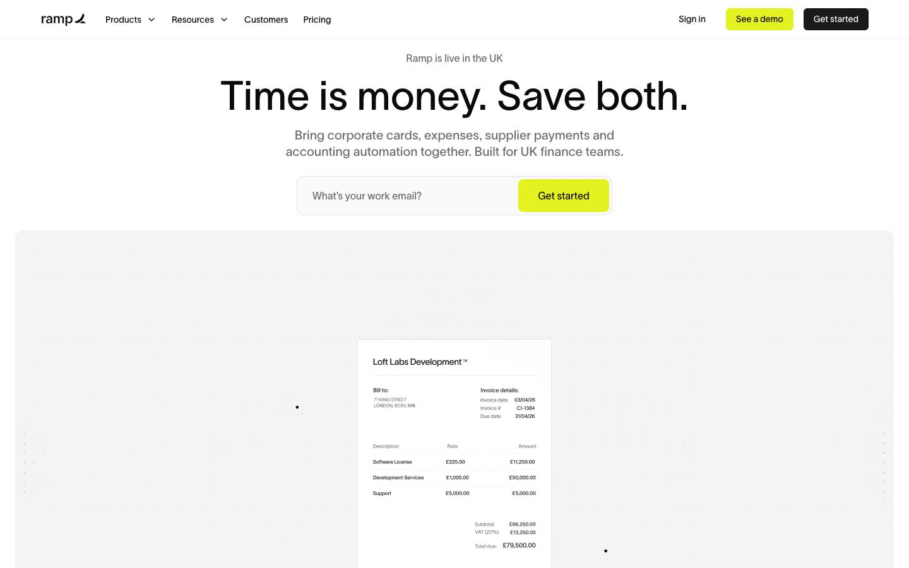
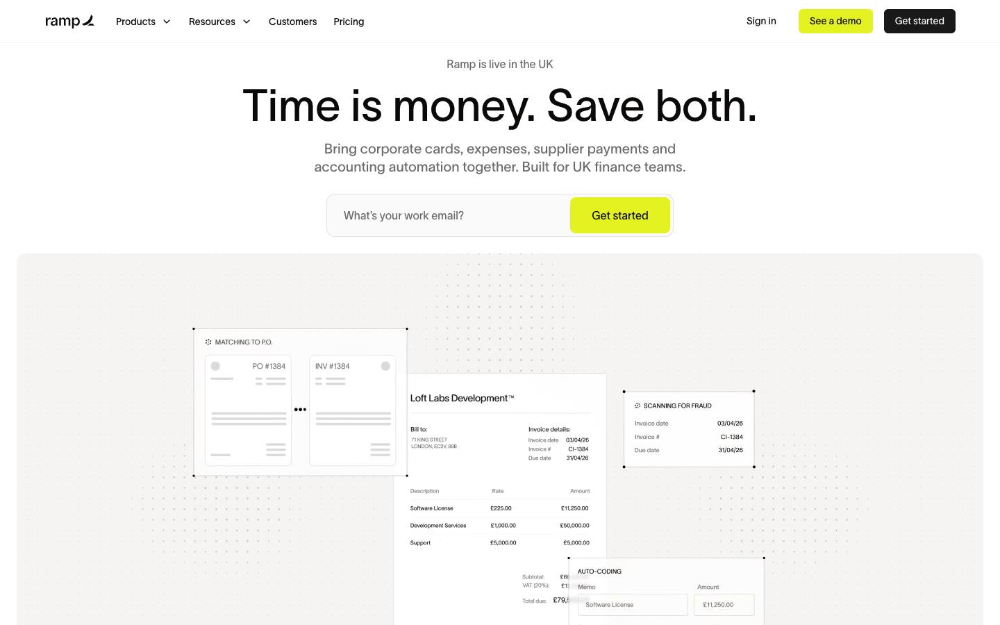
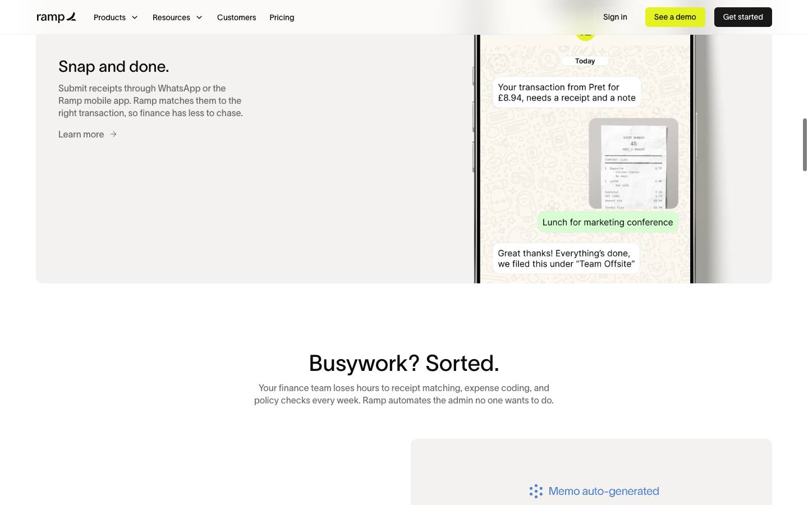
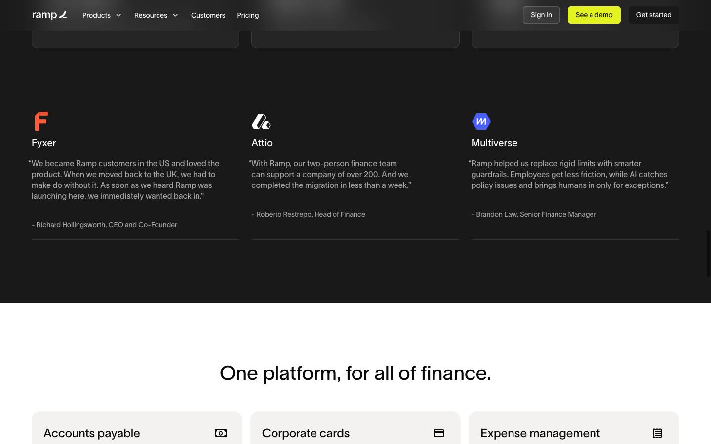
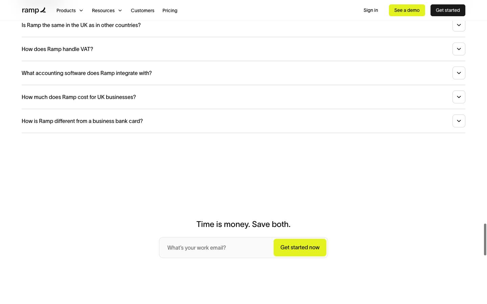
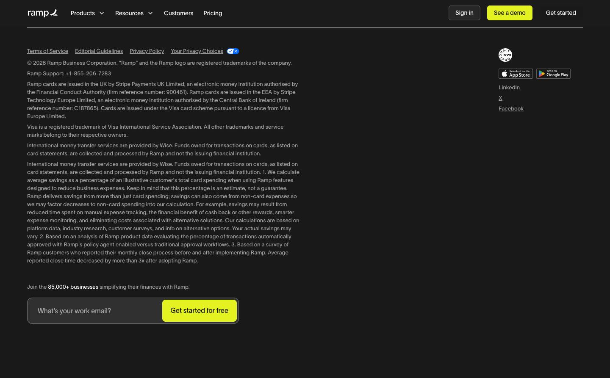

# Ramp — homepage

[Source](https://ramp.com/) · [Discovery page](https://styles.refero.design/style/b38702a0-75ab-474c-9106-00b624535825) · [Raw record](../../../captures/refero/refero-ramp/page.json)

Captured `2026-11-12T10:49:57.216Z` at **1440 × 900**. Type: **landing-page**. Status: **captured**.

[Play/download the recorded browser traversal](../../../captures/refero/refero-ramp/traversal.mp4) (8.2 seconds, muted). This is a browser recording, not an extracted source video.

## Visual checkpoints

Each percentage is requested capture progress, not a verified animation timeline. Check the recorded URL and visible section IDs.

Frame `0` · `0.0s` · requested progress `0` · [actual route](https://ramp.com/en-gb/).

Frame `5` · `0.9s` · requested progress `0.22` · [actual route](https://ramp.com/en-gb/).

Frame `9` · `2.7s` · requested progress `0.39` · [actual route](https://ramp.com/en-gb/).

Frame `14` · `4.7s` · requested progress `0.61` · [actual route](https://ramp.com/en-gb/).

Frame `18` · `6.3s` · requested progress `0.78` · [actual route](https://ramp.com/en-gb/).

Frame `23` · `8.2s` · requested progress `1` · [actual route](https://ramp.com/en-gb/).

## Observed structure

| Section ID | Initial y | Height |
|:--|--:|--:|
| `_R_` | 0 | 0 |
| `RyuLiveRegionStatus` | 8274 | 1 |
| `RyuLiveRegionAlert` | 8274 | 1 |
| `c076frame` | 0 | 0 |
| `batBeacon379111952545` | 0 | 0 |
| `li_sync_frame` | 0 | 0 |
| `podscribe-request` | 0 | 0 |
| `chili-loader` | 8275 | 0 |

## Implementation boundary

This package records the route above. A studio case study may show videos of a client website; it does not establish that client's runtime or interactions. Inspect the outbound links in the record before choosing a live project as a target.

- A recorded browser traversal, not an offline copy of the site.
- Shader source, models, textures and original media are inventoried by URL only.
- Audio is muted. Scroll checkpoints do not enumerate every possible interaction.
- A canvas does not by itself prove Three.js or any particular rendering technique.
- Cookie/consent banners were left untouched (nothing accepted), so they may cover part of a checkpoint.
- Traversal navigated to https://ramp.com/en-gb/; inspect checkpoint URLs before comparing.

Reference screenshots and recordings of a public brand homepage discovered through the Refero Styles index; the site owner retains all rights. No reusable asset licence granted.

[Agent workflow](../../../.agents/skills/frontend-library/SKILL.md) · [Implementation guidance](../../../.agents/skills/frontend-library/references/implementation.md)
