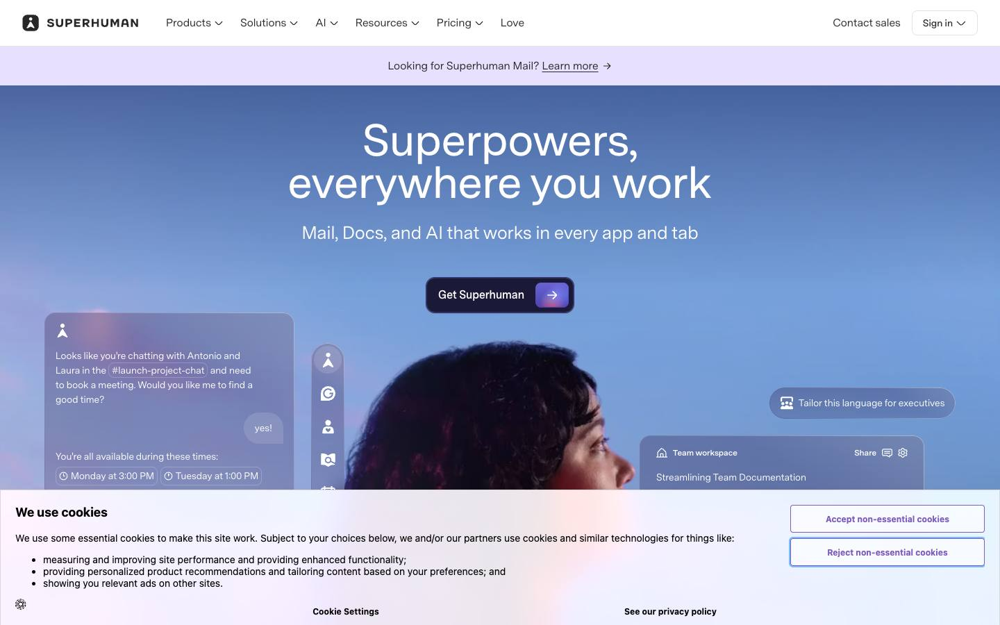
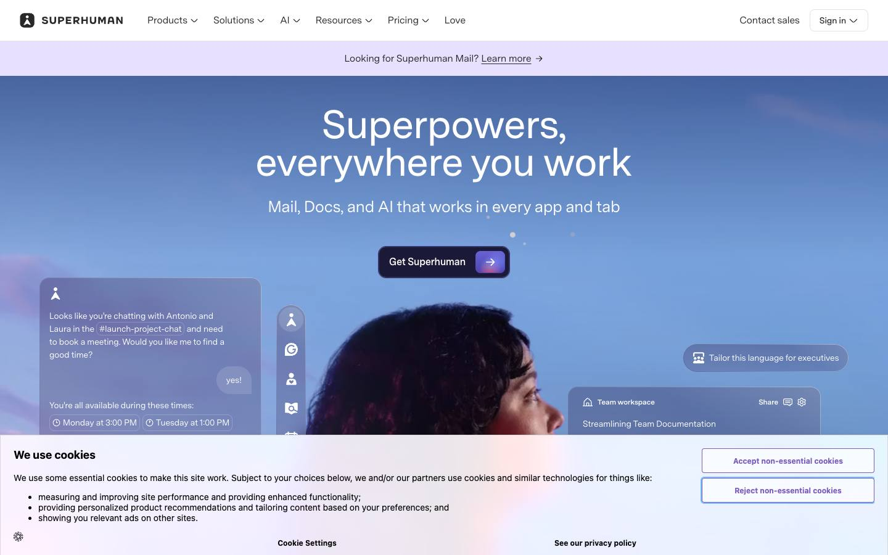
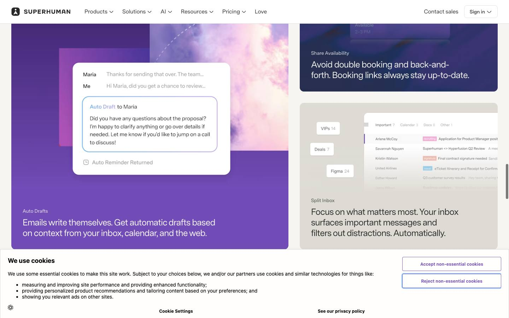
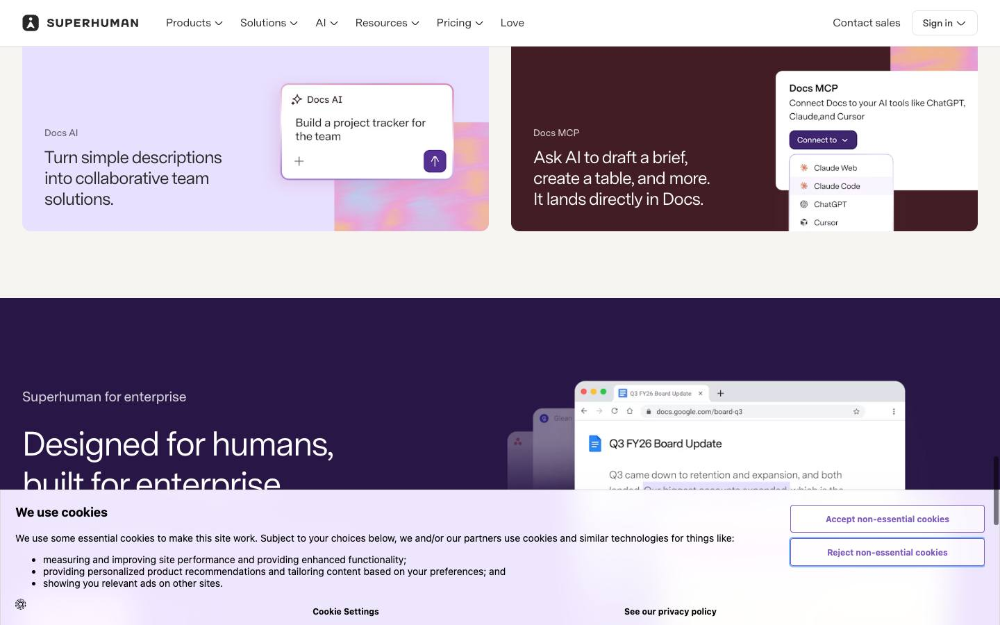
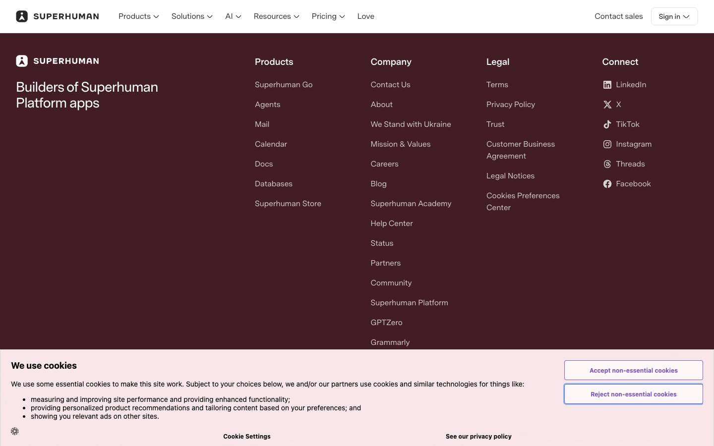

# Superhuman — homepage

[Source](https://superhuman.com/) · [Discovery page](https://styles.refero.design/style/418b374a-be64-44f0-b17e-1d45308c7e62) · [Raw record](../../../captures/refero/refero-superhuman/page.json)

Captured `2026-11-12T10:47:04.357Z` at **1440 × 900**. Type: **landing-page**. Status: **captured**.

[Play/download the recorded browser traversal](../../../captures/refero/refero-superhuman/traversal.mp4) (10.1 seconds, muted). This is a browser recording, not an extracted source video.

## Visual checkpoints

Each percentage is requested capture progress, not a verified animation timeline. Check the recorded URL and visible section IDs.

Frame `0` · `0.0s` · requested progress `0` · [actual route](https://superhuman.com/).

Frame `5` · `2.8s` · requested progress `0.22` · [actual route](https://superhuman.com/).

Frame `9` · `5.1s` · requested progress `0.39` · [actual route](https://superhuman.com/).

Frame `14` · `7.1s` · requested progress `0.61` · [actual route](https://superhuman.com/).

Frame `18` · `8.4s` · requested progress `0.78` · [actual route](https://superhuman.com/).

Frame `23` · `10.1s` · requested progress `1` · [actual route](https://superhuman.com/).

## Observed structure

| Section ID | Initial y | Height |
|:--|--:|--:|
| `sectionSingleColumn_38u7mvRfaQjY5pAVOp9CNQ` | 1110 | 338 |
| `sectionGroup_4ScPrUqBk9O4IiWZHFOfqO` | 1448 | 1634 |
| `sectionSingleColumn_5I73yc9zVtMEJaR6vjwGey` | 3082 | 466 |
| `sectionTwoColumns_5VdLTj4rUIIeWZb5fXSfMB` | 3548 | 1284 |
| `sectionGroup_73BiQUprFOcUjIRIiqf50m` | 4833 | 1308 |
| `sectionTwoColumns_5sIy1xJJCnIdbVtrY070Uj` | 6141 | 602 |
| `sectionTwoColumns_6vwUbLx1hDEdXlEr8NpmSS` | 6743 | 251 |

## Implementation boundary

This package records the route above. A studio case study may show videos of a client website; it does not establish that client's runtime or interactions. Inspect the outbound links in the record before choosing a live project as a target.

- A recorded browser traversal, not an offline copy of the site.
- Shader source, models, textures and original media are inventoried by URL only.
- Audio is muted. Scroll checkpoints do not enumerate every possible interaction.
- A canvas does not by itself prove Three.js or any particular rendering technique.
- Cookie/consent banners were left untouched (nothing accepted), so they may cover part of a checkpoint.

Reference screenshots and recordings of a public brand homepage discovered through the Refero Styles index; the site owner retains all rights. No reusable asset licence granted.

[Agent workflow](../../../.agents/skills/frontend-library/SKILL.md) · [Implementation guidance](../../../.agents/skills/frontend-library/references/implementation.md)
