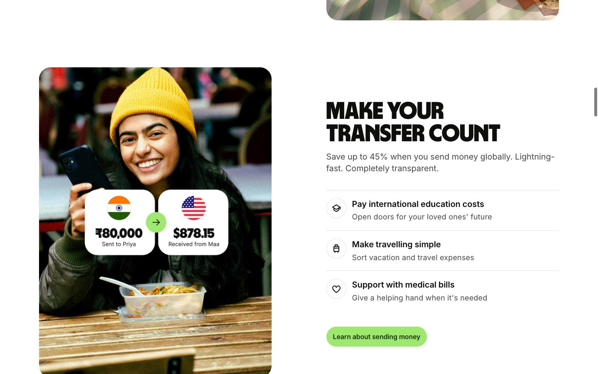
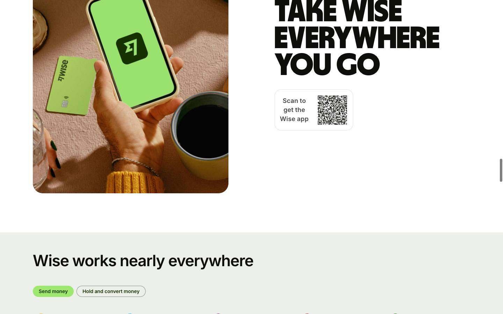
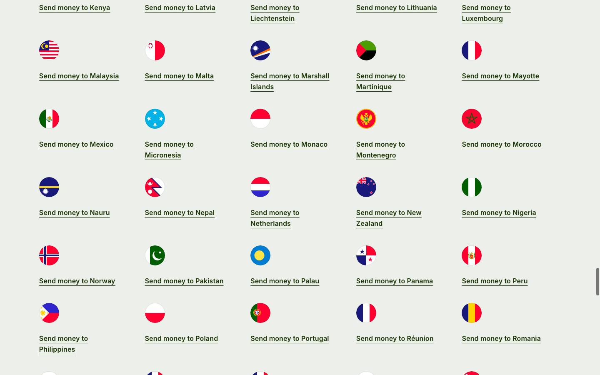
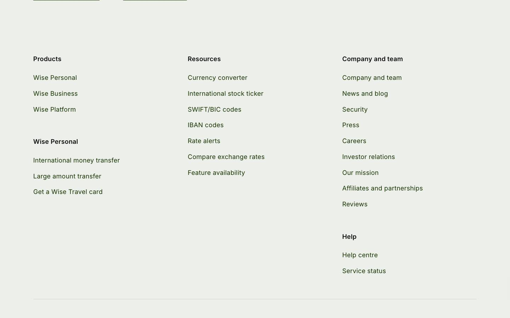

# Wise — homepage

[Source](https://wise.com/) · [Discovery page](https://styles.refero.design/style/367c0c6e-73a7-441c-a8ff-91d139ac60dc) · [Raw record](../../../captures/refero/refero-wise/page.json)

Captured `2026-11-12T10:46:49.542Z` at **1440 × 900**. Type: **landing-page**. Status: **captured**.

[Play/download the recorded browser traversal](../../../captures/refero/refero-wise/traversal.mp4) (7.5 seconds, muted). This is a browser recording, not an extracted source video.

## Visual checkpoints

Each percentage is requested capture progress, not a verified animation timeline. Check the recorded URL and visible section IDs.

Frame `0` · `0.0s` · requested progress `0` · [actual route](https://wise.com/).

Frame `5` · `0.9s` · requested progress `0.22` · [actual route](https://wise.com/).

Frame `9` · `2.3s` · requested progress `0.39` · [actual route](https://wise.com/).

Frame `14` · `4.2s` · requested progress `0.61` · [actual route](https://wise.com/).

Frame `18` · `5.9s` · requested progress `0.78` · [actual route](https://wise.com/).

Frame `23` · `7.5s` · requested progress `1` · [actual route](https://wise.com/).

## Observed structure

| Section ID | Initial y | Height |
|:--|--:|--:|
| `hero-section` | 76 | 1311 |
| `maxitrust-section` | 1444 | 401 |
| `feature-section` | 1901 | 1264 |
| `transfer-section` | 3221 | 693 |
| `security-section-in` | 3971 | 524 |
| `social-trust-section` | 4551 | 598 |
| `app-section` | 5205 | 500 |
| `coverage-section` | 5762 | 3655 |

## Implementation boundary

This package records the route above. A studio case study may show videos of a client website; it does not establish that client's runtime or interactions. Inspect the outbound links in the record before choosing a live project as a target.

- A recorded browser traversal, not an offline copy of the site.
- Shader source, models, textures and original media are inventoried by URL only.
- Audio is muted. Scroll checkpoints do not enumerate every possible interaction.
- A canvas does not by itself prove Three.js or any particular rendering technique.
- Cookie/consent banners were left untouched (nothing accepted), so they may cover part of a checkpoint.

Reference screenshots and recordings of a public brand homepage discovered through the Refero Styles index; the site owner retains all rights. No reusable asset licence granted.

[Agent workflow](../../../.agents/skills/frontend-library/SKILL.md) · [Implementation guidance](../../../.agents/skills/frontend-library/references/implementation.md)
