# Codrops: WebGL and creative frontend references

**315 source-tracked references: 297 official Codrops demo repositories and 18 resolved WebGL article links.**

[Original WebGL tag](https://tympanus.net/codrops/tag/webgl/) · [Machine-readable catalog](../../data/codrops-webgl.json) · [Library](../../README.md)

These are links and factual repository metadata, not local landing-page captures. They complement the [Lusion page recordings](../../docs/reference-library/README.md) with implementation references for shaders, scrolling, transitions, typography, galleries and interaction.

## Coverage and access

The public WebGL tag listing advertised 263 posts across 13 pages on 2026-11-12. Its first listing exposed 18 current article references; their exact permalinks were resolved through public search results. Codrops robots.txt blocks named AI crawlers, and a direct tag request returned HTTP 403. Article bodies and blocked pagination were not bulk-crawled. The remaining collection comes from Codrops’ own public GitHub account, following API pagination sequentially. This is not a claim to have collected all 263 tagged posts.

Tags on repository records are metadata matches, not verification of dependencies or runtime techniques. Repository creation dates are not article publication dates. A linked demo is included only when the GitHub API explicitly supplied it as a homepage; no demo URL was guessed.

## Previews

Repository rows show a small preview: 117 screenshots of the demo rendered locally from its official repository (headless Chrome, tympanus.net requests blocked, commit recorded per row; see `scripts/render-codrops-previews.mjs`), 3 images committed in the repository (pinned to the default-branch commit on raw.githubusercontent.com), 176 README images hosted elsewhere (hotlinked by your browser, mostly from tympanus.net; not fetched or stored by this library) and 1 GitHub-generated social cards. Previews were resolved through the GitHub API on 2026-11-12; tympanus.net was not requested and no demo videos were collected. Local renders are reference screenshots: the demos, their code and assets belong to Codrops and the demo authors.

## Use with an agent

Choose a reference by its tags, then open the repository, its README and its declared demo through permitted access. Inspect the actual effect before adapting it. Verify the current dependency versions, LICENSE and asset notices; an MIT repository may contain separately credited images, fonts or models. Match the user’s project stack and keep layout, motion and assets as distinct implementation requirements. Follow the [frontend-library skill](../../.agents/skills/frontend-library/SKILL.md).

## Article references

| Article | Date | Topics |
|:--|:--|:--|
| [Atelier UI: Mixing WebGL and the DOM in a React UI Library](https://tympanus.net/codrops/2026/10/21/atelier-ui-webgl-dom/) | 2026-10-21 | WebGL, React Three Fiber, Next.js, scroll, page-transition |
| [Beyond the Luminance Ramp: A Shape-Aware ASCII Renderer in Three.js](https://tympanus.net/codrops/2026/09/04/beyond-the-luminance-ramp-a-shape-aware-ascii-renderer-in-three-js/) | 2026-09-04 | WebGL, ASCII, shaders, Three.js |
| [Breaking the Frame: Building a Real-Time Datamosh Effect with Three.js](https://tympanus.net/codrops/2026/09/02/breaking-the-frame-building-a-real-time-datamosh-effect-with-three-js/) | 2026-09-02 | WebGL, shaders, Three.js, post-processing |
| [Build a Browser-Based Image Compression Previewer with libvips-wasm](https://tympanus.net/codrops/2026/10/17/image-compression-previewer/) | 2026-10-17 | WebGL, performance, wasm, Three.js |
| [Building a Mouse-Following Square Lens Effect with Three.js and GLSL](https://tympanus.net/codrops/2026/08/25/building-a-mouse-following-square-lens-effect-with-three-js-and-glsl/) | 2026-08-25 | WebGL, cursor, distortion, Three.js |
| [Building an Infinite Loom: Unravelling Images into Threads with Three.js](https://tympanus.net/codrops/2026/09/05/building-an-infinite-loom-unravelling-images-into-threads-with-three-js/) | 2026-09-05 | WebGL, marquee, Three.js |
| [Building an Interactive Crumpled Paper Effect with Houdini VAT and Three.js](https://tympanus.net/codrops/2026/09/19/crumbled-paper-houdini-vat-threejs/) | 2026-09-19 | WebGL, Three.js, physics, cannon-es |
| [Building Depth: Designing and Developing a 3D Renderer Inside Figma](https://tympanus.net/codrops/2026/09/13/building-depth-designing-and-developing-a-3d-renderer-inside-figma/) | 2026-09-13 | WebGL, Figma, 3D, Three.js |
| [Chasing the Moment: Making a Short Film for the Browser with Three.js and GLSL](https://tympanus.net/codrops/2026/10/12/chasing-the-moment/) | 2026-10-12 | WebGL, case-study, Three.js, GLSL |
| [From Rays to Meshes: Building Vercel’s Prism with vgpu](https://tympanus.net/codrops/2026/09/03/from-rays-to-meshes-building-vercels-prism-with-vgpu/) | 2026-09-03 | WebGL, 3D, GLSL, vgpu |
| [Inside Yichen Xie’s Portfolio: Finding Joy in the Craft of Interaction](https://tympanus.net/codrops/2026/10/06/yichen-xie-portfolio/) | 2026-10-06 | WebGL, portfolio, GLSL, interaction |
| [Interlude: A Starter for Custom Page Transitions in Astro](https://tympanus.net/codrops/2026/10/07/interlude-astro-page-transitions/) | 2026-10-07 | WebGL, Astro, GSAP, page-transition |
| [Just Trying to Do What I Like: Ksenia Kondrashova’s Path from Fun Demos to Paper Shaders](https://tympanus.net/codrops/2026/10/16/ksenia-kondrashova/) | 2026-10-16 | WebGL, developer-spotlight, GLSL, Three.js |
| [Knowing When to Do Less: Translating Noho’s Product DNA into Interaction](https://tympanus.net/codrops/2026/10/15/noho-redesign/) | 2026-10-15 | WebGL, case-study, GSAP, performance |
| [Take It, Break It, Make It Yours: Inside Wide, an Open Source Grid Experiment by BL/S®](https://tympanus.net/codrops/2026/09/28/wide-template/) | 2026-09-28 | WebGL, grid, GLSL, template |
| [The Drive: Building a Resident Evil Concept for the Webflow × GSAP × CodeTV Challenge](https://tympanus.net/codrops/2026/09/29/webflow-gsap-codetv-challenge/) | 2026-09-29 | WebGL, Webflow, GSAP, 3D |
| [Volatile Nexus: Tinkering with Glass, Caustics, Cubes and Sound in Three.js](https://tympanus.net/codrops/2026/08/31/volatile-nexus-tinkering-with-glass-caustics-cubes-and-sound-in-three-js/) | 2026-08-31 | WebGL, 3D, particles, Three.js |
| [When a Website Becomes a Melody: Inside Maria Vasilyeva’s Portfolio](https://tympanus.net/codrops/2026/10/20/maria-vasilyeva-portfolio/) | 2026-10-20 | WebGL, portfolio, sound, GLSL |

## Official demo repositories

| Preview | Repository | Metadata tags | Licence reported by API | Explicit homepage |
|:--|:--|:--|:--|:--|
| <a href="https://github.com/codrops/3DCarousel"></a> | [3DCarousel](https://github.com/codrops/3DCarousel) | scroll, 3d | MIT | — |
| <a href="https://github.com/codrops/3DGridContentPreview"></a> | [3DGridContentPreview](https://github.com/codrops/3DGridContentPreview) | hover, gallery, animation | MIT | [article](https://tympanus.net/codrops/?p=54253) |
| <a href="https://github.com/codrops/3DLettersMenuHover"></a> | [3DLettersMenuHover](https://github.com/codrops/3DLettersMenuHover) | hover, 3d, animation | MIT | — |
| <a href="https://github.com/codrops/3DRestaurantMenu">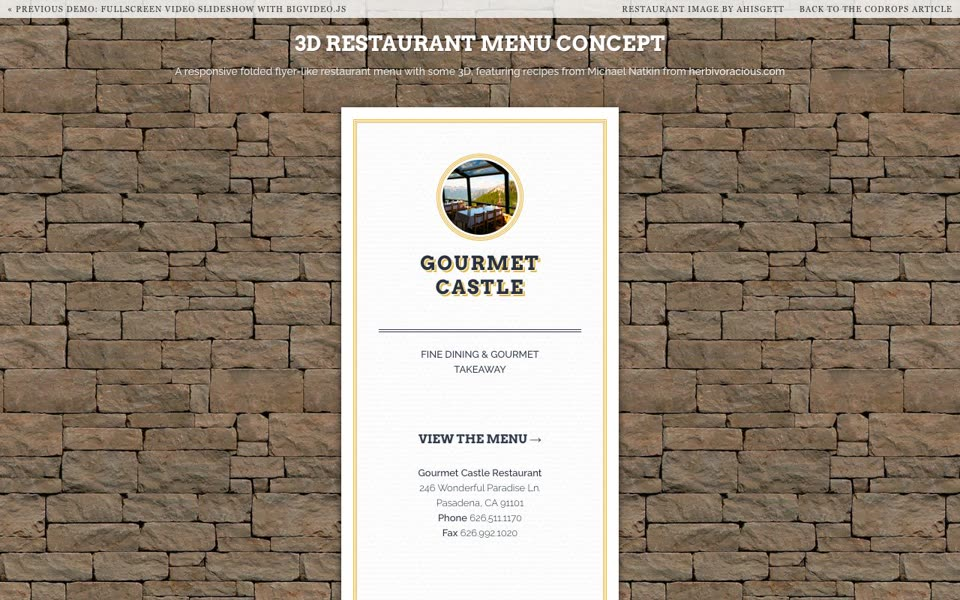</a> | [3DRestaurantMenu](https://github.com/codrops/3DRestaurantMenu) | 3d | not-declared-in-api | — |
| <a href="https://github.com/codrops/3DStackMotion"></a> | [3DStackMotion](https://github.com/codrops/3DStackMotion) | scroll, 3d, animation | MIT | — |
| <a href="https://github.com/codrops/AnimatedAnimals">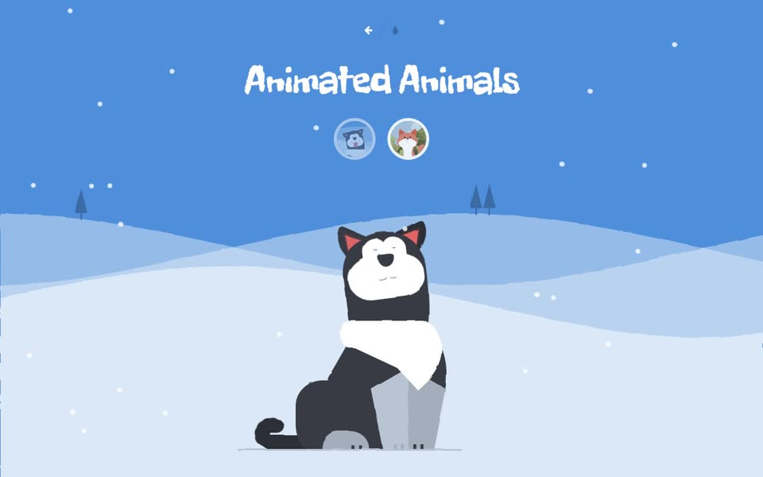</a> | [AnimatedAnimals](https://github.com/codrops/AnimatedAnimals) | animation | not-declared-in-api | [demo](http://tympanus.net/Tutorials/AnimatedAnimals/) |
| <a href="https://github.com/codrops/AnimatedBorderMenus">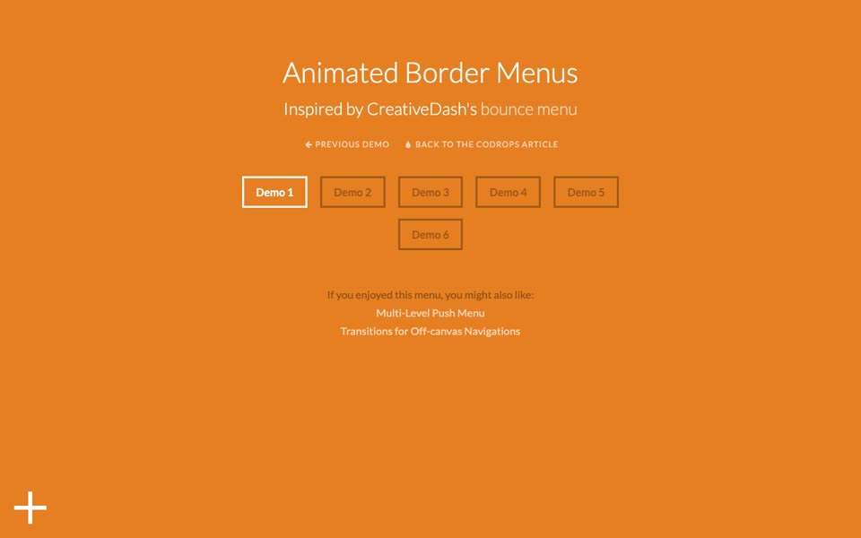</a> | [AnimatedBorderMenus](https://github.com/codrops/AnimatedBorderMenus) | animation | not-declared-in-api | — |
| <a href="https://github.com/codrops/AnimatedCodeBackground"></a> | [AnimatedCodeBackground](https://github.com/codrops/AnimatedCodeBackground) | hover, gallery, animation | MIT | — |
| <a href="https://github.com/codrops/AnimatedCustomCursor"></a> | [AnimatedCustomCursor](https://github.com/codrops/AnimatedCustomCursor) | cursor, animation | MIT | [article](https://tympanus.net/codrops/?p=48725) |
| <a href="https://github.com/codrops/AnimatedFrameSlideshow"></a> | [AnimatedFrameSlideshow](https://github.com/codrops/AnimatedFrameSlideshow) | page-transition, slideshow, animation | not-declared-in-api | [article](https://tympanus.net/codrops/?p=33037) |
| <a href="https://github.com/codrops/AnimatedGridLayout">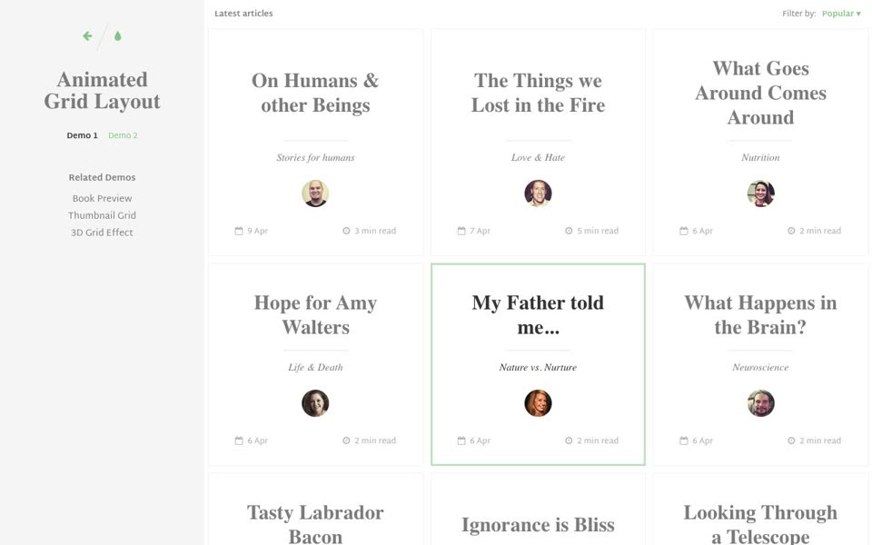</a> | [AnimatedGridLayout](https://github.com/codrops/AnimatedGridLayout) | gallery, animation | not-declared-in-api | — |
| <a href="https://github.com/codrops/AnimatedGridPreviews"></a> | [AnimatedGridPreviews](https://github.com/codrops/AnimatedGridPreviews) | gallery, animation | not-declared-in-api | [article](https://tympanus.net/codrops/?p=36291) |
| <a href="https://github.com/codrops/AnimatedHeader">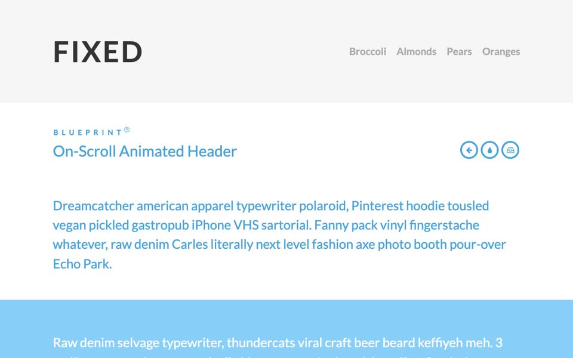</a> | [AnimatedHeader](https://github.com/codrops/AnimatedHeader) | scroll, page-transition, animation | not-declared-in-api | — |
| <a href="https://github.com/codrops/AnimatedImageColumns"></a> | [AnimatedImageColumns](https://github.com/codrops/AnimatedImageColumns) | animation | not-declared-in-api | [article](https://tympanus.net/codrops/?p=40486) |
| <a href="https://github.com/codrops/AnimatedImagePieces"></a> | [AnimatedImagePieces](https://github.com/codrops/AnimatedImagePieces) | animation | not-declared-in-api | — |
| <a href="https://github.com/codrops/AnimatedLetters">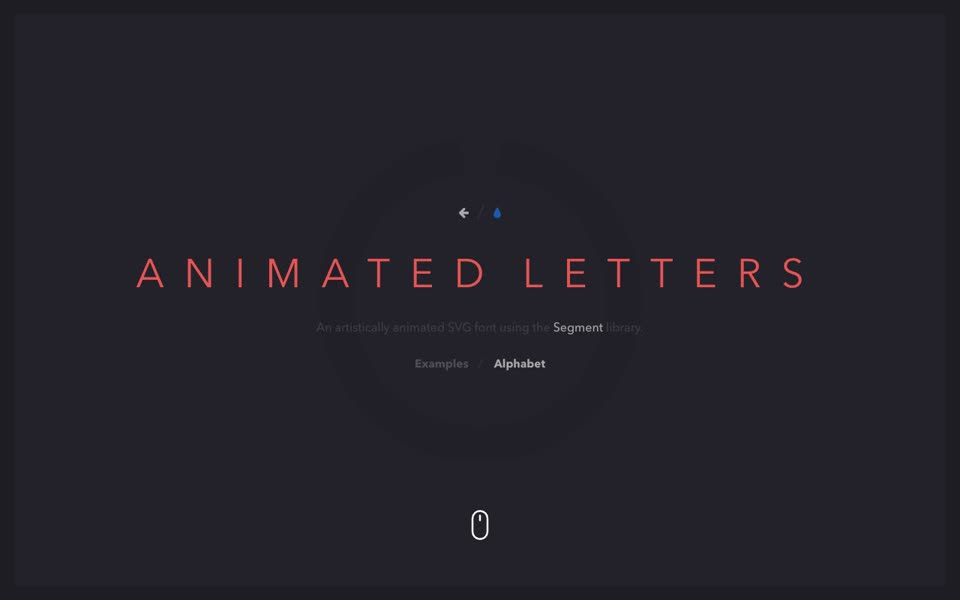</a> | [AnimatedLetters](https://github.com/codrops/AnimatedLetters) | animation | not-declared-in-api | — |
| <a href="https://github.com/codrops/AnimatedMenuIcon">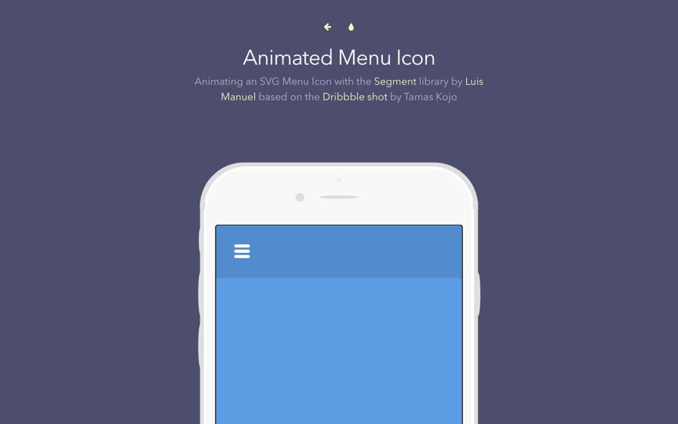</a> | [AnimatedMenuIcon](https://github.com/codrops/AnimatedMenuIcon) | animation | not-declared-in-api | [demo](http://tympanus.net/Tutorials/AnimatedMenuIcon/) |
| <a href="https://github.com/codrops/AnimatedResponsiveImageGrid">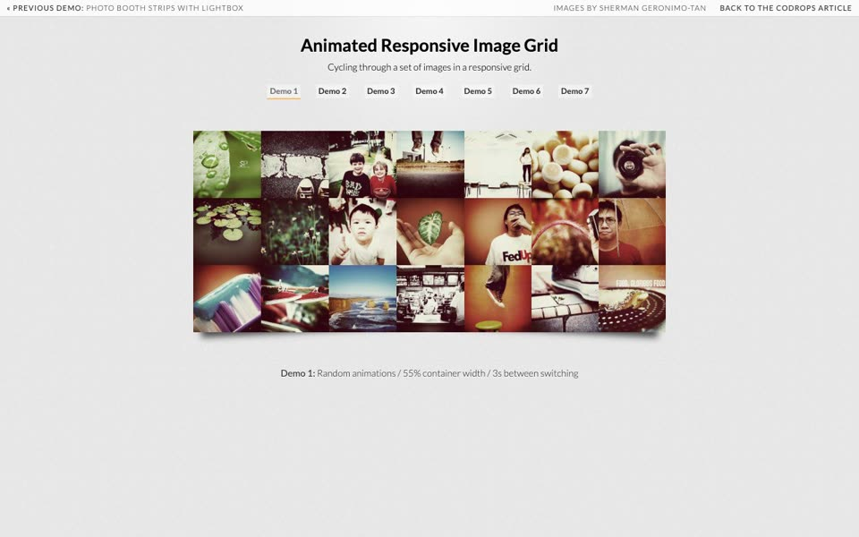</a> | [AnimatedResponsiveImageGrid](https://github.com/codrops/AnimatedResponsiveImageGrid) | page-transition, gallery, animation | not-declared-in-api | — |
| <a href="https://github.com/codrops/AnimatedSVGIcons">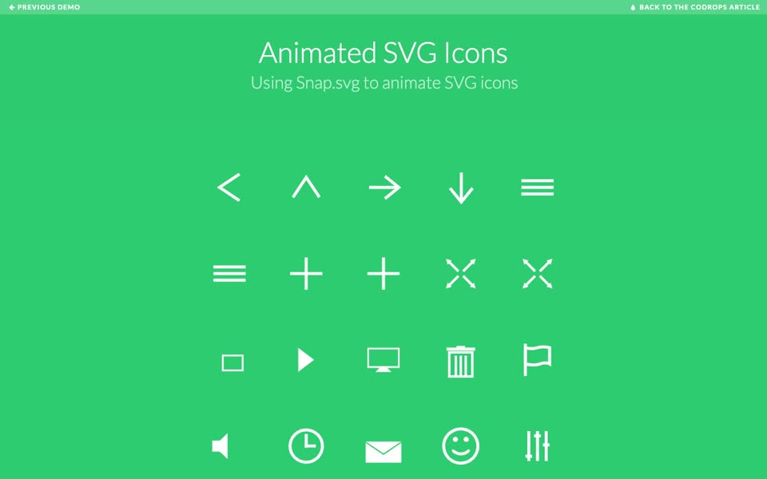</a> | [AnimatedSVGIcons](https://github.com/codrops/AnimatedSVGIcons) | animation | not-declared-in-api | — |
| <a href="https://github.com/codrops/AnimateSVGTextPath"></a> | [AnimateSVGTextPath](https://github.com/codrops/AnimateSVGTextPath) | scroll, animation | MIT | [article](https://tympanus.net/codrops/?p=47831) |
| <a href="https://github.com/codrops/Animocons">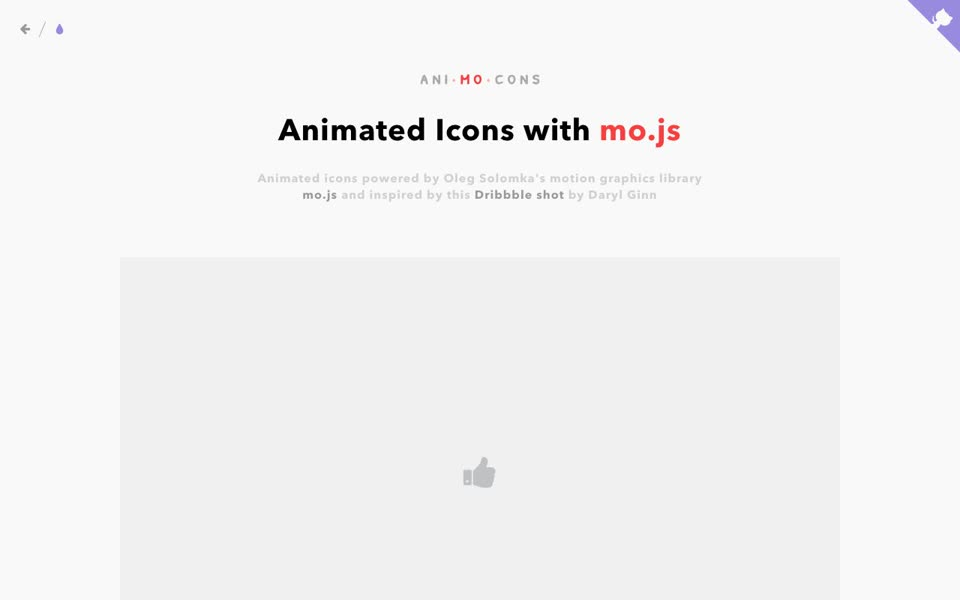</a> | [Animocons](https://github.com/codrops/Animocons) | animation | not-declared-in-api | — |
| <a href="https://github.com/codrops/ArrowNavigationStyles">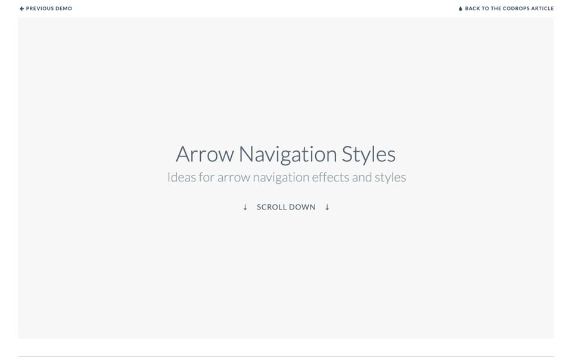</a> | [ArrowNavigationStyles](https://github.com/codrops/ArrowNavigationStyles) | page-transition, hover, animation | not-declared-in-api | — |
| <a href="https://github.com/codrops/astro-shop-view-transitions"></a> | [astro-shop-view-transitions](https://github.com/codrops/astro-shop-view-transitions) | page-transition | MIT | [article](https://tympanus.net/codrops/?p=73418) |
| <a href="https://github.com/codrops/BackgroundScaleHoverEffect"></a> | [BackgroundScaleHoverEffect](https://github.com/codrops/BackgroundScaleHoverEffect) | hover, animation | MIT | [article](https://tympanus.net/codrops/?p=48414) |
| <a href="https://github.com/codrops/BackgroundShift"></a> | [BackgroundShift](https://github.com/codrops/BackgroundShift) | animation | MIT | — |
| <a href="https://github.com/codrops/BlockRevealers">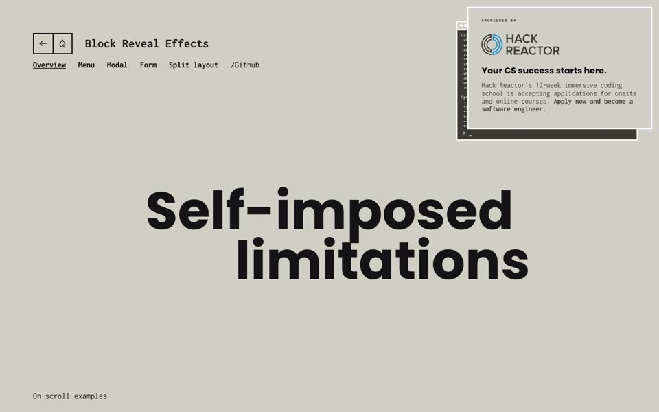</a> | [BlockRevealers](https://github.com/codrops/BlockRevealers) | animation | not-declared-in-api | [article](https://tympanus.net/codrops/?p=29372) |
| <a href="https://github.com/codrops/Blueprint-BackgroundSlideshow">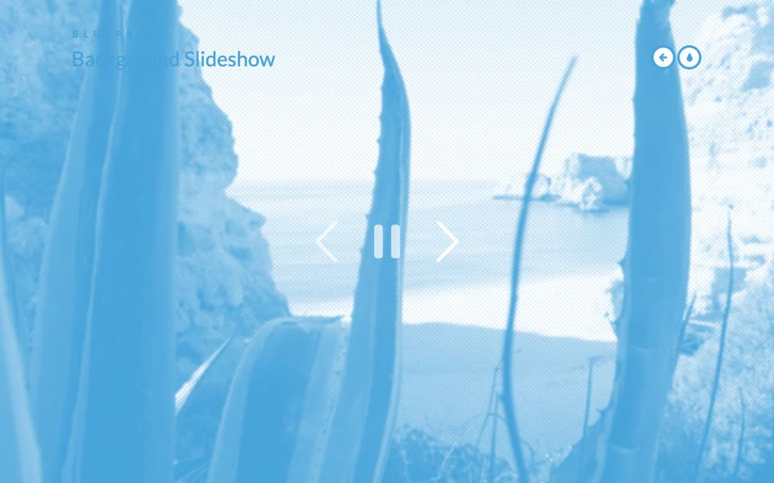</a> | [Blueprint-BackgroundSlideshow](https://github.com/codrops/Blueprint-BackgroundSlideshow) | slideshow | not-declared-in-api | — |
| <a href="https://github.com/codrops/Blueprint-ElasticContentSlider">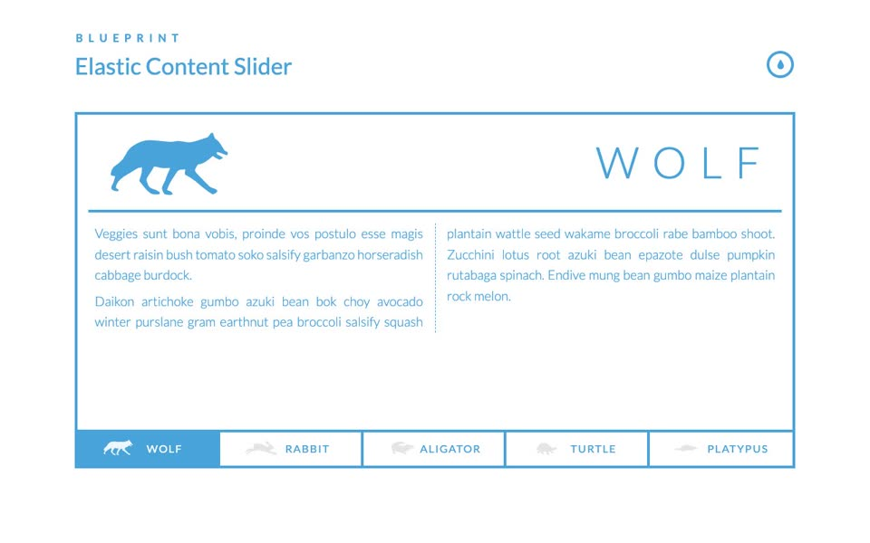</a> | [Blueprint-ElasticContentSlider](https://github.com/codrops/Blueprint-ElasticContentSlider) | slideshow | not-declared-in-api | — |
| <a href="https://github.com/codrops/Blueprint-FixedBackgroundScrollingLayout">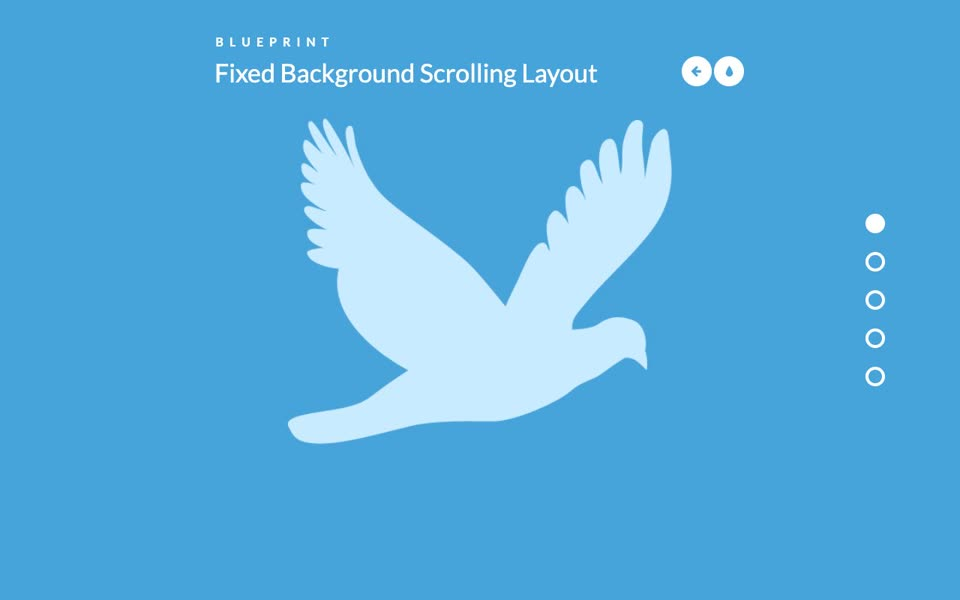</a> | [Blueprint-FixedBackgroundScrollingLayout](https://github.com/codrops/Blueprint-FixedBackgroundScrollingLayout) | scroll | not-declared-in-api | — |
| <a href="https://github.com/codrops/Blueprint-FullWidthImageSlider">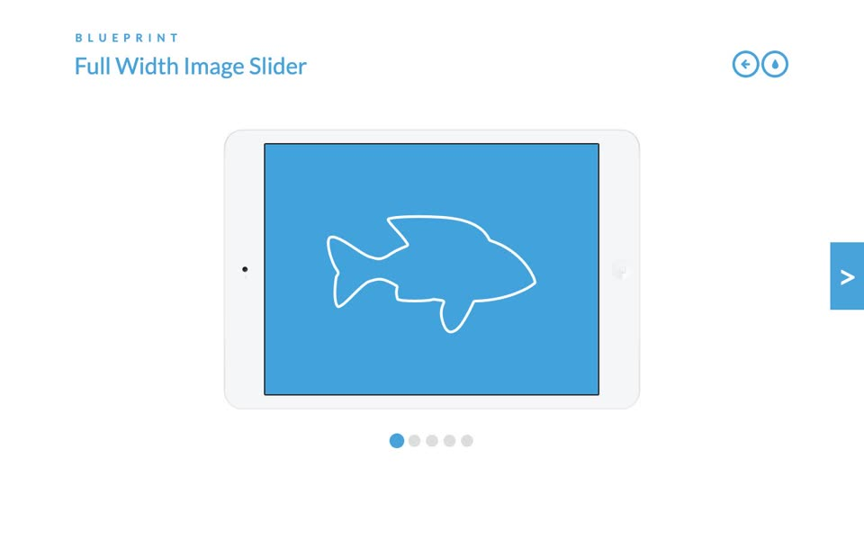</a> | [Blueprint-FullWidthImageSlider](https://github.com/codrops/Blueprint-FullWidthImageSlider) | slideshow | not-declared-in-api | — |
| <a href="https://github.com/codrops/Blueprint-ResponsiveFullWidthGrid">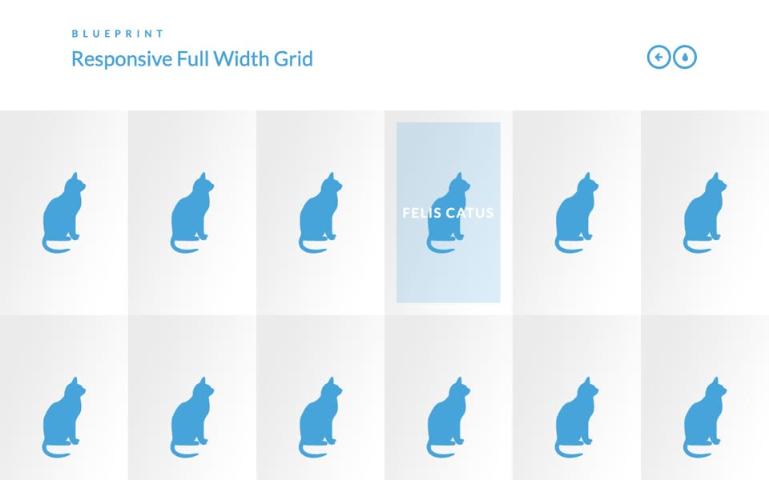</a> | [Blueprint-ResponsiveFullWidthGrid](https://github.com/codrops/Blueprint-ResponsiveFullWidthGrid) | gallery | not-declared-in-api | — |
| <a href="https://github.com/codrops/BookPreview">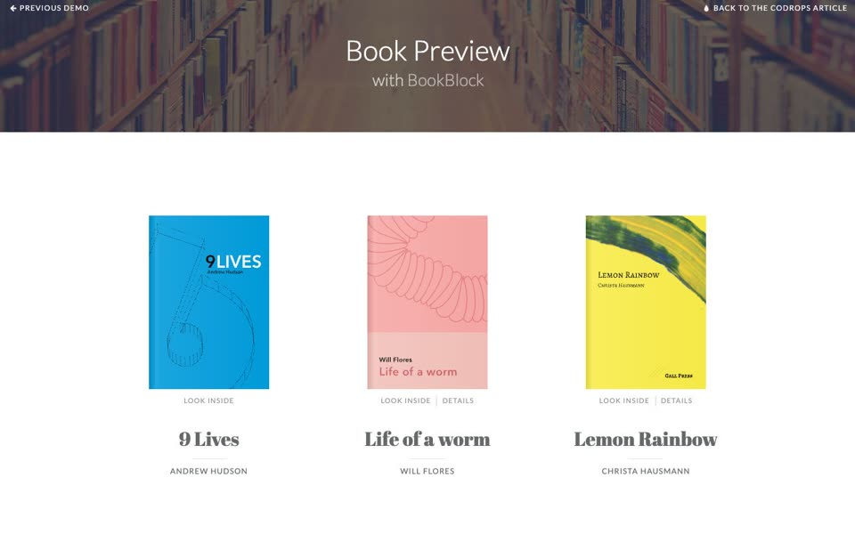</a> | [BookPreview](https://github.com/codrops/BookPreview) | 3d, gallery | not-declared-in-api | — |
| <a href="https://github.com/codrops/ButtonComponentMorph">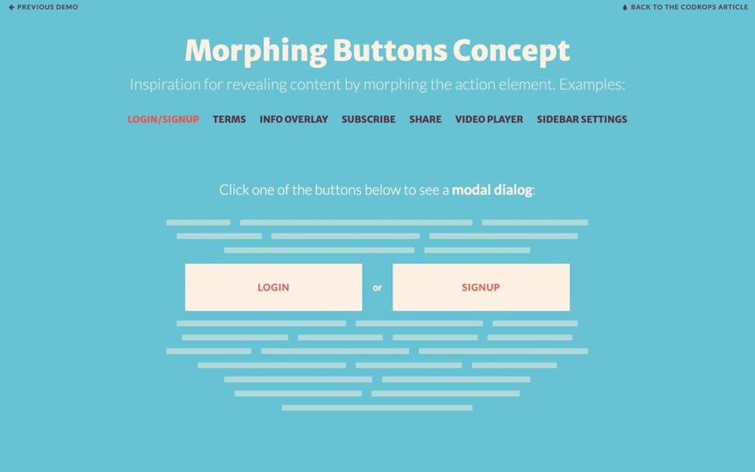</a> | [ButtonComponentMorph](https://github.com/codrops/ButtonComponentMorph) | animation | not-declared-in-api | — |
| <a href="https://github.com/codrops/ButtonHoverStyles"></a> | [ButtonHoverStyles](https://github.com/codrops/ButtonHoverStyles) | hover, animation | MIT | — |
| <a href="https://github.com/codrops/ButtonStylesInspiration">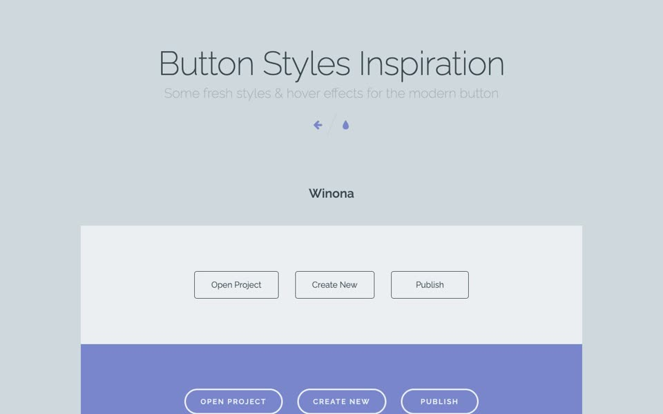</a> | [ButtonStylesInspiration](https://github.com/codrops/ButtonStylesInspiration) | animation | not-declared-in-api | — |
| <a href="https://github.com/codrops/CaptionHoverEffects">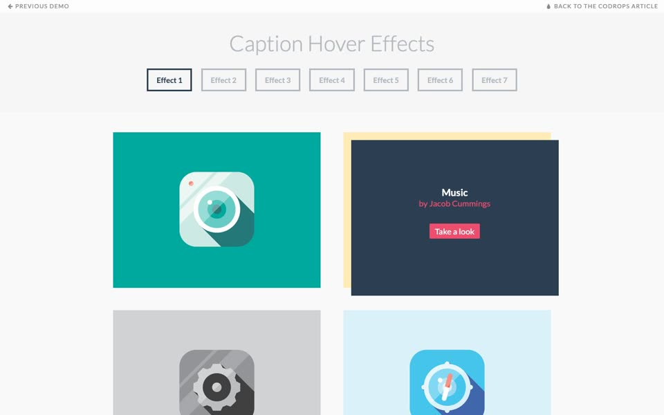</a> | [CaptionHoverEffects](https://github.com/codrops/CaptionHoverEffects) | hover, animation | not-declared-in-api | — |
| <a href="https://github.com/codrops/CardStackEffects">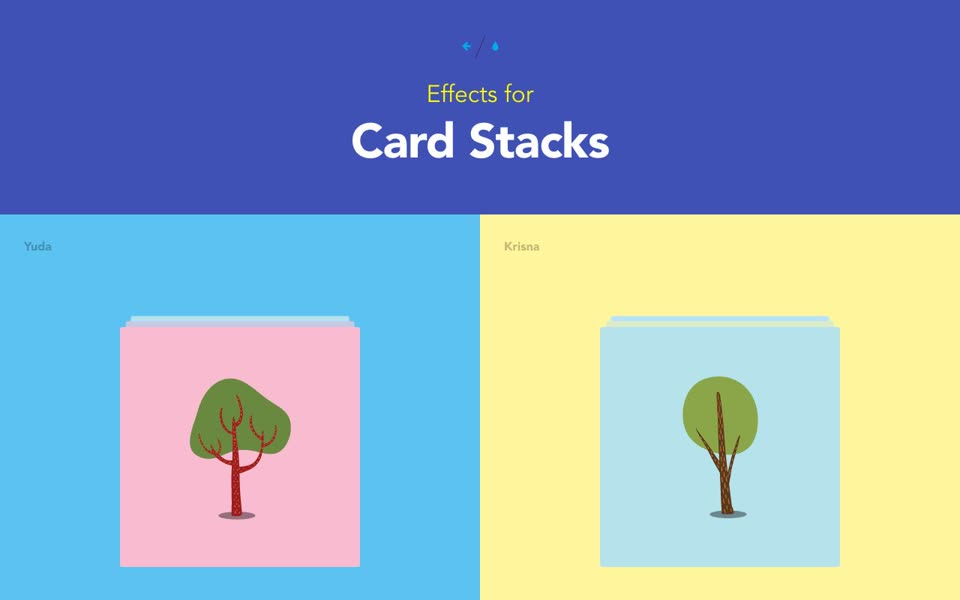</a> | [CardStackEffects](https://github.com/codrops/CardStackEffects) | animation | not-declared-in-api | — |
| <a href="https://github.com/codrops/CinemaSeatPreview">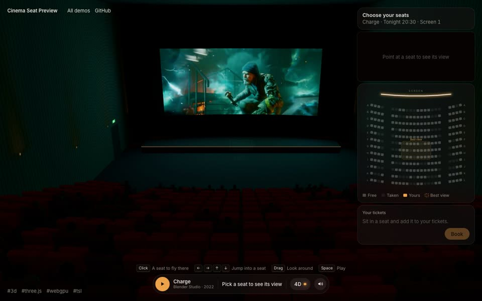</a> | [CinemaSeatPreview](https://github.com/codrops/CinemaSeatPreview) | three.js, 3d, animation | MIT | [demo](https://tympanus.net/Demos/CinemaSeatPreview/) |
| <a href="https://github.com/codrops/CircularTextEffect"></a> | [CircularTextEffect](https://github.com/codrops/CircularTextEffect) | animation | MIT | — |
| <a href="https://github.com/codrops/ClickEffects">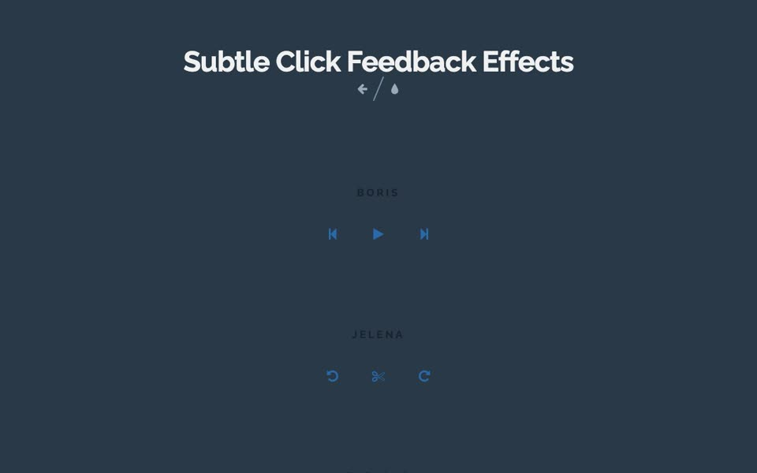</a> | [ClickEffects](https://github.com/codrops/ClickEffects) | animation | not-declared-in-api | — |
| <a href="https://github.com/codrops/ClipHoverEffect"></a> | [ClipHoverEffect](https://github.com/codrops/ClipHoverEffect) | hover, animation | MIT | — |
| <a href="https://github.com/codrops/CollapsingLogo"></a> | [CollapsingLogo](https://github.com/codrops/CollapsingLogo) | animation | not-declared-in-api | [article](https://tympanus.net/codrops/?p=35022) |
| <a href="https://github.com/codrops/ColumnScroll"></a> | [ColumnScroll](https://github.com/codrops/ColumnScroll) | scroll, gallery | MIT | — |
| <a href="https://github.com/codrops/ConnectedGrid"></a> | [ConnectedGrid](https://github.com/codrops/ConnectedGrid) | scroll, gallery, animation | MIT | — |
| <a href="https://github.com/codrops/ContentLayoutTransition"></a> | [ContentLayoutTransition](https://github.com/codrops/ContentLayoutTransition) | page-transition, gallery | MIT | [article](https://tympanus.net/codrops/?p=63558) |
| <a href="https://github.com/codrops/ContextAwareLogoAnimationScroll"></a> | [ContextAwareLogoAnimationScroll](https://github.com/codrops/ContextAwareLogoAnimationScroll) | scroll, animation | MIT | — |
| <a href="https://github.com/codrops/CoverPageTransition"></a> | [CoverPageTransition](https://github.com/codrops/CoverPageTransition) | page-transition | MIT | — |
| <a href="https://github.com/codrops/CreativeButtons">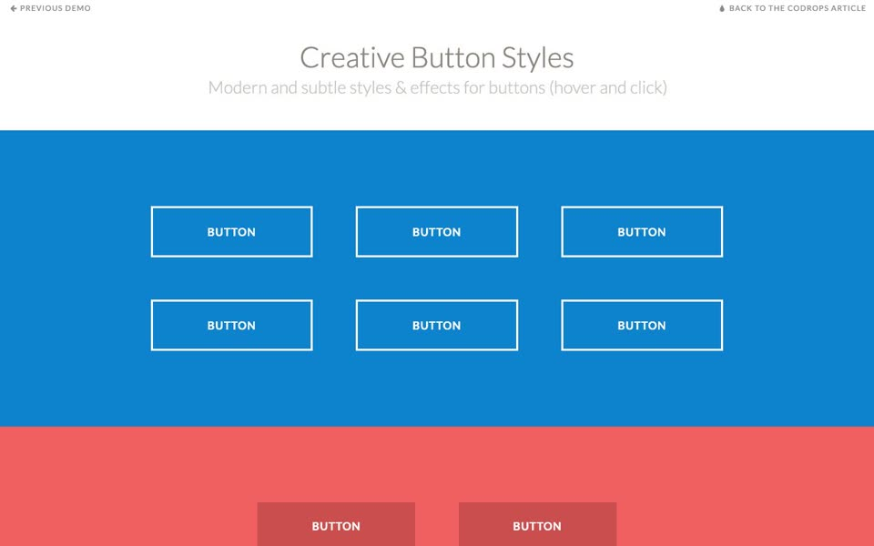</a> | [CreativeButtons](https://github.com/codrops/CreativeButtons) | animation | not-declared-in-api | — |
| <a href="https://github.com/codrops/CreativeGooeyEffects">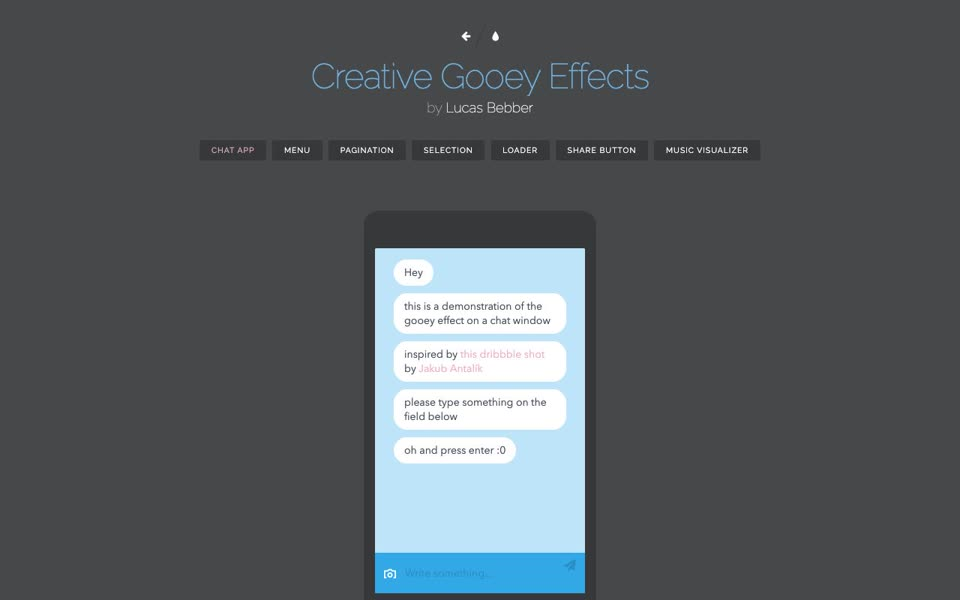</a> | [CreativeGooeyEffects](https://github.com/codrops/CreativeGooeyEffects) | animation | not-declared-in-api | [article](http://tympanus.net/codrops/?p=23487) |
| <a href="https://github.com/codrops/CreativeLinkEffects">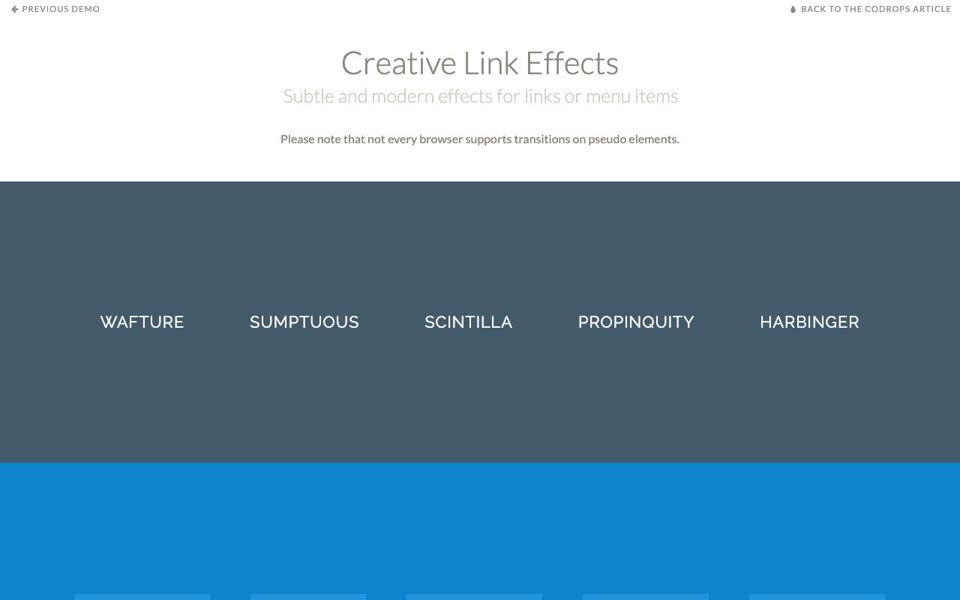</a> | [CreativeLinkEffects](https://github.com/codrops/CreativeLinkEffects) | page-transition, animation | not-declared-in-api | — |
| <a href="https://github.com/codrops/CrosshairDistortion"></a> | [CrosshairDistortion](https://github.com/codrops/CrosshairDistortion) | hover, distortion, cursor, animation | MIT | — |
| <a href="https://github.com/codrops/CrossroadsSlideshow"></a> | [CrossroadsSlideshow](https://github.com/codrops/CrossroadsSlideshow) | slideshow | not-declared-in-api | [article](https://tympanus.net/codrops/?p=39863) |
| <a href="https://github.com/codrops/CSSGlitchEffect"></a> | [CSSGlitchEffect](https://github.com/codrops/CSSGlitchEffect) | animation | not-declared-in-api | [article](https://tympanus.net/codrops/?p=33498) |
| <a href="https://github.com/codrops/CSSMarqueeMenu"></a> | [CSSMarqueeMenu](https://github.com/codrops/CSSMarqueeMenu) | animation | MIT | [article](https://tympanus.net/codrops/?p=48796) |
| <a href="https://github.com/codrops/CubesAdventCalendar"></a> | [CubesAdventCalendar](https://github.com/codrops/CubesAdventCalendar) | hover, 3d, animation | not-declared-in-api | [article](http://tympanus.net/codrops/2016/11/09/cubes-advent-calendar/) |
| <a href="https://github.com/codrops/DecorativeLetterAnimations"></a> | [DecorativeLetterAnimations](https://github.com/codrops/DecorativeLetterAnimations) | animation | not-declared-in-api | [article](https://tympanus.net/codrops/?p=33640) |
| <a href="https://github.com/codrops/DeveloperDesignerPageLayout"></a> | [DeveloperDesignerPageLayout](https://github.com/codrops/DeveloperDesignerPageLayout) | animation | not-declared-in-api | — |
| <a href="https://github.com/codrops/DiagonalSlideshow"></a> | [DiagonalSlideshow](https://github.com/codrops/DiagonalSlideshow) | slideshow | not-declared-in-api | [article](https://tympanus.net/codrops/?p=35765) |
| <a href="https://github.com/codrops/DiagonalThumbnails"></a> | [DiagonalThumbnails](https://github.com/codrops/DiagonalThumbnails) | slideshow | MIT | [article](https://tympanus.net/codrops/?p=50811) |
| <a href="https://github.com/codrops/DialogEffects">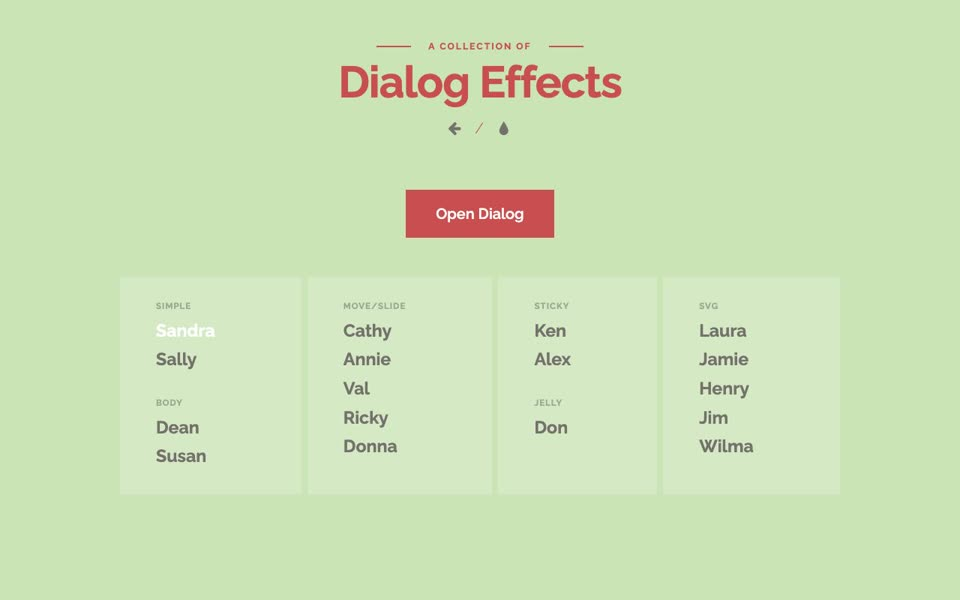</a> | [DialogEffects](https://github.com/codrops/DialogEffects) | animation | not-declared-in-api | — |
| <a href="https://github.com/codrops/DirectionAwareHoverEffect">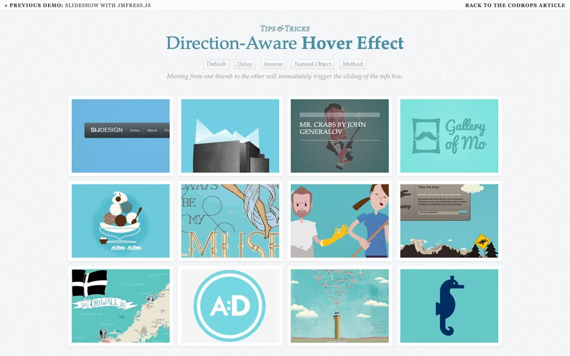</a> | [DirectionAwareHoverEffect](https://github.com/codrops/DirectionAwareHoverEffect) | hover, cursor, animation | not-declared-in-api | — |
| <a href="https://github.com/codrops/DistortedButtonEffects">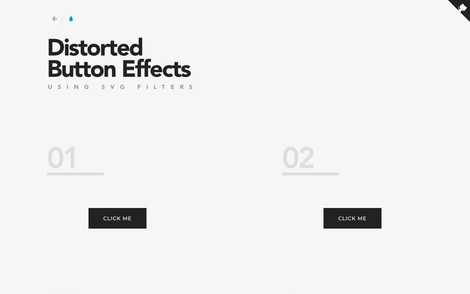</a> | [DistortedButtonEffects](https://github.com/codrops/DistortedButtonEffects) | distortion, animation | not-declared-in-api | [demo](http://tympanus.net/Development/DistortedButtonEffects/) |
| <a href="https://github.com/codrops/DistortedLinkEffects"></a> | [DistortedLinkEffects](https://github.com/codrops/DistortedLinkEffects) | hover, distortion, animation | MIT | [article](https://tympanus.net/codrops/?p=48230) |
| <a href="https://github.com/codrops/DistortedMenuLinkEffects"></a> | [DistortedMenuLinkEffects](https://github.com/codrops/DistortedMenuLinkEffects) | distortion, animation | MIT | [article](https://tympanus.net/codrops/2020/03/18/ideas-for-distorted-link-effects-on-menus/) |
| <a href="https://github.com/codrops/DotNavigationStyles">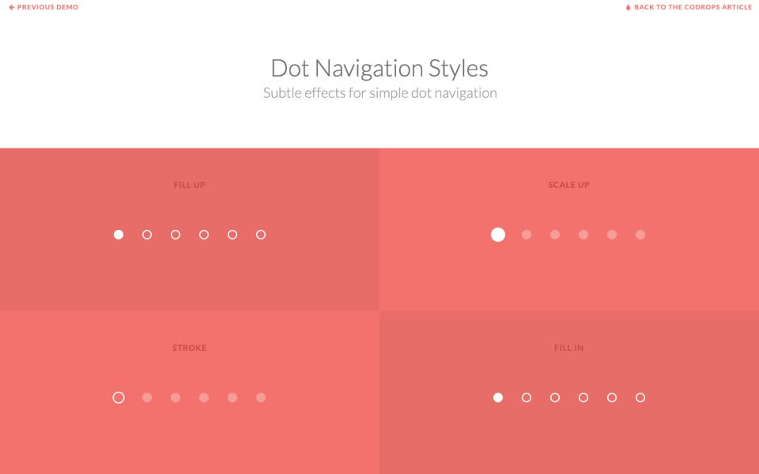</a> | [DotNavigationStyles](https://github.com/codrops/DotNavigationStyles) | animation | not-declared-in-api | — |
| <a href="https://github.com/codrops/DoubleImageHoverEffects"></a> | [DoubleImageHoverEffects](https://github.com/codrops/DoubleImageHoverEffects) | hover, animation | MIT | — |
| <a href="https://github.com/codrops/DoubleSlideshow"></a> | [DoubleSlideshow](https://github.com/codrops/DoubleSlideshow) | slideshow | MIT | — |
| <a href="https://github.com/codrops/DraggableDualViewSlideshow">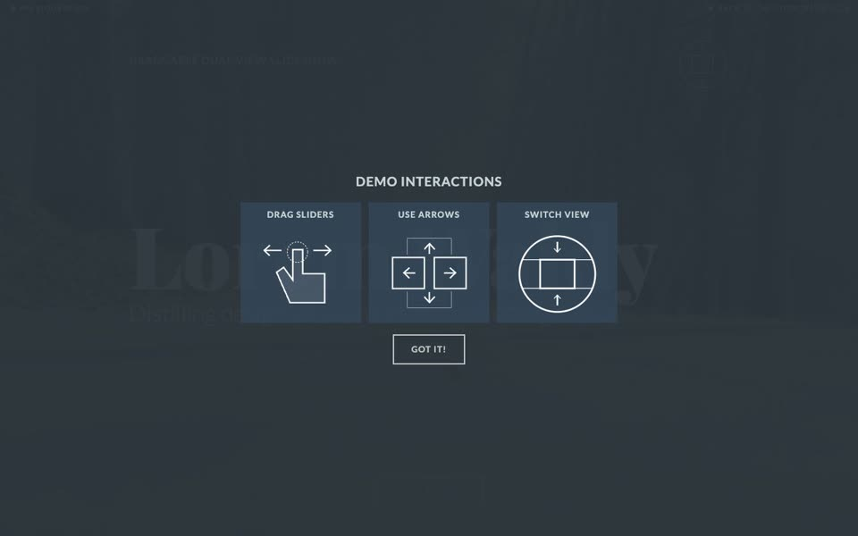</a> | [DraggableDualViewSlideshow](https://github.com/codrops/DraggableDualViewSlideshow) | slideshow | not-declared-in-api | — |
| <a href="https://github.com/codrops/DraggableMenu"></a> | [DraggableMenu](https://github.com/codrops/DraggableMenu) | gallery | not-declared-in-api | [article](https://tympanus.net/codrops/?p=40926) |
| <a href="https://github.com/codrops/DynamicGrid">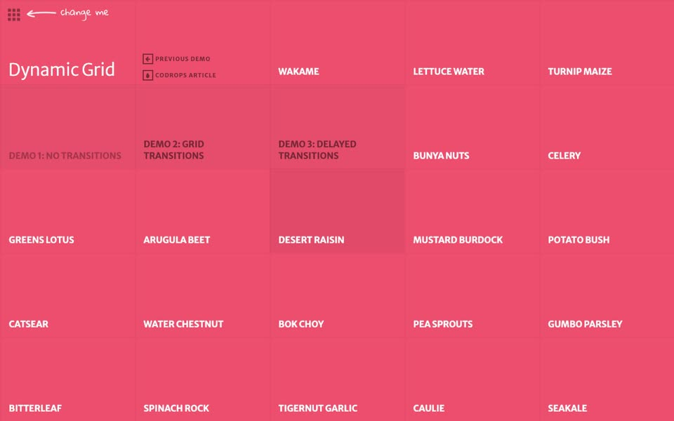</a> | [DynamicGrid](https://github.com/codrops/DynamicGrid) | page-transition, gallery | not-declared-in-api | — |
| <a href="https://github.com/codrops/ElasticCircleSlideshow">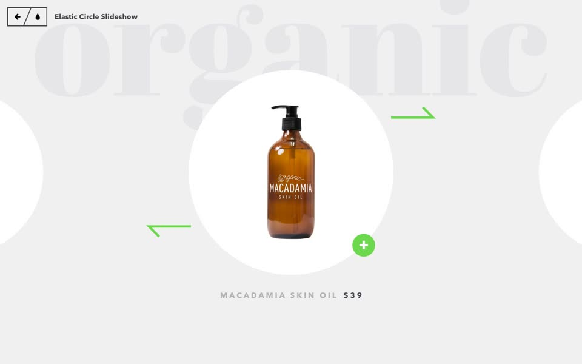</a> | [ElasticCircleSlideshow](https://github.com/codrops/ElasticCircleSlideshow) | slideshow, animation | not-declared-in-api | — |
| <a href="https://github.com/codrops/ElasticGridScroll"></a> | [ElasticGridScroll](https://github.com/codrops/ElasticGridScroll) | scroll, gallery, animation | MIT | — |
| <a href="https://github.com/codrops/ElasticProgress"></a> | [ElasticProgress](https://github.com/codrops/ElasticProgress) | animation | not-declared-in-api | [article](http://tympanus.net/codrops/2015/09/23/elastic-progress/) |
| <a href="https://github.com/codrops/ElasticSVGElements">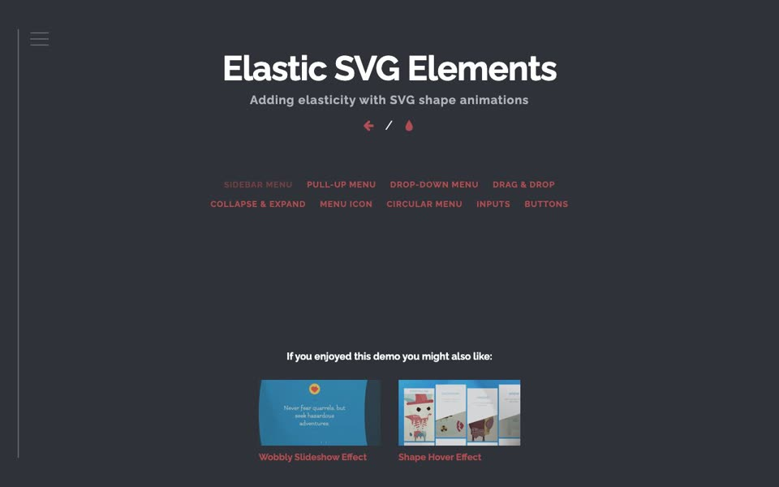</a> | [ElasticSVGElements](https://github.com/codrops/ElasticSVGElements) | animation | not-declared-in-api | — |
| <a href="https://github.com/codrops/Exhibition">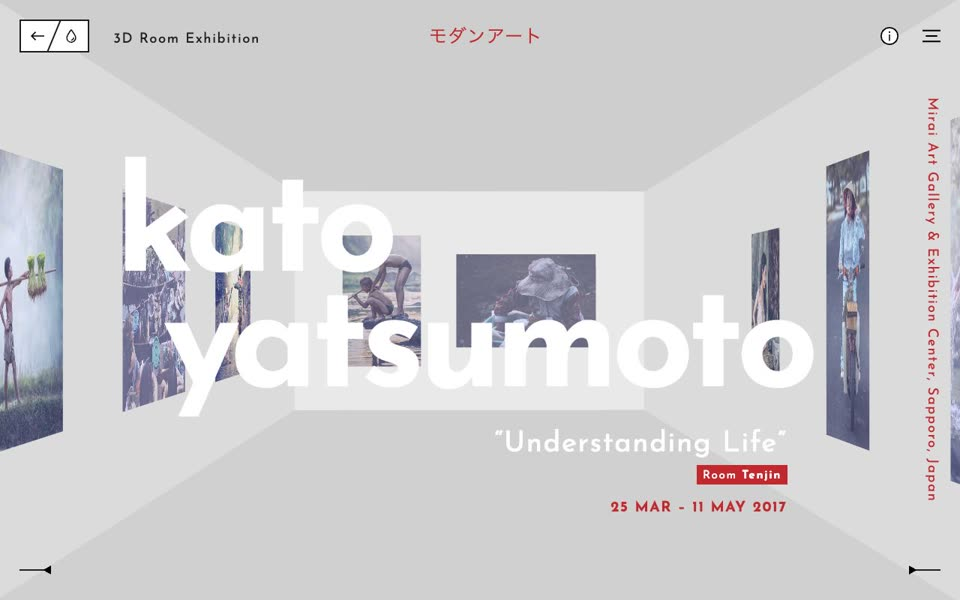</a> | [Exhibition](https://github.com/codrops/Exhibition) | 3d, gallery | not-declared-in-api | — |
| <a href="https://github.com/codrops/ExpandingGridItemAnimation"></a> | [ExpandingGridItemAnimation](https://github.com/codrops/ExpandingGridItemAnimation) | gallery, animation | not-declared-in-api | [article](https://tympanus.net/codrops/?p=32944) |
| <a href="https://github.com/codrops/ExpandingRoundedMenu"></a> | [ExpandingRoundedMenu](https://github.com/codrops/ExpandingRoundedMenu) | animation | MIT | — |
| <a href="https://github.com/codrops/FancyLetterAnimation"></a> | [FancyLetterAnimation](https://github.com/codrops/FancyLetterAnimation) | animation | not-declared-in-api | — |
| <a href="https://github.com/codrops/FilterableProductGrid">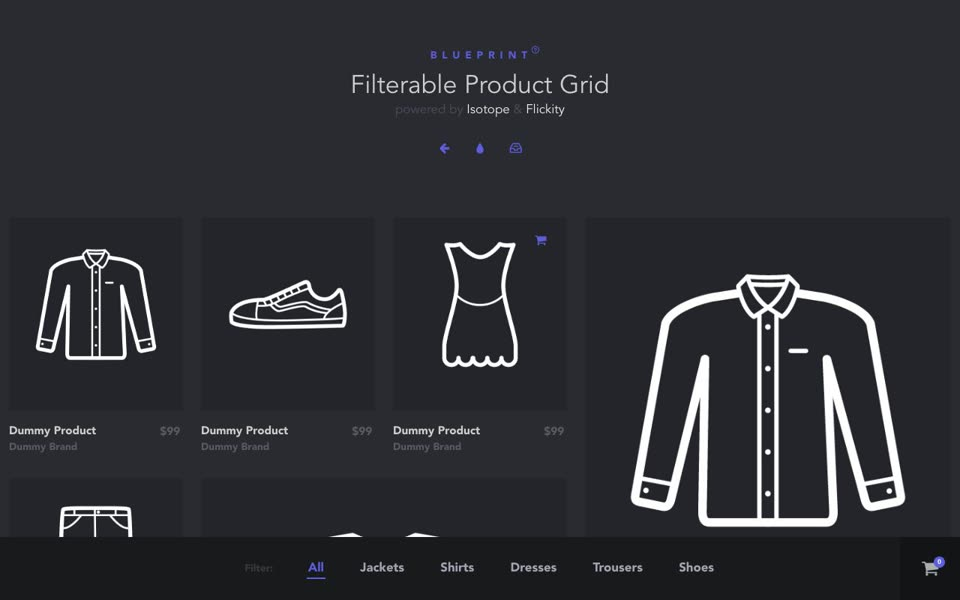</a> | [FilterableProductGrid](https://github.com/codrops/FilterableProductGrid) | gallery | not-declared-in-api | — |
| <a href="https://github.com/codrops/FolderPreviewIdeas"></a> | [FolderPreviewIdeas](https://github.com/codrops/FolderPreviewIdeas) | hover | not-declared-in-api | [demo](https://tympanus.net/Development/FolderPreviewIdeas/) |
| <a href="https://github.com/codrops/FourBoxes">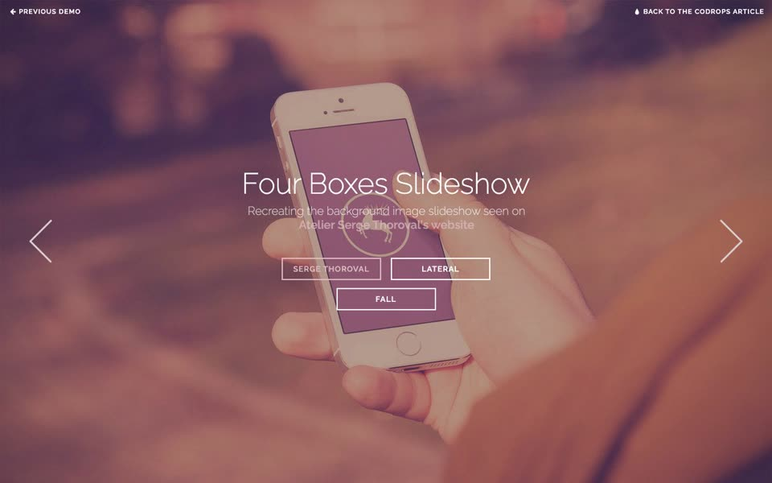</a> | [FourBoxes](https://github.com/codrops/FourBoxes) | slideshow | not-declared-in-api | — |
| <a href="https://github.com/codrops/FullImageReveal"></a> | [FullImageReveal](https://github.com/codrops/FullImageReveal) | animation | not-declared-in-api | [article](https://tympanus.net/codrops/?p=35087) |
| <a href="https://github.com/codrops/FullscreenClipEffect"></a> | [FullscreenClipEffect](https://github.com/codrops/FullscreenClipEffect) | gallery, animation | MIT | — |
| <a href="https://github.com/codrops/FullscreenForm">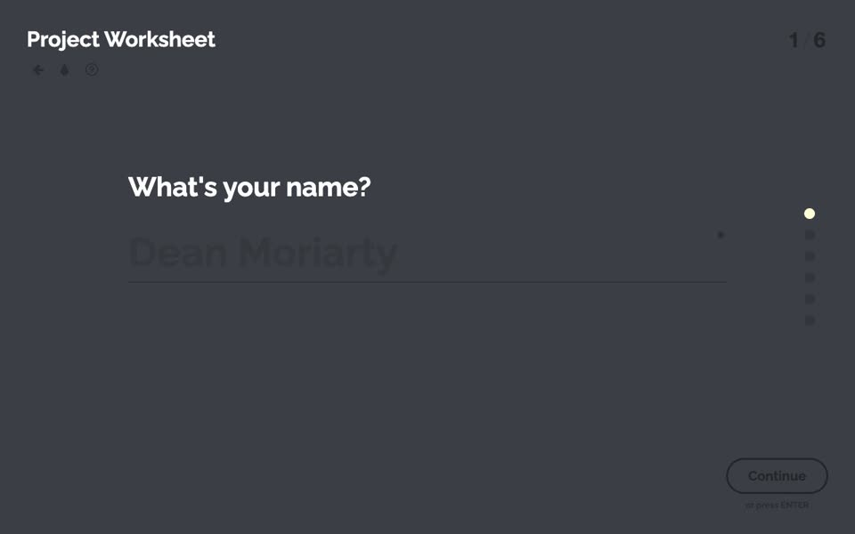</a> | [FullscreenForm](https://github.com/codrops/FullscreenForm) | animation | not-declared-in-api | — |
| <a href="https://github.com/codrops/FullscreenHoverLoop"></a> | [FullscreenHoverLoop](https://github.com/codrops/FullscreenHoverLoop) | hover, gallery, animation | not-declared-in-api | [article](https://tympanus.net/codrops/?p=36172) |
| <a href="https://github.com/codrops/FullscreenLayoutPageTransitions">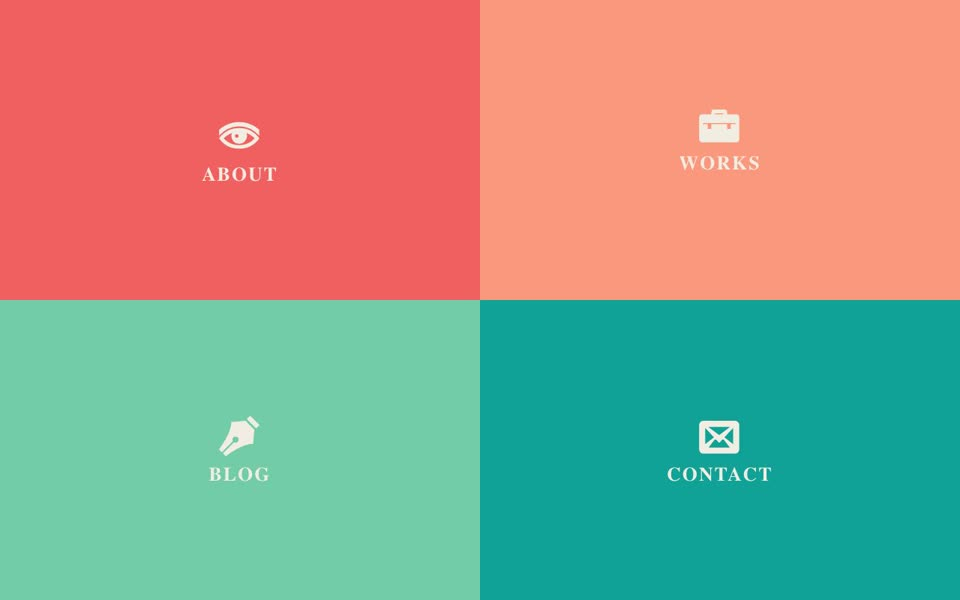</a> | [FullscreenLayoutPageTransitions](https://github.com/codrops/FullscreenLayoutPageTransitions) | page-transition, gallery | not-declared-in-api | — |
| <a href="https://github.com/codrops/FullscreenOverlayStyles">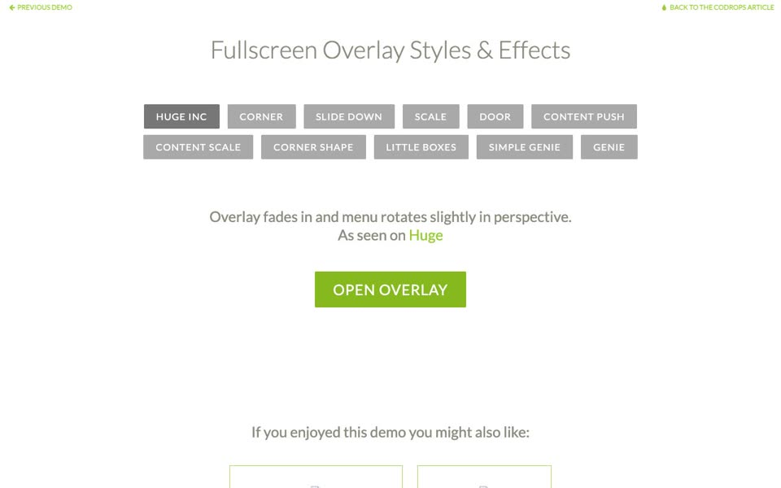</a> | [FullscreenOverlayStyles](https://github.com/codrops/FullscreenOverlayStyles) | animation | not-declared-in-api | — |
| <a href="https://github.com/codrops/FullscreenScroll"></a> | [FullscreenScroll](https://github.com/codrops/FullscreenScroll) | scroll, slideshow | MIT | — |
| <a href="https://github.com/codrops/GammaGallery">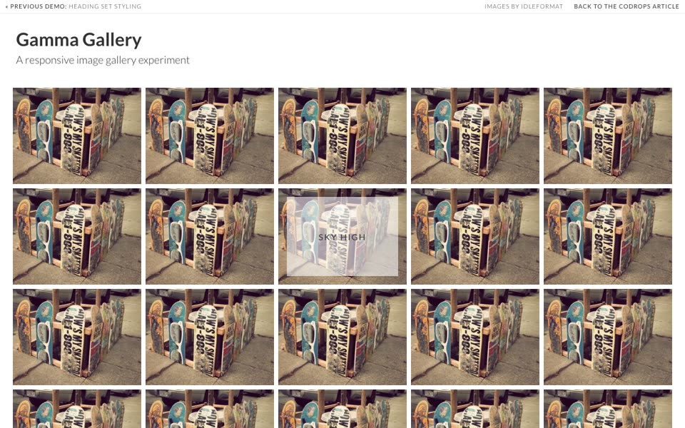</a> | [GammaGallery](https://github.com/codrops/GammaGallery) | gallery, slideshow | not-declared-in-api | — |
| <a href="https://github.com/codrops/GlitchPerspective"></a> | [GlitchPerspective](https://github.com/codrops/GlitchPerspective) | hover, animation | MIT | — |
| <a href="https://github.com/codrops/GlitchSlideshow"></a> | [GlitchSlideshow](https://github.com/codrops/GlitchSlideshow) | page-transition, slideshow, animation | not-declared-in-api | [article](https://tympanus.net/codrops/?p=34273) |
| <a href="https://github.com/codrops/GlitchyGrid"></a> | [GlitchyGrid](https://github.com/codrops/GlitchyGrid) | gallery, slideshow, animation | MIT | [article](https://tympanus.net/codrops/?p=50258) |
| <a href="https://github.com/codrops/GooeyCursor"></a> | [GooeyCursor](https://github.com/codrops/GooeyCursor) | cursor, animation | MIT | — |
| <a href="https://github.com/codrops/GooeyTextHoverEffect"></a> | [GooeyTextHoverEffect](https://github.com/codrops/GooeyTextHoverEffect) | hover, animation | MIT | [article](https://tympanus.net/codrops/?p=49166) |
| <a href="https://github.com/codrops/GradientTopographyAnimation"></a> | [GradientTopographyAnimation](https://github.com/codrops/GradientTopographyAnimation) | animation | not-declared-in-api | [article](https://tympanus.net/codrops/?p=33779) |
| <a href="https://github.com/codrops/GridFlowEffect"></a> | [GridFlowEffect](https://github.com/codrops/GridFlowEffect) | gallery, animation | MIT | — |
| <a href="https://github.com/codrops/GridGallery">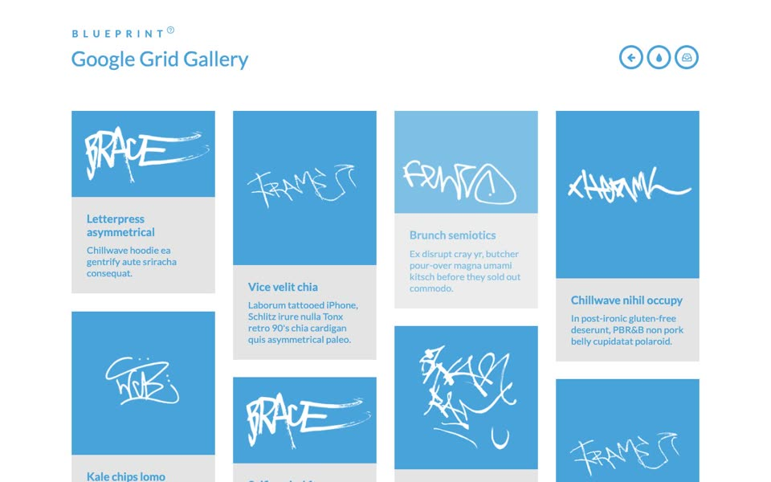</a> | [GridGallery](https://github.com/codrops/GridGallery) | 3d, gallery | not-declared-in-api | — |
| <a href="https://github.com/codrops/GridItemHoverEffect"></a> | [GridItemHoverEffect](https://github.com/codrops/GridItemHoverEffect) | hover, gallery, animation | MIT | — |
| <a href="https://github.com/codrops/GridLayoutAnimation"></a> | [GridLayoutAnimation](https://github.com/codrops/GridLayoutAnimation) | page-transition, gallery, animation | MIT | [article](https://tympanus.net/codrops/?p=64172) |
| <a href="https://github.com/codrops/GridLayoutMotion"></a> | [GridLayoutMotion](https://github.com/codrops/GridLayoutMotion) | hover, gallery, animation | not-declared-in-api | [article](https://tympanus.net/codrops/?p=34922) |
| <a href="https://github.com/codrops/GridLayoutScrollableContent"></a> | [GridLayoutScrollableContent](https://github.com/codrops/GridLayoutScrollableContent) | scroll, hover, gallery, animation | not-declared-in-api | [article](https://tympanus.net/codrops/?p=35959) |
| <a href="https://github.com/codrops/GridLayoutSlideshow"></a> | [GridLayoutSlideshow](https://github.com/codrops/GridLayoutSlideshow) | gallery, slideshow, animation | not-declared-in-api | [article](https://tympanus.net/codrops/?p=31774) |
| <a href="https://github.com/codrops/GridLoadingAnimations">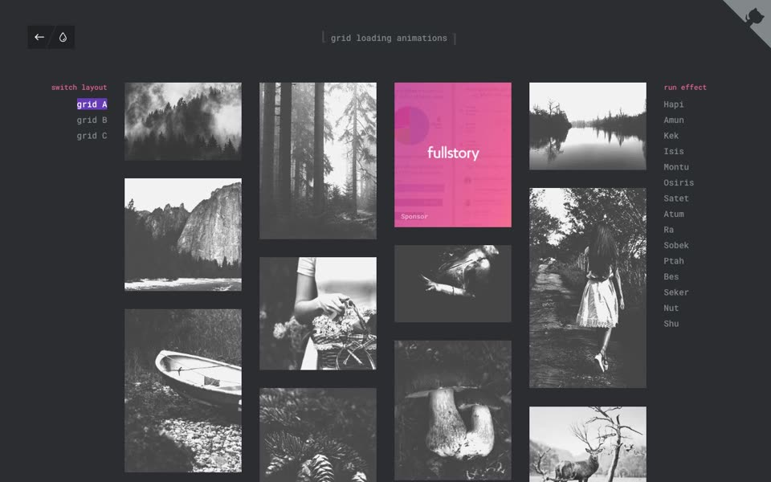</a> | [GridLoadingAnimations](https://github.com/codrops/GridLoadingAnimations) | gallery, animation | not-declared-in-api | — |
| <a href="https://github.com/codrops/GridLoadingEffects">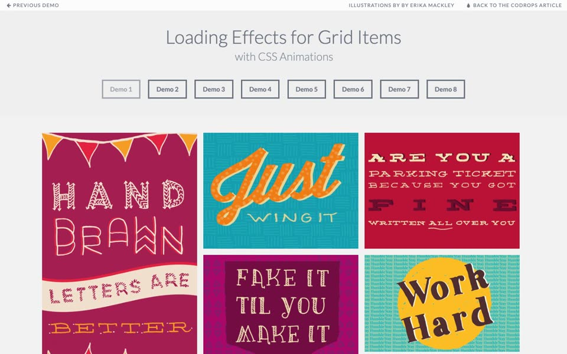</a> | [GridLoadingEffects](https://github.com/codrops/GridLoadingEffects) | gallery, animation | not-declared-in-api | — |
| <a href="https://github.com/codrops/GridMenu"></a> | [GridMenu](https://github.com/codrops/GridMenu) | gallery, animation | not-declared-in-api | [article](https://tympanus.net/codrops/?p=34419) |
| <a href="https://github.com/codrops/GridRevealEffects"></a> | [GridRevealEffects](https://github.com/codrops/GridRevealEffects) | gallery, animation | not-declared-in-api | [article](https://tympanus.net/codrops/?p=38214) |
| <a href="https://github.com/codrops/GridToSlider"></a> | [GridToSlider](https://github.com/codrops/GridToSlider) | gallery, slideshow, animation | MIT | — |
| <a href="https://github.com/codrops/GridViewSwitch"></a> | [GridViewSwitch](https://github.com/codrops/GridViewSwitch) | gallery, slideshow, animation | MIT | — |
| <a href="https://github.com/codrops/GridZoom"></a> | [GridZoom](https://github.com/codrops/GridZoom) | gallery | MIT | — |
| <a href="https://github.com/codrops/HorizontalSlideOutMenu">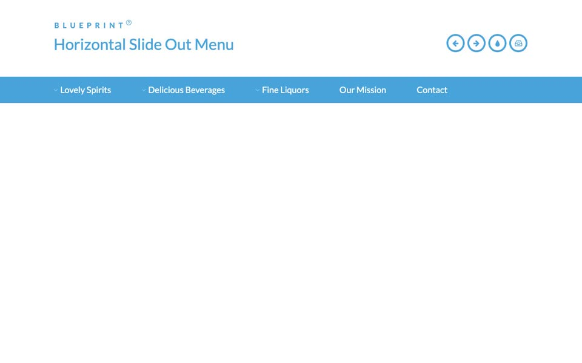</a> | [HorizontalSlideOutMenu](https://github.com/codrops/HorizontalSlideOutMenu) | gallery | not-declared-in-api | — |
| <a href="https://github.com/codrops/HorizontalSmoothScrollLayout"></a> | [HorizontalSmoothScrollLayout](https://github.com/codrops/HorizontalSmoothScrollLayout) | scroll, animation | MIT | — |
| <a href="https://github.com/codrops/HoverEffectIdeas">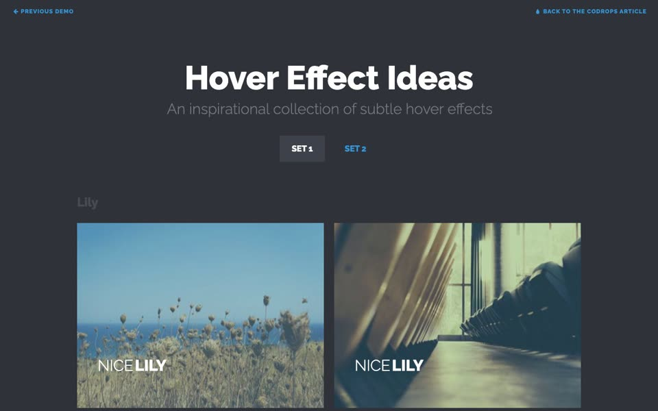</a> | [HoverEffectIdeas](https://github.com/codrops/HoverEffectIdeas) | hover, animation | not-declared-in-api | — |
| <a href="https://github.com/codrops/HoverGrid">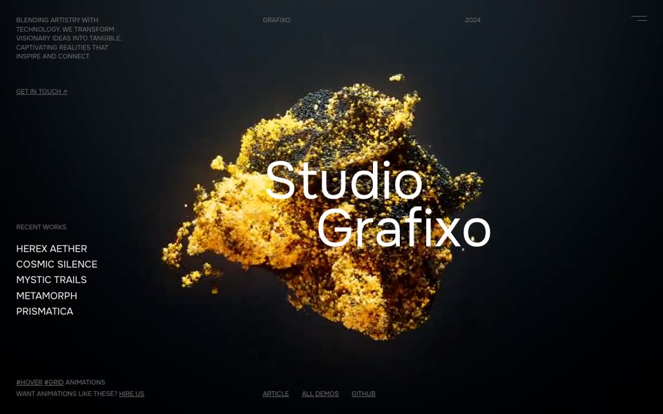</a> | [HoverGrid](https://github.com/codrops/HoverGrid) | hover, gallery, animation | MIT | — |
| <a href="https://github.com/codrops/HoverPreviewMiniMap"></a> | [HoverPreviewMiniMap](https://github.com/codrops/HoverPreviewMiniMap) | hover, cursor, animation | MIT | — |
| <a href="https://github.com/codrops/IconHoverEffects">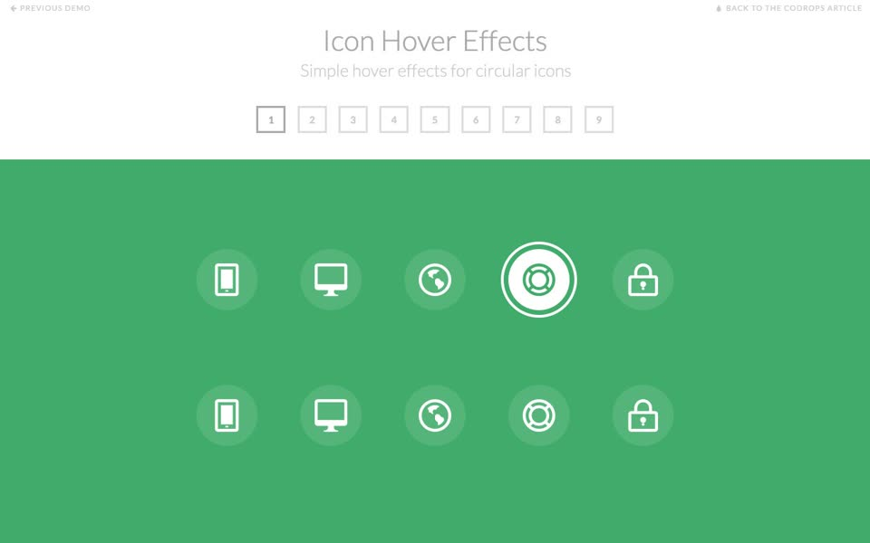</a> | [IconHoverEffects](https://github.com/codrops/IconHoverEffects) | page-transition, hover, animation | not-declared-in-api | — |
| <a href="https://github.com/codrops/ImageDraggingEffects"></a> | [ImageDraggingEffects](https://github.com/codrops/ImageDraggingEffects) | animation | not-declared-in-api | [article](https://tympanus.net/codrops/?p=47024) |
| <a href="https://github.com/codrops/ImageExpansionTypography"></a> | [ImageExpansionTypography](https://github.com/codrops/ImageExpansionTypography) | animation | MIT | — |
| <a href="https://github.com/codrops/ImageGridEffects">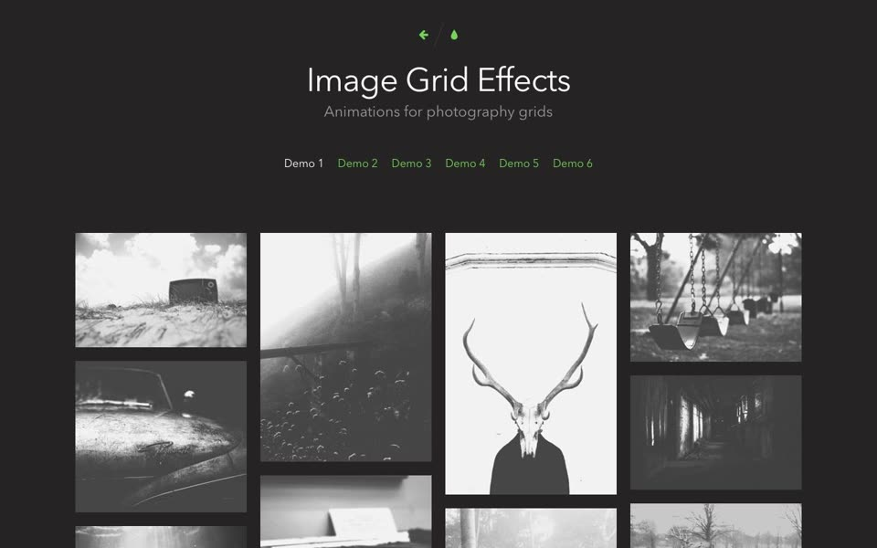</a> | [ImageGridEffects](https://github.com/codrops/ImageGridEffects) | gallery, animation | not-declared-in-api | [article](http://tympanus.net/codrops/2015/10/15/effect-ideas-for-image-grids/) |
| <a href="https://github.com/codrops/ImageGridMotionEffect"></a> | [ImageGridMotionEffect](https://github.com/codrops/ImageGridMotionEffect) | hover, gallery, animation | MIT | [article](https://tympanus.net/codrops/?p=50073) |
| <a href="https://github.com/codrops/ImagePixelLoading"></a> | [ImagePixelLoading](https://github.com/codrops/ImagePixelLoading) | scroll, animation | MIT | — |
| <a href="https://github.com/codrops/ImageRevealHover"></a> | [ImageRevealHover](https://github.com/codrops/ImageRevealHover) | hover, animation | not-declared-in-api | [article](https://tympanus.net/codrops/?p=36588) |
| <a href="https://github.com/codrops/ImageStackGrid"></a> | [ImageStackGrid](https://github.com/codrops/ImageStackGrid) | gallery, animation | MIT | [article](https://tympanus.net/codrops/?p=52018) |
| <a href="https://github.com/codrops/ImageTilesMenu"></a> | [ImageTilesMenu](https://github.com/codrops/ImageTilesMenu) | animation | MIT | — |
| <a href="https://github.com/codrops/ImageTiltEffect"></a> | [ImageTiltEffect](https://github.com/codrops/ImageTiltEffect) | animation | not-declared-in-api | — |
| <a href="https://github.com/codrops/ImageToContent"></a> | [ImageToContent](https://github.com/codrops/ImageToContent) | scroll, page-transition, animation | MIT | — |
| <a href="https://github.com/codrops/ImageToGridTransition"></a> | [ImageToGridTransition](https://github.com/codrops/ImageToGridTransition) | page-transition, gallery, animation | MIT | [article](https://tympanus.net/codrops/?p=63608) |
| <a href="https://github.com/codrops/ImageTrailEffects"></a> | [ImageTrailEffects](https://github.com/codrops/ImageTrailEffects) | cursor, animation | not-declared-in-api | [article](https://tympanus.net/codrops/?p=42696) |
| <a href="https://github.com/codrops/InfiniteTubes"></a> | [InfiniteTubes](https://github.com/codrops/InfiniteTubes) | webgl, animation | not-declared-in-api | [demo](https://tympanus.net/Development/InfiniteTubes/) |
| <a href="https://github.com/codrops/InlineAnchorStyles"></a> | [InlineAnchorStyles](https://github.com/codrops/InlineAnchorStyles) | animation | not-declared-in-api | — |
| <a href="https://github.com/codrops/InlineLayoutSwitch"></a> | [InlineLayoutSwitch](https://github.com/codrops/InlineLayoutSwitch) | gallery | MIT | — |
| <a href="https://github.com/codrops/InlineMenuLayout"></a> | [InlineMenuLayout](https://github.com/codrops/InlineMenuLayout) | hover, gallery, animation | MIT | [article](https://tympanus.net/codrops/?p=51858) |
| <a href="https://github.com/codrops/InlineToMenuLink"></a> | [InlineToMenuLink](https://github.com/codrops/InlineToMenuLink) | animation | MIT | — |
| <a href="https://github.com/codrops/Interactive3DMallMap"></a> | [Interactive3DMallMap](https://github.com/codrops/Interactive3DMallMap) | 3d | not-declared-in-api | — |
| <a href="https://github.com/codrops/InteractivePoints"></a> | [InteractivePoints](https://github.com/codrops/InteractivePoints) | hover, animation | not-declared-in-api | — |
| <a href="https://github.com/codrops/interlude"></a> | [interlude](https://github.com/codrops/interlude) | webgl, three.js, page-transition | MIT | [demo](https://interlude.crnacura.workers.dev/) |
| <a href="https://github.com/codrops/IntroGridMotionTransition"></a> | [IntroGridMotionTransition](https://github.com/codrops/IntroGridMotionTransition) | page-transition, hover, gallery, animation | MIT | — |
| <a href="https://github.com/codrops/IntroTrailEffect"></a> | [IntroTrailEffect](https://github.com/codrops/IntroTrailEffect) | animation | MIT | — |
| <a href="https://github.com/codrops/isle-thorne-collective"></a> | [isle-thorne-collective](https://github.com/codrops/isle-thorne-collective) | page-transition | MIT | [demo](https://isle-thorne-collective.crnacura.workers.dev/) |
| <a href="https://github.com/codrops/IsometricGrids"></a> | [IsometricGrids](https://github.com/codrops/IsometricGrids) | 3d, gallery | not-declared-in-api | — |
| <a href="https://github.com/codrops/ItemRevealer"></a> | [ItemRevealer](https://github.com/codrops/ItemRevealer) | gallery, animation | not-declared-in-api | — |
| <a href="https://github.com/codrops/ItemSlider"></a> | [ItemSlider](https://github.com/codrops/ItemSlider) | slideshow, animation | not-declared-in-api | — |
| <a href="https://github.com/codrops/KineticTypePageTransition"></a> | [KineticTypePageTransition](https://github.com/codrops/KineticTypePageTransition) | page-transition | MIT | — |
| <a href="https://github.com/codrops/LayerMotionSlideshow"></a> | [LayerMotionSlideshow](https://github.com/codrops/LayerMotionSlideshow) | gallery, slideshow, animation | not-declared-in-api | [article](https://tympanus.net/codrops/?p=37953) |
| <a href="https://github.com/codrops/LayersAnimation"></a> | [LayersAnimation](https://github.com/codrops/LayersAnimation) | page-transition, animation | MIT | — |
| <a href="https://github.com/codrops/LetterEffects"></a> | [LetterEffects](https://github.com/codrops/LetterEffects) | animation | not-declared-in-api | [demo](http://tympanus.net/Development/LetterEffects/) |
| <a href="https://github.com/codrops/LetterInteractions"></a> | [LetterInteractions](https://github.com/codrops/LetterInteractions) | hover, animation | not-declared-in-api | [article](https://tympanus.net/codrops/?p=31349) |
| <a href="https://github.com/codrops/LettersAnimationLayout"></a> | [LettersAnimationLayout](https://github.com/codrops/LettersAnimationLayout) | hover, animation | MIT | — |
| <a href="https://github.com/codrops/LetterShuffleMenu"></a> | [LetterShuffleMenu](https://github.com/codrops/LetterShuffleMenu) | animation | MIT | — |
| <a href="https://github.com/codrops/LineHoverStyles"></a> | [LineHoverStyles](https://github.com/codrops/LineHoverStyles) | hover, animation | MIT | — |
| <a href="https://github.com/codrops/LineTextHoverAnimations"></a> | [LineTextHoverAnimations](https://github.com/codrops/LineTextHoverAnimations) | hover, animation | MIT | — |
| <a href="https://github.com/codrops/LineTypeEffect"></a> | [LineTypeEffect](https://github.com/codrops/LineTypeEffect) | animation | MIT | — |
| <a href="https://github.com/codrops/LiquidDistortion"></a> | [LiquidDistortion](https://github.com/codrops/LiquidDistortion) | webgl, slideshow, distortion, animation | not-declared-in-api | [article](https://tympanus.net/codrops/?p=32454) |
| <a href="https://github.com/codrops/LittleFragments"></a> | [LittleFragments](https://github.com/codrops/LittleFragments) | animation | not-declared-in-api | [article](https://tympanus.net/codrops/2017/01/19/little-fragments-creating-a-simple-image-poster-effect/) |
| <a href="https://github.com/codrops/LookbookHoverEffects"></a> | [LookbookHoverEffects](https://github.com/codrops/LookbookHoverEffects) | webgl, hover, gallery, animation | MIT | [demo](https://tympanus.net/Demos/LookbookHoverEffects/) |
| <a href="https://github.com/codrops/LoopScrolling"></a> | [LoopScrolling](https://github.com/codrops/LoopScrolling) | scroll, animation | MIT | — |
| <a href="https://github.com/codrops/MagneticButtons"></a> | [MagneticButtons](https://github.com/codrops/MagneticButtons) | hover, animation | MIT | [article](https://tympanus.net/codrops/?p=50513) |
| <a href="https://github.com/codrops/MakeWayGridEffect"></a> | [MakeWayGridEffect](https://github.com/codrops/MakeWayGridEffect) | gallery, animation | MIT | — |
| <a href="https://github.com/codrops/MarqueeMenu"></a> | [MarqueeMenu](https://github.com/codrops/MarqueeMenu) | hover, animation | MIT | — |
| <a href="https://github.com/codrops/MediaPopUpEffect"></a> | [MediaPopUpEffect](https://github.com/codrops/MediaPopUpEffect) | hover, animation | not-declared-in-api | — |
| <a href="https://github.com/codrops/MenuFullGrid"></a> | [MenuFullGrid](https://github.com/codrops/MenuFullGrid) | gallery | MIT | — |
| <a href="https://github.com/codrops/MenuHoverEffects"></a> | [MenuHoverEffects](https://github.com/codrops/MenuHoverEffects) | hover, animation | not-declared-in-api | [article](https://tympanus.net/codrops/?p=31887) |
| <a href="https://github.com/codrops/MenuThumbStackAnimation"></a> | [MenuThumbStackAnimation](https://github.com/codrops/MenuThumbStackAnimation) | animation | MIT | — |
| <a href="https://github.com/codrops/MenuToGrid"></a> | [MenuToGrid](https://github.com/codrops/MenuToGrid) | gallery, animation | MIT | — |
| <a href="https://github.com/codrops/MirrorEffect"></a> | [MirrorEffect](https://github.com/codrops/MirrorEffect) | slideshow, animation | not-declared-in-api | — |
| <a href="https://github.com/codrops/ModalWindowEffects"></a> | [ModalWindowEffects](https://github.com/codrops/ModalWindowEffects) | page-transition, animation | not-declared-in-api | — |
| <a href="https://github.com/codrops/MorphingBackgroundShapes"></a> | [MorphingBackgroundShapes](https://github.com/codrops/MorphingBackgroundShapes) | scroll, animation | not-declared-in-api | [article](https://tympanus.net/codrops/?p=31190) |
| <a href="https://github.com/codrops/MorphingDevices"></a> | [MorphingDevices](https://github.com/codrops/MorphingDevices) | page-transition, slideshow | not-declared-in-api | — |
| <a href="https://github.com/codrops/MorphingPageTransition"></a> | [MorphingPageTransition](https://github.com/codrops/MorphingPageTransition) | page-transition, animation | not-declared-in-api | [article](https://tympanus.net/codrops/?p=31976) |
| <a href="https://github.com/codrops/MorphingSearch"></a> | [MorphingSearch](https://github.com/codrops/MorphingSearch) | animation | not-declared-in-api | — |
| <a href="https://github.com/codrops/MotionBlurEffect"></a> | [MotionBlurEffect](https://github.com/codrops/MotionBlurEffect) | animation | not-declared-in-api | [article](http://tympanus.net/codrops/?p=23824) |
| <a href="https://github.com/codrops/MotionRevealSlideshow"></a> | [MotionRevealSlideshow](https://github.com/codrops/MotionRevealSlideshow) | slideshow, animation | not-declared-in-api | [article](https://tympanus.net/codrops/?p=35450) |
| <a href="https://github.com/codrops/MotionTrailAnimations"></a> | [MotionTrailAnimations](https://github.com/codrops/MotionTrailAnimations) | cursor, animation | MIT | — |
| <a href="https://github.com/codrops/MotionTransitionEffect"></a> | [MotionTransitionEffect](https://github.com/codrops/MotionTransitionEffect) | page-transition, slideshow, animation | not-declared-in-api | [article](https://tympanus.net/codrops/?p=36812) |
| <a href="https://github.com/codrops/MultiboxMenu"></a> | [MultiboxMenu](https://github.com/codrops/MultiboxMenu) | gallery, animation | not-declared-in-api | [article](https://tympanus.net/codrops/?p=36043) |
| <a href="https://github.com/codrops/MultiLayoutSlideshow"></a> | [MultiLayoutSlideshow](https://github.com/codrops/MultiLayoutSlideshow) | slideshow, animation | not-declared-in-api | — |
| <a href="https://github.com/codrops/NavigationIndicators"></a> | [NavigationIndicators](https://github.com/codrops/NavigationIndicators) | slideshow | not-declared-in-api | — |
| <a href="https://github.com/codrops/NotificationStyles"></a> | [NotificationStyles](https://github.com/codrops/NotificationStyles) | animation | not-declared-in-api | — |
| <a href="https://github.com/codrops/OffCanvasMenuEffects"></a> | [OffCanvasMenuEffects](https://github.com/codrops/OffCanvasMenuEffects) | page-transition, animation | not-declared-in-api | — |
| <a href="https://github.com/codrops/OneElementScroll"></a> | [OneElementScroll](https://github.com/codrops/OneElementScroll) | scroll | MIT | — |
| <a href="https://github.com/codrops/OnScrollColumnsRows"></a> | [OnScrollColumnsRows](https://github.com/codrops/OnScrollColumnsRows) | scroll, animation | MIT | — |
| <a href="https://github.com/codrops/OnScrollEffectLayout"></a> | [OnScrollEffectLayout](https://github.com/codrops/OnScrollEffectLayout) | scroll, animation | not-declared-in-api | — |
| <a href="https://github.com/codrops/OnScrollFilter"></a> | [OnScrollFilter](https://github.com/codrops/OnScrollFilter) | scroll | MIT | — |
| <a href="https://github.com/codrops/OnScrollLayoutFormations"></a> | [OnScrollLayoutFormations](https://github.com/codrops/OnScrollLayoutFormations) | scroll | MIT | [article](https://tympanus.net/codrops/2024/09/18/exploration-of-on-scroll-layout-formations/) |
| <a href="https://github.com/codrops/OnScrollLetterAnimations"></a> | [OnScrollLetterAnimations](https://github.com/codrops/OnScrollLetterAnimations) | scroll, animation | MIT | — |
| <a href="https://github.com/codrops/OnScrollPathAnimations"></a> | [OnScrollPathAnimations](https://github.com/codrops/OnScrollPathAnimations) | scroll, animation | MIT | — |
| <a href="https://github.com/codrops/OnScrollShapeMorph"></a> | [OnScrollShapeMorph](https://github.com/codrops/OnScrollShapeMorph) | scroll, animation | MIT | — |
| <a href="https://github.com/codrops/OnScrollSVGFilterText"></a> | [OnScrollSVGFilterText](https://github.com/codrops/OnScrollSVGFilterText) | scroll, animation | MIT | — |
| <a href="https://github.com/codrops/OnScrollTextHighlight"></a> | [OnScrollTextHighlight](https://github.com/codrops/OnScrollTextHighlight) | scroll, animation | MIT | — |
| <a href="https://github.com/codrops/OnScrollTypoAnimations"></a> | [OnScrollTypoAnimations](https://github.com/codrops/OnScrollTypoAnimations) | scroll, animation | MIT | — |
| <a href="https://github.com/codrops/OnScrollTypographyAnimations"></a> | [OnScrollTypographyAnimations](https://github.com/codrops/OnScrollTypographyAnimations) | scroll, animation | MIT | — |
| <a href="https://github.com/codrops/OnScrollViewSwitch"></a> | [OnScrollViewSwitch](https://github.com/codrops/OnScrollViewSwitch) | scroll, gallery, animation | MIT | — |
| <a href="https://github.com/codrops/OrganicShapeAnimations"></a> | [OrganicShapeAnimations](https://github.com/codrops/OrganicShapeAnimations) | hover, animation | not-declared-in-api | [article](https://tympanus.net/codrops/2017/06/28/organic-shape-animations-with-svg-clippath/) |
| <a href="https://github.com/codrops/OutdoorsTemplate"></a> | [OutdoorsTemplate](https://github.com/codrops/OutdoorsTemplate) | gallery | not-declared-in-api | — |
| <a href="https://github.com/codrops/PageFlipLayout"></a> | [PageFlipLayout](https://github.com/codrops/PageFlipLayout) | gallery, animation | not-declared-in-api | [article](https://tympanus.net/codrops/?p=36406) |
| <a href="https://github.com/codrops/PageLoadingEffects"></a> | [PageLoadingEffects](https://github.com/codrops/PageLoadingEffects) | animation | not-declared-in-api | — |
| <a href="https://github.com/codrops/PagePreloadingEffect"></a> | [PagePreloadingEffect](https://github.com/codrops/PagePreloadingEffect) | animation | not-declared-in-api | — |
| <a href="https://github.com/codrops/PageRevealEffects"></a> | [PageRevealEffects](https://github.com/codrops/PageRevealEffects) | page-transition, animation | not-declared-in-api | — |
| <a href="https://github.com/codrops/PageTransitions"></a> | [PageTransitions](https://github.com/codrops/PageTransitions) | page-transition, animation | not-declared-in-api | — |
| <a href="https://github.com/codrops/ParanoiaSlideshow"></a> | [ParanoiaSlideshow](https://github.com/codrops/ParanoiaSlideshow) | slideshow, animation | MIT | — |
| <a href="https://github.com/codrops/ParticleEffectsButtons"></a> | [ParticleEffectsButtons](https://github.com/codrops/ParticleEffectsButtons) | particles, animation | not-declared-in-api | [article](https://tympanus.net/codrops/?p=34685) |
| <a href="https://github.com/codrops/PerspectivePageViewNavigation"></a> | [PerspectivePageViewNavigation](https://github.com/codrops/PerspectivePageViewNavigation) | 3d, animation | not-declared-in-api | — |
| <a href="https://github.com/codrops/PFold"></a> | [PFold](https://github.com/codrops/PFold) | animation | not-declared-in-api | — |
| <a href="https://github.com/codrops/PhotographyWebsiteConcept"></a> | [PhotographyWebsiteConcept](https://github.com/codrops/PhotographyWebsiteConcept) | slideshow, animation | not-declared-in-api | — |
| <a href="https://github.com/codrops/PixelGooeyTooltip"></a> | [PixelGooeyTooltip](https://github.com/codrops/PixelGooeyTooltip) | animation | MIT | — |
| <a href="https://github.com/codrops/PixelTransition"></a> | [PixelTransition](https://github.com/codrops/PixelTransition) | page-transition, animation | MIT | [article](https://tympanus.net/codrops/?p=71437) |
| <a href="https://github.com/codrops/PlayfulTrampolineEffect"></a> | [PlayfulTrampolineEffect](https://github.com/codrops/PlayfulTrampolineEffect) | animation | not-declared-in-api | — |
| <a href="https://github.com/codrops/PolaroidStackGrid"></a> | [PolaroidStackGrid](https://github.com/codrops/PolaroidStackGrid) | gallery, animation | not-declared-in-api | — |
| <a href="https://github.com/codrops/PreviewContentTransition"></a> | [PreviewContentTransition](https://github.com/codrops/PreviewContentTransition) | page-transition | MIT | — |
| <a href="https://github.com/codrops/ProductComparison"></a> | [ProductComparison](https://github.com/codrops/ProductComparison) | gallery, animation | not-declared-in-api | — |
| <a href="https://github.com/codrops/ProductGridLayout"></a> | [ProductGridLayout](https://github.com/codrops/ProductGridLayout) | gallery | not-declared-in-api | — |
| <a href="https://github.com/codrops/ProgressButtonStyles"></a> | [ProgressButtonStyles](https://github.com/codrops/ProgressButtonStyles) | 3d | not-declared-in-api | — |
| <a href="https://github.com/codrops/ProximityFeedback"></a> | [ProximityFeedback](https://github.com/codrops/ProximityFeedback) | hover, animation | not-declared-in-api | [article](https://tympanus.net/codrops/?p=34754) |
| <a href="https://github.com/codrops/PushGridItems"></a> | [PushGridItems](https://github.com/codrops/PushGridItems) | gallery, animation | MIT | — |
| <a href="https://github.com/codrops/RainEffect"></a> | [RainEffect](https://github.com/codrops/RainEffect) | webgl, animation | not-declared-in-api | [demo](https://tympanus.net/Development/RainEffect/) |
| <a href="https://github.com/codrops/RapidImageHoverMenu"></a> | [RapidImageHoverMenu](https://github.com/codrops/RapidImageHoverMenu) | hover, animation | MIT | [article](https://tympanus.net/codrops/?p=50362) |
| <a href="https://github.com/codrops/RapidImageHoverMenuEffects"></a> | [RapidImageHoverMenuEffects](https://github.com/codrops/RapidImageHoverMenuEffects) | hover, animation | MIT | [article](https://tympanus.net/codrops/2020/07/08/exploring-animations-for-menu-hover-effects/) |
| <a href="https://github.com/codrops/RapidLayersAnimation"></a> | [RapidLayersAnimation](https://github.com/codrops/RapidLayersAnimation) | page-transition, animation | MIT | [article](https://tympanus.net/codrops/2020/04/07/rapid-image-layers-animation/) |
| <a href="https://github.com/codrops/ReflectionScroll"></a> | [ReflectionScroll](https://github.com/codrops/ReflectionScroll) | scroll, animation | MIT | — |
| <a href="https://github.com/codrops/RepeatingImageTransition"></a> | [RepeatingImageTransition](https://github.com/codrops/RepeatingImageTransition) | page-transition | MIT | — |
| <a href="https://github.com/codrops/RepetitionHoverEffect"></a> | [RepetitionHoverEffect](https://github.com/codrops/RepetitionHoverEffect) | hover, animation | MIT | — |
| <a href="https://github.com/codrops/RepetitiveTypography"></a> | [RepetitiveTypography](https://github.com/codrops/RepetitiveTypography) | animation | MIT | [article](https://tympanus.net/codrops/?p=56972) |
| <a href="https://github.com/codrops/ResponsiveIconGrid"></a> | [ResponsiveIconGrid](https://github.com/codrops/ResponsiveIconGrid) | gallery | not-declared-in-api | — |
| <a href="https://github.com/codrops/RevealSlideshow"></a> | [RevealSlideshow](https://github.com/codrops/RevealSlideshow) | slideshow, animation | not-declared-in-api | [article](https://tympanus.net/codrops/?p=35175) |
| <a href="https://github.com/codrops/RoomDisplay"></a> | [RoomDisplay](https://github.com/codrops/RoomDisplay) | slideshow | not-declared-in-api | — |
| <a href="https://github.com/codrops/RotatedRevealers"></a> | [RotatedRevealers](https://github.com/codrops/RotatedRevealers) | page-transition, animation | not-declared-in-api | [article](https://tympanus.net/codrops/?p=40167) |
| <a href="https://github.com/codrops/RotatingOnScrollAnimations"></a> | [RotatingOnScrollAnimations](https://github.com/codrops/RotatingOnScrollAnimations) | scroll, 3d, animation | MIT | — |
| <a href="https://github.com/codrops/SamsungGrid"></a> | [SamsungGrid](https://github.com/codrops/SamsungGrid) | gallery, animation | not-declared-in-api | — |
| <a href="https://github.com/codrops/ScatteredPolaroidsGallery"></a> | [ScatteredPolaroidsGallery](https://github.com/codrops/ScatteredPolaroidsGallery) | gallery | not-declared-in-api | — |
| <a href="https://github.com/codrops/Scroll3DGrid"></a> | [Scroll3DGrid](https://github.com/codrops/Scroll3DGrid) | scroll, gallery, animation | MIT | — |
| <a href="https://github.com/codrops/ScrollAnimationsGrid"></a> | [ScrollAnimationsGrid](https://github.com/codrops/ScrollAnimationsGrid) | scroll, gallery, animation | MIT | [article](https://tympanus.net/codrops/?p=63672) |
| <a href="https://github.com/codrops/ScrollBasedLayoutAnimations"></a> | [ScrollBasedLayoutAnimations](https://github.com/codrops/ScrollBasedLayoutAnimations) | scroll, animation | MIT | — |
| <a href="https://github.com/codrops/ScrollBlurTypography"></a> | [ScrollBlurTypography](https://github.com/codrops/ScrollBlurTypography) | scroll, animation | MIT | — |
| <a href="https://github.com/codrops/ScrollingLettersAnimation"></a> | [ScrollingLettersAnimation](https://github.com/codrops/ScrollingLettersAnimation) | scroll, animation | not-declared-in-api | [article](https://tympanus.net/codrops/?p=33990) |
| <a href="https://github.com/codrops/ScrollLoopMenu"></a> | [ScrollLoopMenu](https://github.com/codrops/ScrollLoopMenu) | scroll | MIT | [article](https://tympanus.net/codrops/?p=49748) |
| <a href="https://github.com/codrops/ScrollPanels"></a> | [ScrollPanels](https://github.com/codrops/ScrollPanels) | scroll, animation | MIT | — |
| <a href="https://github.com/codrops/ScrollSpiral"></a> | [ScrollSpiral](https://github.com/codrops/ScrollSpiral) | webgl, scroll | not-declared-in-api | [demo](https://tympanus.net/Development/ScrollSpiral/) |
| <a href="https://github.com/codrops/ScrollTextMotion"></a> | [ScrollTextMotion](https://github.com/codrops/ScrollTextMotion) | scroll, animation | MIT | [demo](https://tympanus.net/Development/ScrollTextMotion/) |
| <a href="https://github.com/codrops/SeamTransitions"></a> | [SeamTransitions](https://github.com/codrops/SeamTransitions) | webgl, scroll, page-transition | MIT | — |
| <a href="https://github.com/codrops/SearchUIEffects"></a> | [SearchUIEffects](https://github.com/codrops/SearchUIEffects) | animation | not-declared-in-api | — |
| <a href="https://github.com/codrops/SeatPreview"></a> | [SeatPreview](https://github.com/codrops/SeatPreview) | 3d | not-declared-in-api | [demo](http://tympanus.net/Development/SeatPreview/) |
| <a href="https://github.com/codrops/SegmentEffect"></a> | [SegmentEffect](https://github.com/codrops/SegmentEffect) | animation | not-declared-in-api | — |
| <a href="https://github.com/codrops/ShapeHoverEffectSVG"></a> | [ShapeHoverEffectSVG](https://github.com/codrops/ShapeHoverEffectSVG) | hover, animation | not-declared-in-api | — |
| <a href="https://github.com/codrops/ShapeMorphIdeas"></a> | [ShapeMorphIdeas](https://github.com/codrops/ShapeMorphIdeas) | animation | not-declared-in-api | [article](https://tympanus.net/codrops/?p=32314) |
| <a href="https://github.com/codrops/ShapesSlideshow"></a> | [ShapesSlideshow](https://github.com/codrops/ShapesSlideshow) | page-transition, slideshow | MIT | — |
| <a href="https://github.com/codrops/ShazamButtonEffect"></a> | [ShazamButtonEffect](https://github.com/codrops/ShazamButtonEffect) | animation | not-declared-in-api | — |
| <a href="https://github.com/codrops/SidebarTransitions"></a> | [SidebarTransitions](https://github.com/codrops/SidebarTransitions) | page-transition, animation | not-declared-in-api | [demo](http://tympanus.net/Development/SidebarTransitions/) |
| <a href="https://github.com/codrops/SimpleDropDownEffects"></a> | [SimpleDropDownEffects](https://github.com/codrops/SimpleDropDownEffects) | animation | not-declared-in-api | — |
| <a href="https://github.com/codrops/Slicebox"></a> | [Slicebox](https://github.com/codrops/Slicebox) | 3d, slideshow | not-declared-in-api | — |
| <a href="https://github.com/codrops/SlicedDualImageLayout"></a> | [SlicedDualImageLayout](https://github.com/codrops/SlicedDualImageLayout) | slideshow, animation | not-declared-in-api | [article](https://tympanus.net/codrops/?p=32361) |
| <a href="https://github.com/codrops/SlicedTextEffect"></a> | [SlicedTextEffect](https://github.com/codrops/SlicedTextEffect) | scroll, animation | MIT | — |
| <a href="https://github.com/codrops/SliceRevealer"></a> | [SliceRevealer](https://github.com/codrops/SliceRevealer) | animation | not-declared-in-api | [article](https://tympanus.net/codrops/?p=33895) |
| <a href="https://github.com/codrops/SlideOutBoxMenu"></a> | [SlideOutBoxMenu](https://github.com/codrops/SlideOutBoxMenu) | gallery | not-declared-in-api | — |
| <a href="https://github.com/codrops/SliderPagination"></a> | [SliderPagination](https://github.com/codrops/SliderPagination) | slideshow | not-declared-in-api | — |
| <a href="https://github.com/codrops/SlideshowAnimations"></a> | [SlideshowAnimations](https://github.com/codrops/SlideshowAnimations) | slideshow, animation | MIT | — |
| <a href="https://github.com/codrops/SlidingHeaderLayout"></a> | [SlidingHeaderLayout](https://github.com/codrops/SlidingHeaderLayout) | gallery, animation | not-declared-in-api | — |
| <a href="https://github.com/codrops/SlitSlider"></a> | [SlitSlider](https://github.com/codrops/SlitSlider) | page-transition, slideshow, animation | not-declared-in-api | — |
| <a href="https://github.com/codrops/SmoothScrollAnimations"></a> | [SmoothScrollAnimations](https://github.com/codrops/SmoothScrollAnimations) | scroll, animation | not-declared-in-api | [article](https://tympanus.net/codrops/?p=41030) |
| <a href="https://github.com/codrops/SmoothScrollingImageEffects"></a> | [SmoothScrollingImageEffects](https://github.com/codrops/SmoothScrollingImageEffects) | scroll, animation | not-declared-in-api | [article](https://tympanus.net/codrops/?p=42459) |
| <a href="https://github.com/codrops/SplitLayout"></a> | [SplitLayout](https://github.com/codrops/SplitLayout) | page-transition, animation | not-declared-in-api | — |
| <a href="https://github.com/codrops/StackMotionHoverEffects"></a> | [StackMotionHoverEffects](https://github.com/codrops/StackMotionHoverEffects) | hover, animation | not-declared-in-api | — |
| <a href="https://github.com/codrops/StackSlider"></a> | [StackSlider](https://github.com/codrops/StackSlider) | 3d, slideshow | not-declared-in-api | — |
| <a href="https://github.com/codrops/Staggered3DGridAnimations"></a> | [Staggered3DGridAnimations](https://github.com/codrops/Staggered3DGridAnimations) | scroll, page-transition, 3d, gallery, animation | MIT | — |
| <a href="https://github.com/codrops/Stapel"></a> | [Stapel](https://github.com/codrops/Stapel) | page-transition, gallery | not-declared-in-api | — |
| <a href="https://github.com/codrops/StickySections"></a> | [StickySections](https://github.com/codrops/StickySections) | animation | MIT | — |
| <a href="https://github.com/codrops/SuperfluidLayout"></a> | [SuperfluidLayout](https://github.com/codrops/SuperfluidLayout) | animation | MIT | — |
| <a href="https://github.com/codrops/SurfReport"></a> | [SurfReport](https://github.com/codrops/SurfReport) | animation | not-declared-in-api | — |
| <a href="https://github.com/codrops/SVGImageHover"></a> | [SVGImageHover](https://github.com/codrops/SVGImageHover) | hover, distortion, animation | not-declared-in-api | [article](https://tympanus.net/codrops/?p=38971) |
| <a href="https://github.com/codrops/SwatchBook"></a> | [SwatchBook](https://github.com/codrops/SwatchBook) | page-transition, animation | not-declared-in-api | — |
| <a href="https://github.com/codrops/TextBlockTransitions"></a> | [TextBlockTransitions](https://github.com/codrops/TextBlockTransitions) | page-transition, animation | MIT | — |
| <a href="https://github.com/codrops/TextCharacterAnimations"></a> | [TextCharacterAnimations](https://github.com/codrops/TextCharacterAnimations) | webgl, animation | MIT | [demo](https://tympanus.net/Demos/TextCharacterAnimations/) |
| <a href="https://github.com/codrops/TextClipScroll"></a> | [TextClipScroll](https://github.com/codrops/TextClipScroll) | scroll, animation | MIT | [article](https://tympanus.net/codrops/?p=75256) |
| <a href="https://github.com/codrops/TextDistortionEffects"></a> | [TextDistortionEffects](https://github.com/codrops/TextDistortionEffects) | webgl, three.js, distortion, animation | not-declared-in-api | [article](https://tympanus.net/codrops/?p=38200) |
| <a href="https://github.com/codrops/TextInputEffects"></a> | [TextInputEffects](https://github.com/codrops/TextInputEffects) | animation | not-declared-in-api | — |
| <a href="https://github.com/codrops/TextRepetitionEffect"></a> | [TextRepetitionEffect](https://github.com/codrops/TextRepetitionEffect) | scroll, animation | MIT | — |
| <a href="https://github.com/codrops/TextStylesHoverEffects"></a> | [TextStylesHoverEffects](https://github.com/codrops/TextStylesHoverEffects) | hover, animation | not-declared-in-api | — |
| <a href="https://github.com/codrops/TextTrailEffect"></a> | [TextTrailEffect](https://github.com/codrops/TextTrailEffect) | slideshow, animation | not-declared-in-api | [article](https://tympanus.net/codrops/?p=38516) |
| <a href="https://github.com/codrops/Theodore"></a> | [Theodore](https://github.com/codrops/Theodore) | animation | MIT | [article](https://tympanus.net/codrops/?p=57286) |
| <a href="https://github.com/codrops/ThumbFullTransition"></a> | [ThumbFullTransition](https://github.com/codrops/ThumbFullTransition) | page-transition, animation | MIT | [article](https://tympanus.net/codrops/?p=50733) |
| <a href="https://github.com/codrops/ThumbHoverSVGFilter"></a> | [ThumbHoverSVGFilter](https://github.com/codrops/ThumbHoverSVGFilter) | hover, animation | MIT | [article](https://tympanus.net/codrops/?p=54938) |
| <a href="https://github.com/codrops/ThumbnailGridExpandingPreview"></a> | [ThumbnailGridExpandingPreview](https://github.com/codrops/ThumbnailGridExpandingPreview) | gallery, animation | not-declared-in-api | — |
| <a href="https://github.com/codrops/TileScroll"></a> | [TileScroll](https://github.com/codrops/TileScroll) | scroll, gallery, animation | MIT | — |
| <a href="https://github.com/codrops/TiltHoverEffects"></a> | [TiltHoverEffects](https://github.com/codrops/TiltHoverEffects) | hover, animation | not-declared-in-api | [article](http://tympanus.net/codrops/2016/11/23/tilt-hover-effects/) |
| <a href="https://github.com/codrops/TooltipMenu"></a> | [TooltipMenu](https://github.com/codrops/TooltipMenu) | hover | not-declared-in-api | — |
| <a href="https://github.com/codrops/TooltipStylesInspiration"></a> | [TooltipStylesInspiration](https://github.com/codrops/TooltipStylesInspiration) | hover, animation | not-declared-in-api | — |
| <a href="https://github.com/codrops/TooltipTransition"></a> | [TooltipTransition](https://github.com/codrops/TooltipTransition) | page-transition, gallery | MIT | — |
| <a href="https://github.com/codrops/TriplePanelImageSlider"></a> | [TriplePanelImageSlider](https://github.com/codrops/TriplePanelImageSlider) | page-transition, 3d, slideshow | not-declared-in-api | — |
| <a href="https://github.com/codrops/TypeShuffleAnimation"></a> | [TypeShuffleAnimation](https://github.com/codrops/TypeShuffleAnimation) | animation | MIT | — |
| <a href="https://github.com/codrops/TypographyMotion"></a> | [TypographyMotion](https://github.com/codrops/TypographyMotion) | animation | MIT | [article](https://tympanus.net/codrops/?p=50136) |
| <a href="https://github.com/codrops/UnrevealEffects"></a> | [UnrevealEffects](https://github.com/codrops/UnrevealEffects) | page-transition, animation | MIT | — |
| <a href="https://github.com/codrops/VerticalShowcaseSlider"></a> | [VerticalShowcaseSlider](https://github.com/codrops/VerticalShowcaseSlider) | page-transition, slideshow | not-declared-in-api | — |
| <a href="https://github.com/codrops/VideoOpeningAnimation"></a> | [VideoOpeningAnimation](https://github.com/codrops/VideoOpeningAnimation) | animation | not-declared-in-api | — |
| <a href="https://github.com/codrops/ViewModeSwitch"></a> | [ViewModeSwitch](https://github.com/codrops/ViewModeSwitch) | gallery | not-declared-in-api | — |
| <a href="https://github.com/codrops/WebGLBlobs"></a> | [WebGLBlobs](https://github.com/codrops/WebGLBlobs) | webgl, three.js | MIT | [article](https://tympanus.net/codrops/?p=52932) |
| <a href="https://github.com/codrops/WobblySlideshowEffect"></a> | [WobblySlideshowEffect](https://github.com/codrops/WobblySlideshowEffect) | slideshow, animation | not-declared-in-api | — |
| <a href="https://github.com/codrops/YouTubeLeftSideMenu"></a> | [YouTubeLeftSideMenu](https://github.com/codrops/YouTubeLeftSideMenu) | animation | not-declared-in-api | — |
| <a href="https://github.com/codrops/ZoomSlider"></a> | [ZoomSlider](https://github.com/codrops/ZoomSlider) | slideshow | not-declared-in-api | [demo](http://tympanus.net/Blueprints/ZoomSlider/) |
| <a href="https://github.com/codrops/ZoomSlideshow"></a> | [ZoomSlideshow](https://github.com/codrops/ZoomSlideshow) | slideshow | MIT | — |

## Refresh

```bash
python3 scripts/collect-codrops.py --previews
```

Uses Python standard library, public GitHub API and a 0.6-second pause between sequential requests. `--previews` (or `--previews-only` for the existing catalog) resolves repository previews through the authenticated `gh api`, four repositories at a time at most; it reads repository metadata, trees and READMEs, never image bytes. GitHub errors and rate limits stop the refresh before replacing the catalog. Article seeds are preserved; this command does not fetch Codrops article pages. All designs, code and media retain their original owners’ rights. No third-party source code or media files are bundled here.
